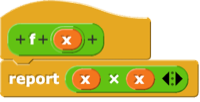

<!--
author:   Cédric Vogel
version:  1.4.0
license:  CC BY-SA 4.0
language: de
narrator: Deutsch Female

comment:  Etappe 1 der Einheit «Funktionen – vom Aufruf zur eigenen Sprache»:
          Von Snap!-Reportern zu Python-Funktionen. Ausdrücke und
          Funktionsaufrufe Schritt für Schritt auswerten, ohne print.

import: https://raw.githubusercontent.com/glpython-edu/glpython-liascript/main/README.md
import: ../00-fehler-lexikon/README.md
import: ../00-makros/README.md

@style
.lia-code--inline {
  background: #F3F4F6;
  color: #1A1A1A;
  border: none;
  border-radius: 3px;
  padding: 0.05em 0.3em;
}
.lia-effect__circle {
  display: none;
}
/* Ein Block: dünner Rahmen um Eingabe (Code, Notizen) und Antwort (glpython, «Notizen speichern») */
.lia-code--block[data-notiz],
.lia-code--block:not([hidden]):has(+ p.lia-paragraph:empty + .glpython-embed) {
  border: 1px solid #D1D5DB; border-bottom: none;
  border-radius: 4px 4px 0 0; margin-bottom: 0; padding: 8px 8px 0;
  background: #FFFFFF;
}
p.lia-paragraph:empty:has(+ .glpython-embed) { display: none; }
.lia-code--block:not([hidden]) + p.lia-paragraph:empty + .glpython-embed {
  border: 1px solid #D1D5DB; border-top: none;
  border-radius: 0 0 4px 4px; margin-bottom: 24px; padding: 0 8px 8px;
}
.notiz-actions {
  border: 1px solid #D1D5DB; border-top: none;
  border-radius: 0 0 4px 4px; margin: 0 0 24px; padding: 4px 8px 8px;
}
/* Verlaufszeile (|< < n > >|) enger an Code und Antwort */
.lia-code--block[data-notiz] .lia-code-control,
.lia-code--block:not([hidden]):has(+ p.lia-paragraph:empty + .glpython-embed) .lia-code-control {
  margin-top: 0; margin-bottom: 0; padding-top: 2px; padding-bottom: 0;
}
/* Buttons links auf derselben Zeile wie die Verlaufszeile rechts, sobald die
   Inhaltsspalte breit genug ist (unabhängig von der Navigation links) */
.lia-slide__content { container-type: inline-size; }
@container (min-width: 580px) {
  .notiz-actions,
  .lia-code--block:not([hidden]) + p.lia-paragraph:empty + .glpython-embed {
    margin-top: -34px; background: transparent; pointer-events: none;
  }
  .notiz-actions button,
  .lia-code--block:not([hidden]) + p.lia-paragraph:empty + .glpython-embed .glp-buttons button,
  .lia-code--block:not([hidden]) + p.lia-paragraph:empty + .glpython-embed iframe,
  .lia-code--block:not([hidden]) + p.lia-paragraph:empty + .glpython-embed .glpython-error,
  .lia-code--block:not([hidden]) + p.lia-paragraph:empty + .glpython-embed .glp-files {
    pointer-events: auto;
  }
}
/* Kontext (z. B. Definitionen einer Aufgabe) bleibt beim Scrollen oben sichtbar */
.kontext {
  position: sticky; top: 0; z-index: 5;
  background: #FFFFFF; border-bottom: 1px solid #D1D5DB;
  padding: 4px 0 2px; margin-bottom: 12px;
}
@end
-->

# Etappe 1: Von Snap!-Reportern zu Python-Funktionen

In dieser Etappe bauen Sie ein Modell davon auf, was passiert, wenn Python eine Funktion aufruft. Sie arbeiten dabei nur mit Funktionen, die einen Wert zurückgeben – ohne `print`. Dieses Modell begleitet Sie durch die ganze Einheit: Am Ende bauen Sie einen eigenen Auswerter – ein Python-Programm, das Ausdrücke nach genau diesem Modell auswertet.

**Lernziele dieser Etappe**

- Sie können Ausdrücke und Funktionsaufrufe Schritt für Schritt mit «→» auswerten.
- Sie unterscheiden Funktionsdefinition und Funktionsaufruf (Name, Parameter, Rumpf, Argument).
- Sie wissen, dass Python die Argumente auswertet, bevor es eine Funktion aufruft.
- Sie prüfen Ergebnisse in der REPL und im Visualizer.

## Input

Dieser Teil wird im Unterricht gemeinsam angeschaut. Im Selbststudium können Sie ihn jederzeit nachlesen.

1. Rückblick: Welchen Wert liefert der Reporter?
2. Eigene Reporter – und jetzt in Python?
3. Ausdrücke auswerten
4. Funktionen in der Mathematik
5. Die Bausteine einer Funktion
6. Ein Aufruf Schritt für Schritt
7. Werte anschauen wie in Snap!

### 🎓 Rückblick: Welchen Wert liefert der Reporter?

✏️ **Kurzauftrag (3′):** Werten Sie von Hand aus:

`3 * 10 - 2`

[[28]]
**************************************************

`3 * 10 - 2  →  30 - 2  →  28`

**************************************************

`7 / 4`

[[1.75]]
@Dezimal(1.75)
**************************************************

`7 / 4  →  1.75`

**************************************************

In Snap! haben Sie eigene Reporter gebaut, zum Beispiel diesen:


Sie klicken im Skriptbereich auf diesen Block. Welchen Wert zeigt Snap! direkt am Block an?


[[4]]
**************************************************


Der Reporter `average` berechnet den Durchschnitt seiner beiden Argumente: (3 + 5) / 2 = 4. Ein Klick auf einen Reporter im Skriptbereich zeigt seinen **Wert** direkt am Block an. Steckt der Reporter in einem anderen Block, liefert er seinen Wert an diesen umschliessenden Block weiter.

**************************************************

### 🎓 Eigene Reporter – und jetzt in Python?

In Snap! haben Sie eigene Blöcke gebaut. Blöcke mit runder Form heissen **Reporter**: Sie geben einen Wert zurück, und dieser Wert kann weiterverwendet werden – zum Beispiel als Argument eines anderen Blocks.

Zwei Fragen begleiten diese Etappe:

- Wie sieht ein eigener Reporter in Python aus?
- Was passiert genau, wenn man ihn aufruft?

### 🎓 Ausdrücke auswerten

Manche Ausdrücke sind schon **ausgewertet**: `11`, `3.2`, `42`, `-1`. Hier lässt sich nichts mehr rechnen. Solche Ausdrücke heissen auch **Werte**.

Andere sind **nicht ausgewertet**: `3 + 2`, `7 / 4`, `3 * 10 - 2`. Hier lässt sich ein Ergebnis berechnen.

Um anzuzeigen, zu welchem Wert ein Ausdruck ausgewertet wird, schreiben wir nicht «=», sondern «→». Jeder Pfeil steht für **genau einen** Schritt.

    {{1}}
---

    {{1}}
**Beispiel:** Was erhalten wir, wenn wir `3 * 10 - 2` auswerten?

    {{1}}
`3 * 10 - 2`

    {{2}}
`→ 30 - 2`

    {{3}}
`→ 28`

    {{4}}
---

    {{4}}
**Beispiel:** Auch Vergleiche sind Ausdrücke. Was erhalten wir, wenn wir `7 * 7 == 49` auswerten?

    {{5}}
`→ 49 == 49`

    {{6}}
`→ True`

    {{7}}
---

    {{7}}
**Gemeinsam zuordnen:** Welche Ausdrücke sind schon ausgewertet, welche noch nicht?

    {{7}}
[(ausgewertet)(nicht ausgewertet)]
[    (X)           ( )           ] `11`
[    ( )           (X)           ] `3 + 2`
[    (X)           ( )           ] `3.2`
[    ( )           (X)           ] `7 / 4`
[    ( )           (X)           ] `5 ** 2`
[    (X)           ( )           ] `-1`
[    ( )           (X)           ] `7 * 7 == 49`
[    (X)           ( )           ] `True`

### 🎓 Funktionen in der Mathematik

Aus der Mathematik kennen Sie Funktionen. Hier sind zwei Funktionen und eine Variable in mathematischer Notation definiert:

$$
f(x) = x^2 \qquad g(y) = y + 2 \qquad a = 5
$$

---

✏️ **Kurzauftrag (2′):** Werten Sie die drei Aufrufe mit den gegebenen Definitionen aus.

`g(-1)`

[[1]]
**************************************************

`g(-1)  →  -1 + 2  →  1`

**************************************************

`f(3)`

[[9]]
**************************************************

`f(3)  →  3²  →  9`

**************************************************

`g(a)`

[[7]]
**************************************************

`g(a)  →  g(5)  →  5 + 2  →  7`

Zuerst wird `a` durch seinen Wert ersetzt, erst dann wird `g` aufgerufen.

**************************************************

### 🎓 Die Bausteine einer Funktion

Eine **Funktionsdefinition** hat einen **Namen**, einen oder mehrere **Parameter** und einen **Rumpf**. Ein **Funktionsaufruf** hat einen **Namen** und **Argumente**. Dieselbe Funktion in drei Schreibweisen:

**Definition**

<div style="display: flex; flex-wrap: wrap; gap: 1.5rem; align-items: flex-start;">
<div style="flex: 1 1 12rem;">

*Mathematik*

<span style="font-family:serif;font-style:italic;font-size:1.3em"><span style="background:#5EC4A0;color:#000;padding:0 0.25em 0.08em 0.25em">f</span>(<span style="background:#56B4E9;color:#000;padding:0 0.25em 0.08em 0.25em">x</span>) = <span style="background:#F0E442;color:#000;padding:0 0.25em 0.08em 0.25em">x · x</span></span>

</div>
<div style="flex: 1 1 12rem;">

*Snap!*



</div>
<div style="flex: 1 1 12rem;">

*Python*

<div style="font-family:monospace;font-size:1.1em;line-height:1.8">
<div>def <span style="background:#5EC4A0;color:#000;padding:0 0.1em">f</span>(<span style="background:#56B4E9;color:#000;padding:0 0.1em">x</span>):</div>
<div style="padding-left:4ch">return <span style="background:#F0E442;color:#000;padding:0 0.1em">x * x</span></div>
</div>

</div>
</div>

**Aufruf**

<div style="display: flex; flex-wrap: wrap; gap: 1.5rem; align-items: flex-start;">
<div style="flex: 1 1 12rem;">

*Mathematik*

<span style="font-family:serif;font-style:italic;font-size:1.3em"><span style="background:#5EC4A0;color:#000;padding:0 0.25em 0.08em 0.25em">f</span>(<span style="background:#CC79A7;color:#000;padding:0 0.25em 0.08em 0.25em">3</span>)</span>

</div>
<div style="flex: 1 1 12rem;">

*Snap!*


</div>
<div style="flex: 1 1 12rem;">

*Python*

<div style="font-family:monospace;font-size:1.1em;line-height:1.8">
<div><span style="background:#5EC4A0;color:#000;padding:0 0.1em">f</span>(<span style="background:#CC79A7;color:#000;padding:0 0.1em">3</span>)</div>
</div>

</div>
</div>

    {{1}}
- **Name** (grün): @Baustein.Name(f) – unter diesem Namen wird die Funktion aufgerufen.

    {{2}}
- **Parameter** (hellblau): @Baustein.Parameter(x) – ein Platzhalter für den Wert, der beim Aufruf eingesetzt wird.

    {{3}}
- **Rumpf** (gelb): @Baustein.Rumpf(x * x) – der Ausdruck, der beim Aufruf ausgewertet und zurückgegeben wird. In Etappe 3 lernen Sie Funktionen kennen, deren Rumpf aus mehreren Zeilen besteht.

    {{4}}
- **Argument** (violett): @Baustein.Argument(3) – der Wert, der beim Aufruf für den Parameter eingesetzt wird.

    {{5}}
<div>

---

Wir verfolgen den Aufruf im Visualizer:

```python
def f(x):
    return x * x

f(3)
```
@Code.demo

</div>

    {{6}}
---

    {{6}}
- `def` leitet eine Definition ein, der Doppelpunkt und die Einrückung markieren den Rumpf – wie bei `if` und `for`.
- `return` entspricht dem Snap!-Block `report`: Der Wert des Ausdrucks wird zurückgegeben.
- In Python ist `**` die Potenz: `x * x` lässt sich auch als `x ** 2` schreiben, das entspricht $x^2$.

### 🎓 Ein Aufruf Schritt für Schritt

Auf dieser Seite gilt:

```python
def f(x):
    return x ** 2

def g(y):
    return y + 2

a = 5
```

    {{1}}
---

    {{1}}
**Beispiel:** Was erhalten wir, wenn wir `f(a + 2)` auswerten? Wir werten zuerst von Hand aus:

    {{1}}
`f(a + 2)`

    {{2}}
`→ f(5 + 2)`

    {{3}}
`→ f(7)`

    {{4}}
`→ 7 ** 2`

    {{5}}
`→ 49`

    {{6}}
**Python wertet zuerst das Argument aus.** Erst wenn daraus ein Wert geworden ist (`7`), wird die Funktion aufgerufen, und der Aufruf wird durch den Ausdruck nach `return` ersetzt – mit `7` an der Stelle von `x`.

    {{7}}
<div>

Wir schauen uns dasselbe im Visualizer an:

```python
def f(x):
    return x ** 2

a = 5
f(a + 2)
```
@Code.demo

</div>

    {{8}}
---

    {{8}}
**Beispiel:** Was erhalten wir bei einem Aufruf, dessen Argument selbst einen Aufruf enthält? `f(3 + g(3))`

    {{9}}
```text
f(3 + g(3))  →  f(3 + (3 + 2))  →  f(3 + 5)  →  f(8)  →  8 ** 2  →  64
```

    {{9}}
Auch hier gilt: Zuerst wird das Argument `3 + g(3)` vollständig ausgewertet – dafür muss zuerst `g(3)` aufgerufen werden.

    {{9}}
**Klammern:** Wird ein Aufruf durch einen Ausdruck mit Operator ersetzt, setzen wir diesen Ausdruck in Klammern: `g(3)` → `(3 + 2)`. So bleibt erhalten, was zusammengehört.

### 🎓 Werte anschauen wie in Snap!

In Snap! klicken Sie im Skriptbereich auf einen Reporter, und Snap! zeigt seinen **Wert** direkt am Block an. In Python übernimmt das die **REPL**: Wir tippen einen Aufruf ein, Python wertet ihn aus und zeigt den Wert an.

Die REPL heisst ausgeschrieben *Read – Eval – Print – Loop*: Sie **liest** einen Ausdruck, **wertet ihn aus**, **zeigt** den Wert an und **wartet** auf die nächste Eingabe.

In dieser Etappe arbeiten wir deshalb **ohne `print`**: Ergebnisse sehen wir in der REPL und im Visualizer.

So gehen wir vor:

1. **Ausführen:** Die Datei enthält die Definition. Beim Ausführen lernt Python die Funktion kennen – es erscheint noch kein Ergebnis.
2. **Aufrufen:** In der Konsole unter dem Code steht die REPL – die Zeile, die mit `>>>` beginnt. Direkt dahinter können wir einen Aufruf eingeben, indem wir zum Beispiel `f(3)` tippen und dann Enter drücken.
3. **Anschauen:** Neben jedem Aufruf in der Konsole steht «Visualisieren». Damit schauen wir ihn Schritt für Schritt an – auch später noch.

```python
def f(x):
    return x ** 2
```
@Code.erkunden

    {{1}}
---

    {{1}}
**Beispiel:** Was erhalten wir, wenn wir in der REPL `f(3)` eingeben? Und bei `f(3) + 1`?

    {{2}}
<div>

So sieht die REPL-Sitzung aus:

```text
>>> f(3)
9
>>> f(3) + 1
10
```

</div>

---

> [!NOTE] Werkzeug: glpython statt WebTigerPython
> In dieser Einheit arbeiten wir mit glpython. Es ist «normales» Python 3: `print(...)` immer mit Klammern, `for i in range(4):` statt `repeat 4:`, und `input()` liefert immer Text. Weder `repeat` noch `input()` brauchen wir in dieser Einheit.

### 🎓 Ab hier arbeiten Sie selbständig weiter

**Ab hier arbeiten Sie selbständig weiter.** Der Lernweg beginnt mit Aufgabe 1. Aufgaben mit 📌 geben Sie ab – die Anleitung steht jeweils direkt unter dem Codeblock. Abgegeben wird ein benannter Link auf der OneNote-Seite «1201» im Abschnitt «1200 - Funktionen», in der Zeile der Etappe.

So gehen Sie bei jeder Aufgabe vor:

1. **Vorhersagen:** Zuerst von Hand auswerten: im Notizfeld mit `->`, auf Papier mit «→».
2. **Ausführen:** Dann in der REPL oder im Visualizer prüfen.
3. **Vergleichen:** Stimmt Ihre Vorhersage nicht? Gut – dann finden Sie heraus, wo Ihre Vorstellung davon abweicht, was Python tatsächlich tut.

> [!NOTE] KI: Velo oder E-Trottinett?
> Eine KI kann Ihr eigenes Denken verstärken wie ein **Velo** – Sie treten selbst in die Pedale und werden dabei fitter. Oder sie nimmt Ihnen das Denken ab wie ein **E-Trottinett** – Sie kommen auch ans Ziel, aber Ihr Muskel wächst nicht. In der Prüfung gibt es keine KI: Dort zählt Ihr eigener Muskel.
>
> **Velo in dieser Etappe:** eine Fehlermeldung erklären lassen, nachdem Sie sie selbst gelesen haben · um einen Tipp bitten statt um die Lösung · Ihre eigene Kette prüfen lassen · neue Übungsausdrücke erzeugen lassen (Aufgabe 7).
>
> **E-Trottinett in dieser Etappe:** eine Kette erzeugen lassen · eine Funktion übersetzen lassen (Aufgabe 4) · eine Aufgabe einfügen und die Antwort übernehmen.
>
> Wenn Sie eine KI benutzen: Copilot mit Ihrem Schulkonto – kostenlos für alle.

Dasselbe gilt für die Lösungen zum Aufklappen: Wer sie vor einem ernsthaften eigenen Versuch liest, fährt E-Trottinett. Niemand kontrolliert das – Sie betrügen damit nur sich selbst, und in der Prüfung gibt es nichts zum Aufklappen.

## Arbeitsphase

Sieben Aufgaben. Sie beginnen im Unterricht und arbeiten zuhause weiter.

| Aufgabe | Worum es geht |
|---|---|
| 1 | Vorhersagen |
| 2 | Zwei Strategien |
| 3 | Was geht hier schief? |
| 4 | Übersetzen und prüfen 📌 |
| 5 | Kreis mit Durchmesser |
| 6 | Vom Snap!-Reporter zur Python-Funktion 📌 |
| 7 | Mit KI üben – Velo statt E-Trottinett |

### Aufgabe 1: Vorhersagen

Das Ziel dieser Aufgabe ist es, Ausdrücke mit Funktionsaufrufen Schritt für Schritt von Hand auszuwerten.

<div class="kontext">

Für die ganze Aufgabe gilt:

```text
a = 2
b = 5
f(x) = 2 * x + 1
g(x) = x ** 2
h(x) = (x + 2) * (x - 1)
```

</div>

Werten Sie jeden Ausdruck Schritt für Schritt aus – im Notizfeld (oder auf Papier), ein Schritt pro Zeile mit `->`. Mit «Notizen speichern» halten Sie Ihre Schritte fest. Tragen Sie dann das Ergebnis ein.

`a + 3`

```text
a + 3
-> 
```
@Notiz

[[5]]
**************************************************

```text
a + 3
→ 2 + 3
→ 5
```

Vergleichen Sie Ihre Kette Schritt für Schritt mit dem Visualizer: **›** geht einen Schritt weiter, **‹** einen zurück. **Kasten** zeigt einen Aufruf als Kasten an der Stelle, an der er steht; **Ersetzung** zeigt die Schritte so, wie Sie sie schreiben.

```python
a = 2

a + 3
```
@Code.anschauen

**************************************************

`f(3)`

```text
f(3)
-> 
```
@Notiz

[[7]]
**************************************************

```text
f(3)
→ 2 * 3 + 1
→ 6 + 1
→ 7
```


```python
def f(x):
    return 2 * x + 1

f(3)
```
@Code.anschauen

**************************************************

**Klammern:** Wird ein Aufruf durch einen Ausdruck mit Operator ersetzt, setzen Sie diesen Ausdruck in Klammern.

`f(a) * g(b)`

```text
f(a) * g(b)
-> 
```
@Notiz

Welcher Ausdruck steht nach dem **zweiten** Schritt?

- [( )] `f(2) * g(5)`
- [( )] `2 * 2 + 1 * g(b)`
- [(X)] `(2 * 2 + 1) * g(b)`
- [( )] `f(2) * (b ** 2)`
**************************************************

Python wertet von links nach rechts aus: Zuerst wird `f(a)` vollständig ausgewertet, erst dann kommt `g(b)` an die Reihe – `f(2) * g(5)` und `f(2) * (b ** 2)` sind deshalb nicht der nächste Schritt.

Die Klammern um den Rumpf von `f` sind hier nötig: Ohne sie würde `1 * g(b)` zuerst gerechnet, und am Ende käme `4 + 25 → 29` heraus statt `5 * 25 → 125`.

**************************************************

Welchen Wert hat `f(a) * g(b)`?

[[125]]
**************************************************

```text
f(a) * g(b)
→ f(2) * g(b)
→ (2 * 2 + 1) * g(b)
→ (4 + 1) * g(b)
→ 5 * g(b)
→ 5 * g(5)
→ 5 * (5 ** 2)
→ 5 * 25
→ 125
```

```python
def f(x):
    return 2 * x + 1

def g(x):
    return x ** 2

a = 2
b = 5

f(a) * g(b)
```
@Code.anschauen

**************************************************

#### Fortsetzung

Das Ziel bleibt dasselbe: Werten Sie auch diese Ausdrücke Schritt für Schritt aus – im Notizfeld (oder auf Papier) – und tragen Sie dann das Ergebnis ein.

<div class="kontext">

Für die ganze Aufgabe gilt:

```text
a = 2
b = 5
f(x) = 2 * x + 1
g(x) = x ** 2
h(x) = (x + 2) * (x - 1)
```

</div>

`g(2 + b)`

```text
g(2 + b)
-> 
```
@Notiz

[[49]]
**************************************************

```text
g(2 + b)
→ g(2 + 5)
→ g(7)
→ 7 ** 2
→ 49
```


```python
def g(x):
    return x ** 2

b = 5

g(2 + b)
```
@Code.anschauen

**************************************************

`g(f(b))`

```text
g(f(b))
-> 
```
@Notiz

[[121]]
**************************************************

```text
g(f(b))
→ g(f(5))
→ g(2 * 5 + 1)
→ g(10 + 1)
→ g(11)
→ 11 ** 2
→ 121
```


```python
def f(x):
    return 2 * x + 1

def g(x):
    return x ** 2

b = 5

g(f(b))
```
@Code.anschauen

**************************************************

**Die längste Kette dieser Aufgabe:** Fehler unterwegs sind normal – vergleichen Sie danach Schritt für Schritt mit der Lösung.

`h(f(g(b)) - 50)`

```text
h(f(g(b)) - 50)
-> 
```
@Notiz

[[0]]
**************************************************

```text
h(f(g(b)) - 50)
→ h(f(g(5)) - 50)
→ h(f(5 ** 2) - 50)
→ h(f(25) - 50)
→ h((2 * 25 + 1) - 50)
→ h((50 + 1) - 50)
→ h(51 - 50)
→ h(1)
→ (1 + 2) * (1 - 1)
→ 3 * (1 - 1)
→ 3 * 0
→ 0
```


```python
def f(x):
    return 2 * x + 1

def g(x):
    return x ** 2

def h(x):
    return (x + 2) * (x - 1)

b = 5

h(f(g(b)) - 50)
```
@Code.anschauen

**************************************************

### Aufgabe 2: Zwei Strategien

Das Ziel dieser Aufgabe ist es, eine zweite Strategie für das Auswerten auszuprobieren und mit der von Python zu vergleichen.

<div class="kontext">

Es gelten dieselben Definitionen wie in Aufgabe 1:

```text
a = 2
b = 5
f(x) = 2 * x + 1
g(x) = x ** 2
h(x) = (x + 2) * (x - 1)
```

</div>

Werten Sie `h(f(g(b)) - 50)` noch einmal aus – diesmal aber anders: Setzen Sie Argumente jeweils **unausgewertet** in den Rumpf ein. Beispiel für diese Strategie:

```text
f(a + 2)  →  2 * (a + 2) + 1  →  …
```

Schreiben Sie die Kette im Notizfeld (oder auf Papier), so weit Sie kommen.

```text

```
@Notiz

Welcher Ausdruck steht mit dieser Strategie nach dem **ersten** Schritt?

- [( )] `h(f(g(5)) - 50)`
- [(X)] `((f(g(b)) - 50) + 2) * ((f(g(b)) - 50) - 1)`
- [( )] `(f(g(b)) + 2) * (f(g(b)) - 1)`
- [( )] `h(1)`
**************************************************

Das ganze Argument `f(g(b)) - 50` wird unausgewertet für `x` eingesetzt – an beiden Stellen, an denen `x` im Rumpf von `h` steht. `h(f(g(5)) - 50)` wäre der erste Schritt von Python: Dort wird zuerst `b` ersetzt.

**************************************************

Beantworten Sie: Warum ist diese Strategie bei `h(f(g(b)) - 50)` viel mühsamer?

- [( )] Weil diese Strategie ein anderes Ergebnis liefert.
- [(X)] Weil der Parameter `x` im Rumpf von `h` zweimal vorkommt und das ganze Argument deshalb zweimal ausgewertet werden muss.
- [( )] Weil man dabei mehr Klammern schreiben muss.
**************************************************

```text
h(f(g(b)) - 50)
→ ((f(g(b)) - 50) + 2) * ((f(g(b)) - 50) - 1)
→ …
```

Das Argument `f(g(b)) - 50` steht jetzt **zweimal** im Ausdruck und muss zweimal ausgewertet werden. Wer zuerst das Argument auswertet (`f(g(b)) - 50 → … → 1`), setzt nur noch die Zahl `1` ein:

```text
h(1)  →  (1 + 2) * (1 - 1)  →  3 * (1 - 1)  →  3 * 0  →  0
```

Beide Strategien liefern dasselbe Ergebnis, `0` – nur der Weg ist verschieden lang. Python wertet immer zuerst die Argumente aus – und spart sich so diese doppelte Arbeit.

**************************************************

### Aufgabe 3: Was geht hier schief?

Das Ziel dieser Aufgabe ist es, herauszufinden, was bei einer Funktion schiefgeht, die sich selbst aufruft. Gegeben ist die Funktion

```text
k(x) = x + k(x + 1)
```

Werten Sie `k(0)` aus und schreiben Sie vier bis fünf Schritte auf – im Notizfeld (oder auf Papier). Was fällt Ihnen auf?

```text

```
@Notiz

Welcher Ausdruck steht nach dem **vierten** Schritt?

- [( )] `0 + 1 + k(2)`
- [(X)] `0 + (1 + k(2))`
- [( )] `k(2)`
- [( )] `0 + (1 + k(1 + 1))`
**************************************************

`k(0) → 0 + k(0 + 1) → 0 + k(1) → 0 + (1 + k(1 + 1)) → 0 + (1 + k(2))`: Der Aufruf `k(1)` wird durch `1 + k(1 + 1)` ersetzt – in Klammern, weil der Ausdruck einen Operator enthält.

**************************************************

Beantworten Sie: Was passiert, wenn Python `k(0)` auswertet?

- [( )] Das Ergebnis ist `0`.
- [( )] Das Ergebnis ist eine sehr grosse Zahl.
- [( )] Die Auswertung kommt nie zu einem Ende, und das Programm läuft für immer weiter.
- [(X)] Die Auswertung kommt nie zu einem Ende, und Python bricht mit einem Fehler ab.
**************************************************

```text
k(0)
→ 0 + k(0 + 1)
→ 0 + k(1)
→ 0 + (1 + k(1 + 1))
→ 0 + (1 + k(2))
→ 0 + (1 + (2 + k(2 + 1)))
→ …
```

Jeder Aufruf von `k` öffnet einen neuen Aufruf von `k`. Es gibt keinen Fall, in dem `k` ein Ergebnis ohne weiteren Aufruf zurückgibt – deshalb kommt die Auswertung nie zu einem Ende.

Für immer läuft das Programm trotzdem nicht: Jeder offene Aufruf braucht Platz, und es werden immer mehr. Nach einer festen Anzahl offener Aufrufe (in Python normalerweise 1000) bricht Python ab – mit einem `RecursionError`.

**************************************************

Schauen Sie im Visualizer zu, bis der Fehler auftritt:

```python
def k(x):
    return x + k(x + 1)

k(0)
```
@Code.anschauen

@Fehler.RecursionError

Funktionen, die sich selbst aufrufen, begegnen Ihnen in Etappe 5 wieder – dann mit einem Fall, in dem sie zu einem Ende kommen.

### Aufgabe 4: Übersetzen und prüfen 📌

Das Ziel dieser Aufgabe ist es, die folgenden Funktionen nach Python zu übersetzen.

<div class="kontext">

Die Funktionen in mathematischer Notation:

```text
f(x) = 3x² + 2x - 5
g(x) = 1 / (2 + x)
h(y) = y * 2
kreis(r) = 3.14 * r²
```

</div>

Damit Sie prüfen können, ob Ihre Übersetzung stimmt, brauchen Sie Werte, die Sie **unabhängig von Ihrem Code** kennen. Sagen Sie deshalb voraus, was die folgenden Aufrufe ergeben – Schritt für Schritt im Notizfeld (oder auf Papier). Schreiben Sie dabei wie in Python jedes Malzeichen aus: `3x²` wird zu `3 * x ** 2`.

`f(3)`

```text

```
@Notiz

Welcher Ausdruck steht nach dem **zweiten** Schritt?

- [(X)] `3 * 9 + 2 * 3 - 5`
- [( )] `9 ** 2 + 2 * 3 - 5`
- [( )] `3 * 6 + 2 * 3 - 5`
**************************************************

`**` bindet stärker als `*`: In `3 * 3 ** 2` wird zuerst `3 ** 2 → 9` gerechnet, nicht `3 * 3`. Und `x²` ist `x * x`, nicht `2 * x`.

**************************************************

Welchen Wert hat `f(3)`?

[[28]]
**************************************************

```text
f(3)
→ 3 * 3 ** 2 + 2 * 3 - 5
→ 3 * 9 + 2 * 3 - 5
→ 27 + 2 * 3 - 5
→ 27 + 6 - 5
→ 33 - 5
→ 28
```

**************************************************

`g(3)`

```text

```
@Notiz

[[0.2]]
@Dezimal(0.2)
**************************************************

```text
g(3)
→ 1 / (2 + 3)
→ 1 / 5
→ 0.2
```

**************************************************

`kreis(3)`

```text

```
@Notiz

[[28.26]]
@Dezimal(28.26)
**************************************************

```text
kreis(3)
→ 3.14 * 3 ** 2
→ 3.14 * 9
→ 28.26
```

**************************************************

`g(2 + f(1))`

```text

```
@Notiz

[[0.25]]
@Dezimal(0.25)
**************************************************

```text
g(2 + f(1))
→ g(2 + (3 * 1 ** 2 + 2 * 1 - 5))
→ g(2 + (3 * 1 + 2 * 1 - 5))
→ g(2 + (3 + 2 * 1 - 5))
→ g(2 + (3 + 2 - 5))
→ g(2 + (5 - 5))
→ g(2 + 0)
→ g(2)
→ 1 / (2 + 2)
→ 1 / 4
→ 0.25
```

**************************************************

Ergänzen Sie das Programm: Übersetzen Sie `g`, `h` und `kreis` und entfernen Sie dabei die `#`. Führen Sie danach das Programm aus und prüfen Sie jede Vorhersage in der REPL, zum Beispiel `f(3)`. Stimmt ein Wert nicht, schauen Sie den Aufruf im Visualizer an.

```python
def f(x):
    return 3 * x ** 2 + 2 * x - 5

# def g(x):
#     return ...

# def h(y):
#     return ...

# def kreis(r):
#     return ...
```
@Code.erkunden

> [!IMPORTANT] 📌 Abgabe
> Wenn Ihre Übersetzung fertig ist: Führen Sie den Codeblock oben noch einmal aus – es darf kein Fehler erscheinen. Klicken Sie dann darunter auf «IDE-Link kopieren» und fügen Sie den Link auf der OneNote-Seite «1201» im Abschnitt «1200 - Funktionen» in der Zeile «Etappe 1» ein – mit dem Namen «Aufgabe 4» (Namen schreiben und markieren, dann ⌘K bzw. Ctrl+K).

**Fehler oder Wert?** Sagen Sie für die folgenden drei Aufrufe voraus, was passiert. Probieren Sie es dann in der REPL aus und schauen Sie den Aufruf im Visualizer an.

`s(5)`

- [(X)] Fehler
- [( )] Wert
**************************************************

@Fehler.NameError

**************************************************

`g(-2)`

- [(X)] Fehler
- [( )] Wert
**************************************************

```text
g(-2)
→ 1 / (2 + -2)
→ 1 / 0
→ ZeroDivisionError
```

@Fehler.ZeroDivisionError

**************************************************

`h("hallo")`

- [( )] Fehler
- [(X)] Wert
**************************************************

```text
h("hallo")  →  "hallo" * 2  →  "hallohallo"
```

Kein Fehler! Das Argument `"hallo"` wird eingesetzt wie jeder andere Wert. Was `*` bedeutet, hängt vom **Datentyp** der Werte ab: Bei zwei Zahlen wird multipliziert, bei Text und einer ganzen Zahl wird der Text wiederholt. Erinnern Sie sich an die Snap!-Karte «Datentypen»: Der Datentyp bestimmt, welche Operationen erlaubt sind. Python erlaubt hier mehr als Snap! – aber `"hallo" + 2` ergibt auch in Python einen Fehler.

**************************************************

### Aufgabe 5: Kreis mit Durchmesser

Das Ziel dieser Aufgabe ist es, eine Funktion so zu ändern, dass sie den **Durchmesser** `d` statt des **Radius** `r` erhält.

Sagen Sie voraus, was die Funktion liefern soll, wenn sie den Durchmesser erhält – Schritt für Schritt im Notizfeld (oder auf Papier):

`kreis(2)`

```text

```
@Notiz

[[3.14]]
@Dezimal(3.14)
**************************************************

```text
kreis(2)
→ 3.14 * (2 / 2) ** 2
→ 3.14 * 1.0 ** 2
→ 3.14 * 1.0
→ 3.14
```

**************************************************

`kreis(4)`

```text

```
@Notiz

Welcher Ausdruck steht nach dem **zweiten** Schritt?

- [( )] `3.14 * 2 ** 2`
- [(X)] `3.14 * 2.0 ** 2`
- [( )] `6.28 ** 2`
**************************************************

`4 / 2` ergibt in Python `2.0`, nicht `2` – der Operator `/` liefert immer eine Dezimalzahl. Und `**` bindet stärker als `*`, deshalb wird `3.14 * 2.0` nicht zuerst gerechnet.

**************************************************

Welchen Wert hat `kreis(4)`?

[[12.56]]
@Dezimal(12.56)
**************************************************

```text
kreis(4)
→ 3.14 * (4 / 2) ** 2
→ 3.14 * 2.0 ** 2
→ 3.14 * 4.0
→ 12.56
```

**************************************************

`kreis(6)`

```text

```
@Notiz

[[28.26]]
@Dezimal(28.26)
**************************************************

```text
kreis(6)
→ 3.14 * (6 / 2) ** 2
→ 3.14 * 3.0 ** 2
→ 3.14 * 9.0
→ 28.26
```

Derselbe Wert wie `kreis(3)` in Aufgabe 4: Ein Kreis mit Durchmesser 6 hat Radius 3.

**************************************************

Die folgende Funktion berechnet die Kreisfläche noch aus dem Radius. Führen Sie zuerst das Programm aus und probieren Sie in der REPL `kreis(1)`, `kreis(2)` und `kreis(3)` aus. Ändern Sie dann die Funktion so, dass sie den Durchmesser erhält, und prüfen Sie danach Ihre Vorhersagen in der REPL:

```python
def kreis(r):
    return 3.14 * r ** 2
```
@Code.erkunden

Welche Aufrufe liefern jetzt andere Werte als vorher, und warum?

<details>
<summary>Musterlösung</summary>

```python
def kreis(d):
    return 3.14 * (d / 2) ** 2
```

Jeder Aufruf liefert jetzt einen anderen Wert, weil das Argument etwas anderes bedeutet. Derselbe Kreis wird anders aufgerufen: Der Kreis mit Radius 1 hat Durchmesser 2 – vorher `kreis(1) → 3.14`, jetzt `kreis(2) → 3.14`; ebenso Radius 2 und 3 als `kreis(4)` und `kreis(6)`. Und `kreis(2)` beschreibt jetzt einen kleineren Kreis als vorher – deshalb `3.14` statt `12.56`.

</details>

### Aufgabe 6: Vom Snap!-Reporter zur Python-Funktion 📌

Erinnern Sie sich an den Reporter aus dem Rückblick zu Beginn der Etappe:


Er berechnet `(number1 + number2) / 2`.

Das Ziel dieser Aufgabe ist es, diesen Reporter als Python-Funktion `average` zu schreiben.

Werten Sie mindestens drei Beispiele von Hand aus – eines davon soll `average(3, 5)` sein:

```text

```
@Notiz

Welcher Ausdruck steht bei `average(3, 5)` nach dem **ersten** Schritt?

- [(X)] `(3 + 5) / 2`
- [( )] `3 + 5 / 2`
- [( )] `8 / 2`
**************************************************

Der Aufruf wird durch den Rumpf ersetzt, mit `3` für `number1` und `5` für `number2`. Die Klammern gehören zum Rumpf: Ohne sie würde `5 / 2` zuerst gerechnet. `8 / 2` ist erst der zweite Schritt.

**************************************************

Übersetzen Sie den Reporter nach Python:

```python
def average(number1, number2):
    return ...
```
@Code.erkunden

> [!IMPORTANT] 📌 Abgabe
> Wenn Ihre Funktion `average` fertig ist: Führen Sie den Codeblock oben noch einmal aus – es darf kein Fehler erscheinen. Klicken Sie dann darunter auf «IDE-Link kopieren» und fügen Sie den Link auf der OneNote-Seite «1201» im Abschnitt «1200 - Funktionen» in der Zeile «Etappe 1» ein – mit dem Namen «Aufgabe 6» (Namen schreiben und markieren, dann ⌘K bzw. Ctrl+K).

Prüfen Sie Ihre Beispiele in der REPL. Welchen Wert zeigt sie bei `average(3, 5)`?

[[4.0]]
@Dezimal(4.0)
**************************************************

```text
average(3, 5)  →  (3 + 5) / 2  →  8 / 2  →  4.0
```

**Warum `4.0` und nicht `4`?** In Python ergibt `/` **immer** eine Dezimalzahl, auch wenn die Division aufgeht: `8 / 2 → 4.0`. Snap! zeigt `4`, Python `4.0`. Für Python ist es trotzdem dieselbe Zahl: `average(3, 5) == 4 → 4.0 == 4 → True`. Probieren Sie es in der REPL aus. Wo Python Werte als Text vergleicht – bei den Doctests in Etappe 2 –, zählt aber die Schreibweise: Dort muss `4.0` stehen.

**************************************************

### Aufgabe 7: Mit KI üben – Velo statt E-Trottinett

Das Ziel dieser Aufgabe ist es, eine KI als Velo zu benutzen: Sie erzeugt Übungen und gibt Rückmeldung, auswerten tun Sie selbst.

Öffnen Sie Copilot mit Ihrem Schulkonto und lassen Sie sich drei neue Ausdrücke geben. Kopieren <i aria-hidden="true" class="icon icon-copy"></i> Sie dazu diese Anfrage:

```text
Gib mir drei Python-Ausdrücke zum Auswerten von Hand, in denen die
Funktionen f(x) = 2 * x + 1 und g(x) = x ** 2 aufgerufen werden,
mindestens einmal verschachtelt. Gib mir noch keine Lösungen.
```

Werten Sie die drei Ausdrücke Schritt für Schritt aus:

```text

```
@Notiz

Lassen Sie Copilot dann Ihre Ketten prüfen – aber ohne Lösung. Kopieren <i aria-hidden="true" class="icon icon-copy"></i> Sie Ihre Ketten hinter diese Anfrage:

```text
Hier sind meine Auswertungen, ein Schritt pro Zeile. Prüfe jeden
Schritt. Sag mir nur, in welchem Schritt ein Fehler ist und warum –
nicht, wie die richtige Kette weitergeht.
```

Auch eine KI kann sich irren. Prüfen Sie deshalb jede Rückmeldung in der REPL und im Visualizer: Führen Sie das Programm aus, tippen Sie die Ausdrücke in der REPL ein und schauen Sie die Schritte mit «Visualisieren» an.

```python
def f(x):
    return 2 * x + 1

def g(x):
    return x ** 2
```
@Code.erkunden

Wer hat in dieser Aufgabe in die Pedale getreten?

- [( )] Copilot – es hat die Ausdrücke erfunden und die Fehler gefunden.
- [(X)] Ich – Copilot hat Übungen und Hinweise geliefert, ausgewertet und geprüft habe ich selbst.
- [( )] Niemand – der Visualizer hat alles gemacht.
**************************************************

So wird eine KI zum Velo: Sie liefert Übungsmaterial und Rückmeldung, die Arbeit, die Sie trainieren wollen, bleibt bei Ihnen. Und die Rückmeldung prüfen Sie mit einem Werkzeug, das sich nicht irrt – Python selbst.

**************************************************

### 🧩 Knacknuss für Schnelle

In Aufgabe 2 lieferten beide Strategien dasselbe Ergebnis. Finden Sie eine Funktion und einen Aufruf, bei denen die beiden Strategien **nicht** dasselbe liefern.

<details>
<summary>Tipp</summary>

Was passiert, wenn ein Argument gar keinen Wert hat – und die Funktion ihren Parameter gar nicht braucht?

</details>

Hier können Sie Ihre Idee mit Python ausprobieren:

```python
def konst(x):
    return 1
```
@Code.erkunden

<details>
<summary>Eine mögliche Lösung</summary>

Mit `konst` aus dem Codeblock und dem Aufruf `konst(1 / 0)`:

- **Python** wertet zuerst das Argument aus: `konst(1 / 0) → ZeroDivisionError`.
- **Unausgewertet einsetzen** wie in Aufgabe 2: `konst(1 / 0) → 1` – der Rumpf braucht `x` gar nicht, also wird `1 / 0` nie gerechnet.

Dasselbe gilt für `konst(k(0))` mit der Funktion `k` aus Aufgabe 3 (`def k(x): return x + k(x + 1)`): In Python ein `RecursionError`, beim unausgewerteten Einsetzen `1`.

</details>
