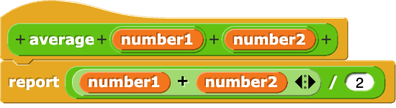

<!--
author:   Cédric Vogel
version:  0.1.0
language: de
narrator: Deutsch Female

comment:  Etappe 1 der Einheit «Funktionen – vom Aufruf zur eigenen Sprache»:
          Von Snap!-Reportern zu Python-Funktionen. Ausdrücke und
          Funktionsaufrufe Schritt für Schritt auswerten, ohne print.

import: https://raw.githubusercontent.com/glpython-edu/glpython-liascript/main/README.md
import: ../../00-fehler-lexikon/README.md
import: ../../00-makros/README.md

@style
.lia-code--inline {
  background: #F3F4F6;
  color: #1A1A1A;
  border: none;
  border-radius: 3px;
  padding: 0.05em 0.3em;
}
.lia-effect__circle {
  display: none;
}
/* Ein Block: dünner Rahmen um Eingabe (Code, Notizen) und Antwort (glpython, «Notizen speichern») */
.lia-code--block[data-notiz],
.lia-code--block:not([hidden]):has(+ p.lia-paragraph:empty + .glpython-embed) {
  border: 1px solid #D1D5DB; border-bottom: none;
  border-radius: 4px 4px 0 0; margin-bottom: 0; padding: 8px 8px 0;
  background: #FFFFFF;
}
p.lia-paragraph:empty:has(+ .glpython-embed) { display: none; }
.lia-code--block:not([hidden]) + p.lia-paragraph:empty + .glpython-embed {
  border: 1px solid #D1D5DB; border-top: none;
  border-radius: 0 0 4px 4px; margin-bottom: 24px; padding: 0 8px 8px;
}
.notiz-actions {
  border: 1px solid #D1D5DB; border-top: none;
  border-radius: 0 0 4px 4px; margin: 0 0 24px; padding: 4px 8px 8px;
}
/* Verlaufszeile (|< < n > >|) enger an Code und Antwort */
.lia-code--block[data-notiz] .lia-code-control,
.lia-code--block:not([hidden]):has(+ p.lia-paragraph:empty + .glpython-embed) .lia-code-control {
  margin-top: 0; margin-bottom: 0; padding-top: 2px; padding-bottom: 0;
}
/* Buttons links auf derselben Zeile wie die Verlaufszeile rechts, sobald die
   Inhaltsspalte breit genug ist (unabhängig von der Navigation links) */
.lia-slide__content { container-type: inline-size; }
@container (min-width: 580px) {
  .notiz-actions,
  .lia-code--block:not([hidden]) + p.lia-paragraph:empty + .glpython-embed {
    margin-top: -34px; background: transparent; pointer-events: none;
  }
  .notiz-actions button,
  .lia-code--block:not([hidden]) + p.lia-paragraph:empty + .glpython-embed .glp-buttons button,
  .lia-code--block:not([hidden]) + p.lia-paragraph:empty + .glpython-embed iframe,
  .lia-code--block:not([hidden]) + p.lia-paragraph:empty + .glpython-embed .glpython-error,
  .lia-code--block:not([hidden]) + p.lia-paragraph:empty + .glpython-embed .glp-files {
    pointer-events: auto;
  }
}
/* Kontext (z. B. Definitionen einer Aufgabe) bleibt beim Scrollen oben sichtbar */
.kontext {
  position: sticky; top: 0; z-index: 5;
  background: #FFFFFF; border-bottom: 1px solid #D1D5DB;
  padding: 4px 0 2px; margin-bottom: 12px;
}
@end
-->

# Start

Hallo

### Test

### Aufgabe 6: Vom Snap!-Reporter zur Python-Funktion 📌

Erinnern Sie sich an den Reporter aus dem Rückblick zu Beginn der Etappe:



Er berechnet `(number1 + number2) / 2`.

Das Ziel dieser Aufgabe ist es, diesen Reporter als Python-Funktion `average` zu schreiben.

Werten Sie mindestens drei Beispiele von Hand aus – eines davon soll `average(3, 5)` sein:

```text

```
@Notiz

Welcher Ausdruck steht bei `average(3, 5)` nach dem **ersten** Schritt?

- [(X)] `(3 + 5) / 2`
- [( )] `3 + 5 / 2`
- [( )] `8 / 2`
**************************************************

Der Aufruf wird durch den Rumpf ersetzt, mit `3` für `number1` und `5` für `number2`. Die Klammern gehören zum Rumpf: Ohne sie würde `5 / 2` zuerst gerechnet. `8 / 2` ist erst der zweite Schritt.

**************************************************

Übersetzen Sie den Reporter nach Python:

```python
def average(number1, number2):
    return ...
```

> [!IMPORTANT] 📌 Abgabe
> Wenn Ihre Funktion `average` fertig ist: Führen Sie den Codeblock oben noch einmal aus – es darf kein Fehler erscheinen. Klicken Sie dann darunter auf «IDE-Link kopieren» und fügen Sie den Link auf der OneNote-Seite «1201» im Abschnitt «1200 - Funktionen» in der Zeile «Etappe 1» ein – mit dem Namen «Aufgabe 6» (Namen schreiben und markieren, dann ⌘K bzw. Ctrl+K).

Prüfen Sie Ihre Beispiele in der REPL. Welchen Wert zeigt sie bei `average(3, 5)`?

[[4.0]]
@Dezimal(4.0)
**************************************************

```text
average(3, 5)  →  (3 + 5) / 2  →  8 / 2  →  4.0
```

**Warum `4.0` und nicht `4`?** In Python ergibt `/` **immer** eine Dezimalzahl, auch wenn die Division aufgeht: `8 / 2 → 4.0`. Snap! zeigt `4`, Python `4.0`. Für Python ist es trotzdem dieselbe Zahl: `average(3, 5) == 4 → 4.0 == 4 → True`. Probieren Sie es in der REPL aus. Wo Python Werte als Text vergleicht – bei den Doctests in Etappe 2 –, zählt aber die Schreibweise: Dort muss `4.0` stehen.

**************************************************

