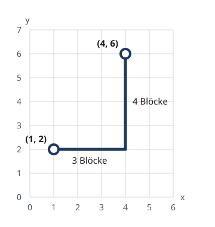

<!--
author:   Cédric Vogel
version:  0.1.0
language: de
narrator: Deutsch Female

comment:  Etappe 2 der Einheit «Funktionen – vom Aufruf zur eigenen Sprache»:
          Das Design-Rezept. Von der Aufgabe zur Funktion in sechs Schritten,
          Beispiele als Doctests, mehrere Parameter, Komposition mit einer
          gegebenen Bibliothek (Schweizer Noten).

import: https://raw.githubusercontent.com/glpython-edu/glpython-liascript/main/README.md
import: ../00-fehler-lexikon/README.md
import: ../00-makros/README.md

@style
.lia-code--inline {
  background: #F3F4F6;
  color: #1A1A1A;
  border: none;
  border-radius: 3px;
  padding: 0.05em 0.3em;
}
.lia-effect__circle {
  display: none;
}
/* Ein Block: dünner Rahmen um Eingabe (Code, Notizen) und Antwort (glpython, «Notizen speichern») */
.lia-code--block[data-notiz],
.lia-code--block:not([hidden]):has(+ p.lia-paragraph:empty + .glpython-embed) {
  border: 1px solid #D1D5DB; border-bottom: none;
  border-radius: 4px 4px 0 0; margin-bottom: 0; padding: 8px 8px 0;
  background: #FFFFFF;
}
p.lia-paragraph:empty:has(+ .glpython-embed) { display: none; }
.lia-code--block:not([hidden]) + p.lia-paragraph:empty + .glpython-embed {
  border: 1px solid #D1D5DB; border-top: none;
  border-radius: 0 0 4px 4px; margin-bottom: 24px; padding: 0 8px 8px;
}
.notiz-actions {
  border: 1px solid #D1D5DB; border-top: none;
  border-radius: 0 0 4px 4px; margin: 0 0 24px; padding: 4px 8px 8px;
}
/* Verlaufszeile (|< < n > >|) enger an Code und Antwort */
.lia-code--block[data-notiz] .lia-code-control,
.lia-code--block:not([hidden]):has(+ p.lia-paragraph:empty + .glpython-embed) .lia-code-control {
  margin-top: 0; margin-bottom: 0; padding-top: 2px; padding-bottom: 0;
}
/* Buttons links auf derselben Zeile wie die Verlaufszeile rechts, sobald die
   Inhaltsspalte breit genug ist (unabhängig von der Navigation links) */
.lia-slide__content { container-type: inline-size; }
@container (min-width: 580px) {
  .notiz-actions,
  .lia-code--block:not([hidden]) + p.lia-paragraph:empty + .glpython-embed {
    margin-top: -34px; background: transparent; pointer-events: none;
  }
  .notiz-actions button,
  .lia-code--block:not([hidden]) + p.lia-paragraph:empty + .glpython-embed .glp-buttons button,
  .lia-code--block:not([hidden]) + p.lia-paragraph:empty + .glpython-embed iframe,
  .lia-code--block:not([hidden]) + p.lia-paragraph:empty + .glpython-embed .glpython-error,
  .lia-code--block:not([hidden]) + p.lia-paragraph:empty + .glpython-embed .glp-files {
    pointer-events: auto;
  }
}
/* Kontext (z. B. Definitionen einer Aufgabe) bleibt beim Scrollen oben sichtbar */
.kontext {
  position: sticky; top: 0; z-index: 5;
  background: #FFFFFF; border-bottom: 1px solid #D1D5DB;
  padding: 4px 0 2px; margin-bottom: 12px;
}
@end
-->

# Etappe 2: Das Design-Rezept

In Etappe 1 haben Sie Code gelesen: Funktionsaufrufe Schritt für Schritt ausgewertet. Jetzt schreiben Sie Funktionen selbst – und Schreiben ist etwas anderes als Lesen: Am Anfang gibt es noch keinen Code, den man auswerten könnte. Dafür gibt es ein Rezept in sechs Schritten. Die Beispiele schreiben Sie dabei **vor** dem Code auf, als Tests, die Python selbst prüft.

**Lernziele dieser Etappe**

- Sie schreiben Funktionen nach dem Design-Rezept: Name, Parameter, Zweck, Beispiele, Rumpf, Testen – und Ihr Programm läuft nach jedem Schritt.
- Sie halten Beispiele als Doctests im Docstring fest und lesen die Meldungen `Expected` und `Got`.
- Sie schreiben Funktionen mit mehreren Parametern und Funktionen, die andere Funktionen aufrufen – auch solche aus einer Bibliothek.

## Input

Dieser Teil wird im Unterricht gemeinsam angeschaut. Im Selbststudium können Sie ihn jederzeit nachlesen.

1. Rückblick: Aufrufe auswerten
2. Von der Aufgabe zur Funktion
3. Doctests: eine REPL-Sitzung als Test
4. Das Design-Rezept Schritt für Schritt
5. Eine Bibliothek benutzen
6. Eine Funktion ruft eine andere auf
7. Ein typischer Fehler: falsche Anzahl Argumente
8. Ab hier arbeiten Sie selbständig weiter

### 🎓 Rückblick: Aufrufe auswerten

Auf dieser Folie gilt:

```python
def average(number1, number2):
    return (number1 + number2) / 2

def f(x):
    return 2 * x + 1

def g(x):
    return x ** 2
```

---

✏️ **Kurzauftrag (3′):** Werten Sie von Hand aus.

`average(3, 5)`

[[4.0]]
@Dezimal(4.0)
**************************************************

`average(3, 5)  →  (3 + 5) / 2  →  8 / 2  →  4.0`

**************************************************

`f(g(2))`

[[9]]
**************************************************

`f(g(2))  →  f(2 ** 2)  →  f(4)  →  2 * 4 + 1  →  8 + 1  →  9`

Zuerst wird das Argument `g(2)` ausgewertet, erst dann wird `f` aufgerufen.

**************************************************

### 🎓 Von der Aufgabe zur Funktion

**Aufgabe:** «Schreiben Sie eine Funktion, die den Schnitt von drei Noten berechnet.»

Zwei Fragen stellen sich bei jeder solchen Aufgabe:

- Wie fange ich an?
- Woher weiss ich, dass meine Funktion stimmt?

    {{1}}
<div>

---

Unsere Antwort ist ein **Rezept** in sechs Schritten. Nach jedem Schritt läuft Ihr Programm – Sie können jederzeit ausführen und prüfen.

1. **Name** – Wie heisst die Funktion?
2. **Parameter** – Welche Werte braucht sie?
3. **Zweck** – Was gibt sie zurück? (ein Satz, der die Parameter beim Namen nennt)
4. **Beispiele** – Was muss bei bestimmten Argumenten herauskommen? So einfach gewählt, dass es klar ist. So unterschiedlich gewählt, dass auch Grenzfälle dabei sind – bei Zahlen zum Beispiel positive und negative Zahlen und 0.
5. **Rumpf** – Wie wird der Wert berechnet?
6. **Testen** – Stimmen die Beispiele?

</div>

    {{2}}
Die Beispiele kommen **vor** dem Rumpf. So haben Sie Werte, die Sie unabhängig von Ihrem Code kennen – wie die Vorhersagen in Etappe 1, Aufgabe 4.

    {{3}}
---

    {{3}}
Bevor wir das Rezept an einem konkreten Beispiel durcharbeiten, müssen Sie wissen, was Doctests sind.

### 🎓 Doctests: eine REPL-Sitzung als Test

In Etappe 1 haben Sie Aufrufe in der REPL geprüft:

```text
>>> average(3, 5)
4.0
```

Genau diese zwei Zeilen kann man in die Beschreibung einer Funktion schreiben – in den **Docstring**, den Text zwischen `"""` und `"""` direkt unter der Zeile `def`. Python prüft dann selbst, ob der Aufruf wirklich diesen Wert ergibt. Ein solches Beispiel heisst **Doctest**.

    {{1}}
---

    {{1}}
**Beispiel:** Drücken Sie «Tests». Was meldet Python?

    {{1}}
<div>

```python
def average(number1, number2):
    """
    Gibt den Durchschnitt von number1 und number2 zurück.

    >>> average(3, 5)
    4
    >>> average(4, 4)
    4.0
    >>> average(4, 5)
    4.5
    """
    return (number1 + number2) / 2
```
@Code.rezept

</div>

    {{2}}
<div>

---

Ein Beispiel scheitert. «Tests» zeigt, was im Beispiel steht (`4`) und was Python berechnet hat (`4.0`). Solche Meldungen gehören zum Arbeiten – sie zeigen genau, wo Funktion und Beispiel nicht zusammenpassen. Bestandene Beispiele erscheinen nicht einzeln – «Tests» zählt sie nur.

Korrigieren wir das Beispiel: Ersetzen Sie im Codeblock `4` durch `4.0` und drücken Sie nochmals «Tests». Jetzt bestehen alle drei.

</div>

    {{3}}
<div>

---

**Zwei Regeln, damit Doctests richtig funktionieren:**

- Nach `>>>` steht **immer ein Leerzeichen**: `>>> average(3, 5)`, nicht `>>>average(3, 5)`.
- Doctest vergleicht die Anzeige, nicht den Wert: Für Python ist `4.0 == 4` zwar `True`, die REPL zeigt aber `4.0` – und genau das muss unter dem Aufruf stehen.

</div>

    {{4}}
---

    {{4}}
Jetzt kennen Sie alles, was es für das Rezept braucht. Wir gehen es an einer Aufgabe Schritt für Schritt durch.

### 🎓 Das Design-Rezept Schritt für Schritt

<div class="kontext">

**Aufgabe:** «Schreiben Sie eine Funktion, die den Schnitt von drei Noten berechnet.»

<details>
<summary>Das Design-Rezept</summary>

1. Wählen Sie einen **Namen**.
2. Bestimmen Sie die **Parameter**.
3. Beschreiben Sie den **Zweck**.
4. Überlegen Sie **Beispiele**.
5. Schreiben Sie den **Rumpf**.
6. **Testen** Sie.

</details>

</div>

    {{1}}
<div>

---

**1. Name:** `notenschnitt`. Der Rumpf ist vorerst nur ein leerer Docstring – das reicht, damit Python die Datei ausführen kann.

<!-- data-readonly="true" -->
```python
def notenschnitt():
    """
    """
```
@Code.rezept

</div>

    {{2}}
<div>

**2. Parameter:** drei Noten.

<!-- data-readonly="true" -->
```python
def notenschnitt(note1, note2, note3):
    """
    """
```
@Code.rezept

</div>

    {{3}}
<div>

**3. Zweck:** ein Satz im Docstring, der sagt, was die Funktion mit ihren Parametern macht – und der jeden Parameter beim Namen nennt.

<!-- data-readonly="true" -->
```python
def notenschnitt(note1, note2, note3):
    """
    Gibt den Durchschnitt von note1, note2 und note3 zurück.
    """
```
@Code.rezept

</div>

    {{4}}
<div>

**4. Beispiele:** aus der Aufgabe überlegt und als Doctests notiert. Der Schnitt von 4, 5 und 6 ist 5 – das ist klar, ohne dass es schon Code gibt. Machen Sie sich das Leben nicht durch komplizierte Beispiele unnötig schwer.

<!-- data-readonly="true" -->
```python
def notenschnitt(note1, note2, note3):
    """
    Gibt den Durchschnitt von note1, note2 und note3 zurück.

    >>> notenschnitt(4, 5, 6)
    5.0
    >>> notenschnitt(6, 6, 4.5)
    5.5
    >>> notenschnitt(3, 4, 5)
    4.0
    """
```
@Code.rezept

Die Datei läuft. «Tests» meldet aber noch Fehler – zu Recht: Die Funktion gibt noch nichts zurück. Ohne `return` liefert sie `None`.

</div>

    {{5}}
<div>

**5. Rumpf:** die Berechnung nach `return`.

**6. Testen:** «Tests» drücken. Alle drei Beispiele bestehen.

<!-- data-readonly="true" -->
```python
def notenschnitt(note1, note2, note3):
    """
    Gibt den Durchschnitt von note1, note2 und note3 zurück.

    >>> notenschnitt(4, 5, 6)
    5.0
    >>> notenschnitt(6, 6, 4.5)
    5.5
    >>> notenschnitt(3, 4, 5)
    4.0
    """
    return (note1 + note2 + note3) / 3
```
@Code.rezept

</div>

### 🎓 Eine Bibliothek benutzen

Im Zeugnis stehen halbe Noten. Den Schnitt `4.25` muss man also runden – in der Schule auf `4.5`.

Dafür gibt es eine fertige Funktion `zeugnis_note` in einer Bibliothek `noten.py`. Sie müssen nicht wissen, wie sie rechnet. Was sie tut, steht in ihrem Docstring – und den zeigt Python in der REPL mit `help` an:

```text
>>> help(zeugnis_note)
Help on function zeugnis_note in module noten:

zeugnis_note(note)
    Rundet note auf eine halbe Note, wie in der Schule:
    ab .25 und ab .75 wird aufgerundet.

    >>> zeugnis_note(4.25)
    4.5
    >>> zeugnis_note(4.2)
    4.0
    >>> zeugnis_note(4.75)
    5.0
```

`help` funktioniert auch mit Ihren eigenen Funktionen – es zeigt immer den Docstring. Deshalb gehört der Zweck-Satz ins Rezept: Wer Ihre Funktion benutzt, liest ihn mit `help`.

### 🎓 Eine Funktion ruft eine andere auf

Auf dieser Folie gilt:

- `notenschnitt(note1, note2, note3)` gibt den Durchschnitt `(note1 + note2 + note3) / 3` zurück.
- `zeugnis_note(note)` aus der Bibliothek `noten.py` rundet `note` auf eine halbe Note, wie in der Schule: `zeugnis_note(4.25) → 4.5`.

    {{1}}
<div>

---

**Beispiel:** Eine neue Funktion `gerundeter_schnitt` ruft `notenschnitt` auf und rundet das Ergebnis mit `zeugnis_note`:

```python
def gerundeter_schnitt(note1, note2, note3):
    """
    Gibt den Durchschnitt von note1, note2 und note3 zurück, gerundet auf eine halbe Note.
    """
    return zeugnis_note(notenschnitt(note1, note2, note3))
```

Was ergibt `gerundeter_schnitt(4, 4.5, 4.25)`?

</div>

    {{2}}
```text
gerundeter_schnitt(4, 4.5, 4.25)
→ zeugnis_note(notenschnitt(4, 4.5, 4.25))
→ zeugnis_note((4 + 4.5 + 4.25) / 3)
→ zeugnis_note((8.5 + 4.25) / 3)
→ zeugnis_note(12.75 / 3)
→ zeugnis_note(4.25)
→ 4.5
```

    {{3}}
<div>

`zeugnis_note(4.25) → 4.5` ist **ein** Schritt: Die Bibliothek wird benutzt, nicht nachverfolgt. Auch der Visualizer zeigt sie so – als Aufruf, der direkt seinen Wert liefert.

Im Codeblock ist `noten.py` eine eigene Datei, zugeklappt – Sie müssen nicht wissen, wie sie rechnet. Die erste Zeile von `main.py`, `from noten import zeugnis_note`, holt die Funktion aus dieser Datei, damit `main.py` sie aufrufen kann. Führen Sie das Programm aus und probieren Sie in der REPL `help(zeugnis_note)` und `help(gerundeter_schnitt)`.

```python -noten.py
def zeugnis_note(note):
    """
    Rundet note auf eine halbe Note, wie in der Schule:
    ab .25 und ab .75 wird aufgerundet.

    >>> zeugnis_note(4.25)
    4.5
    >>> zeugnis_note(4.2)
    4.0
    >>> zeugnis_note(4.75)
    5.0
    """
    return (note * 2 + 0.5) // 1 / 2
```
```python +main.py
from noten import zeugnis_note

def notenschnitt(note1, note2, note3):
    """
    Gibt den Durchschnitt von note1, note2 und note3 zurück.

    >>> notenschnitt(4, 5, 6)
    5.0
    >>> notenschnitt(6, 6, 4.5)
    5.5
    >>> notenschnitt(3, 4, 5)
    4.0
    """
    return (note1 + note2 + note3) / 3

def gerundeter_schnitt(note1, note2, note3):
    """
    Gibt den Durchschnitt von note1, note2 und note3 zurück, gerundet auf eine halbe Note.

    >>> gerundeter_schnitt(4, 4.5, 4.25)
    4.5
    >>> gerundeter_schnitt(4, 5, 6)
    5.0
    >>> gerundeter_schnitt(6, 6, 4.5)
    5.5
    """
    return zeugnis_note(notenschnitt(note1, note2, note3))
```
@Code.rezept

</div>

### 🎓 Ein typischer Fehler: falsche Anzahl Argumente

Jeder Parameter braucht beim Aufruf genau ein Argument. Die Funktion `notenschnitt(note1, note2, note3)`, die wir geschrieben haben, hat drei Parameter. Was passiert, wenn ein Argument fehlt?

    {{1}}
---

    {{1}}
**Beispiel:** Was zeigt Python bei `notenschnitt(4, 5)`?

    {{2}}
```text
>>> notenschnitt(4, 5)
TypeError: notenschnitt() missing 1 required positional argument: 'note3'
```

    {{2}}
Python nennt den Parameter, für den kein Wert da ist: `note3`.

    {{3}}
@Fehler.Argumente

### 🎓 Ab hier arbeiten Sie selbständig weiter

**Ab hier arbeiten Sie selbständig weiter.** Der Lernweg beginnt mit Aufgabe 1. Aufgaben mit 📌 geben Sie ab – die Anleitung steht jeweils direkt unter dem Codeblock. Abgegeben wird ein benannter Link auf der OneNote-Seite «1201» im Abschnitt «1200 - Funktionen», in der Zeile der Etappe.

So gehen Sie bei jeder Aufgabe vor – nach dem Design-Rezept:

1. **Name**, **Parameter** und **Zweck** festlegen; der Rumpf ist vorerst nur der Docstring.
2. **Beispiele** überlegen – so einfach, dass klar ist, was herauskommt – und als Doctests in den Docstring schreiben.
3. **Rumpf** schreiben und mit «Tests» prüfen.

Scheitert ein Test? Prüfen Sie zuerst das Beispiel: Stimmt es, wenn Sie es aus der Aufgabe heraus überlegen? Wenn ja, liegt der Fehler in der Funktion.

> [!NOTE] KI: Velo oder E-Trottinett?
> Eine KI kann Ihr eigenes Denken verstärken wie ein **Velo** – Sie treten selbst in die Pedale und werden dabei fitter. Oder sie nimmt Ihnen das Denken ab wie ein **E-Trottinett** – Sie kommen auch ans Ziel, aber Ihr Muskel wächst nicht. In der Prüfung gibt es keine KI: Dort zählt Ihr eigener Muskel.
>
> **Velo in dieser Etappe:** sich Grenzfälle für Beispiele vorschlagen lassen und diese selbst auswerten · eine Meldung von «Tests» erklären lassen · den eigenen Zweck-Satz prüfen lassen.
>
> **E-Trottinett in dieser Etappe:** Doctests erzeugen lassen · den Rumpf schreiben lassen · Beispiele aus dem fertigen Code abschreiben (das geht auch ganz ohne KI – und prüft dann nichts mehr).
>
> Wenn Sie eine KI benutzen: Copilot mit Ihrem Schulkonto – kostenlos für alle.

Dasselbe gilt für die Lösungen zum Aufklappen: Wer sie vor einem ernsthaften eigenen Versuch liest, fährt E-Trottinett. Niemand kontrolliert das – Sie betrügen damit nur sich selbst, und in der Prüfung gibt es nichts zum Aufklappen.

## Arbeitsphase

Fünf Aufgaben. Sie beginnen im Unterricht und arbeiten zuhause weiter.

| Aufgabe | Worum es geht | ca. |
|---|---|---|
| 1 | Doctests lesen | 15′ |
| 2 | Dauer in Sekunden | 15′ |
| 3 | Rezept mit Lücken 📌 | 20′ |
| 4 | Abstand und Taxi-Abstand 📌 | 35′ |
| 5 | Wer liegt falsch? | 15′ |

### Aufgabe 1: Doctests lesen

Das Ziel dieser Aufgabe ist es, Doctests zu lesen und vorherzusagen, welche bestehen.

Lesen Sie die Beispiele im Docstring. Die Funktion selbst ist richtig.

```python
def schnitt(note1, note2):
    """
    Gibt den Durchschnitt von note1 und note2 zurück.

    >>> schnitt(4, 5)
    4.5
    >>> schnitt(4, 6)
    5
    >>> schnitt(5, 5.5)
    5.25
    >>> schnitt(3, 6)
    4.5
    >>> schnitt(6, 4)
    4.5
    """
    return (note1 + note2) / 2
```

Welche Beispiele scheitern?

- [[ ]] `schnitt(4, 5)` mit `4.5`
- [[X]] `schnitt(4, 6)` mit `5`
- [[ ]] `schnitt(5, 5.5)` mit `5.25`
- [[ ]] `schnitt(3, 6)` mit `4.5`
- [[X]] `schnitt(6, 4)` mit `4.5`
**************************************************

- `schnitt(4, 6)` ergibt `5.0`, nicht `5`. Der Wert ist gleich, aber Doctests vergleichen die Schreibweise – und `/` liefert immer eine Dezimalzahl.
- `schnitt(6, 4)` ergibt `5.0`. Das Beispiel ist schlicht falsch ausgewertet.

Prüfen Sie es mit «Tests» und lesen Sie, was im Beispiel steht und was Python berechnet hat:

```python
def schnitt(note1, note2):
    """
    Gibt den Durchschnitt von note1 und note2 zurück.

    >>> schnitt(4, 5)
    4.5
    >>> schnitt(4, 6)
    5
    >>> schnitt(5, 5.5)
    5.25
    >>> schnitt(3, 6)
    4.5
    >>> schnitt(6, 4)
    4.5
    """
    return (note1 + note2) / 2
```
@Code.rezept

@Fehler.Doctest

**************************************************

#### Ein Leerzeichen zu wenig

In diesem Docstring fehlt in einem Beispiel das Leerzeichen nach `>>>`:

```python
def schnitt(note1, note2):
    """
    Gibt den Durchschnitt von note1 und note2 zurück.

    >>> schnitt(4, 5)
    4.5
    >>>schnitt(5, 6)
    5.5
    """
    return (note1 + note2) / 2
```

Was meldet «Tests»?

- [( )] Das Beispiel `schnitt(5, 6)` scheitert, das andere besteht.
- [(X)] Python meldet einen Fehler und prüft gar kein Beispiel.
- [( )] Python überspringt die Zeile ohne Leerzeichen.
**************************************************

Ohne Leerzeichen nach `>>>` kann doctest die Beispiele gar nicht lesen und bricht ab, bevor es ein einziges prüft.

@Fehler.DoctestLeerzeichen

Probieren Sie es aus und setzen Sie das fehlende Leerzeichen:

```python
def schnitt(note1, note2):
    """
    Gibt den Durchschnitt von note1 und note2 zurück.

    >>> schnitt(4, 5)
    4.5
    >>>schnitt(5, 6)
    5.5
    """
    return (note1 + note2) / 2
```
@Code.rezept

**************************************************

### Aufgabe 2: Dauer in Sekunden

Das Ziel dieser Aufgabe ist es, aus Beispielen den Ausdruck für den Rumpf zu finden.

<div class="kontext">

Die Aufgabe: Eine Stoppuhr zeigt eine Dauer in Stunden, Minuten und Sekunden an, zum Beispiel `1:02:30`. Wie viele Sekunden sind das insgesamt?

Name, Parameter und Zweck sind gegeben:

```python
def dauer_in_sekunden(stunden, minuten, sekunden):
    """
    Gibt die Dauer von stunden Stunden, minuten Minuten und sekunden
    Sekunden in Sekunden zurück.
    """
```

</div>

Bestimmen Sie zuerst, was bei diesen drei Aufrufen herauskommen muss – aus der Aufgabe, noch ohne Code. Ihre Überlegungen können Sie im Notizfeld festhalten.

`dauer_in_sekunden(0, 2, 30)`

```text

```
@Notiz

[[150]]
**************************************************

2 Minuten sind 2 · 60 = 120 Sekunden, dazu 30 Sekunden: 120 + 30 = 150.

**************************************************

`dauer_in_sekunden(1, 0, 0)`

```text

```
@Notiz

[[3600]]
**************************************************

Eine Stunde hat 60 Minuten zu je 60 Sekunden: 60 · 60 = 3600.

**************************************************

`dauer_in_sekunden(1, 2, 30)`

```text

```
@Notiz

[[3750]]
**************************************************

Die Stunde gibt 3600 Sekunden, die 2 Minuten 120, dazu 30: 3600 + 120 + 30 = 3750.

**************************************************

Schreiben Sie die drei Beispiele als Doctests in den Docstring und ergänzen Sie einen Grenzfall. Finden Sie danach den Ausdruck für den Rumpf – wie haben Sie in den Beispielen gerechnet? – und prüfen Sie mit «Tests»:

```python
def dauer_in_sekunden(stunden, minuten, sekunden):
    """
    Gibt die Dauer von stunden Stunden, minuten Minuten und sekunden
    Sekunden in Sekunden zurück.
    """
```
@Code.rezept

<details>
<summary>Eine mögliche Lösung</summary>

In allen Beispielen wurde gleich gerechnet: Stunden mal 3600, Minuten mal 60, dazu die Sekunden.

```python
def dauer_in_sekunden(stunden, minuten, sekunden):
    """
    Gibt die Dauer von stunden Stunden, minuten Minuten und sekunden
    Sekunden in Sekunden zurück.

    >>> dauer_in_sekunden(0, 2, 30)
    150
    >>> dauer_in_sekunden(1, 0, 0)
    3600
    >>> dauer_in_sekunden(1, 2, 30)
    3750
    >>> dauer_in_sekunden(0, 0, 0)
    0
    """
    return 3600 * stunden + 60 * minuten + sekunden
```

`dauer_in_sekunden(0, 0, 0)` ist ein Grenzfall: Eine Dauer von 0 muss 0 Sekunden ergeben. Statt `3600` dürfen Sie auch `60 * 60` schreiben.

</details>

### Aufgabe 3: Rezept mit Lücken 📌

Das Ziel dieser Aufgabe ist es, die Schritte 4 bis 6 des Rezepts selbst zu machen: Beispiele, Rumpf, Testen.

<div class="kontext">

Name, Parameter und Zweck sind gegeben:

```python
def gewichteter_schnitt(test, pruefung):
    """
    Gibt den Schnitt aus der Testnote test und der Prüfungsnote pruefung
    zurück. pruefung zählt doppelt.
    """
```

</div>

Überlegen Sie zuerst, was herauskommen muss – noch ohne Code. Wenn die Prüfung doppelt zählt, ist das wie ein Schnitt aus drei Noten: der Testnote und zweimal der Prüfungsnote. Ihre Überlegungen können Sie im Notizfeld festhalten.

`gewichteter_schnitt(6, 4.5)`

```text

```
@Notiz

Welchen Wert muss `gewichteter_schnitt(6, 4.5)` ergeben?

[[5.0]]
@Dezimal(5.0)
**************************************************

Wie ein Schnitt aus den drei Noten 6, 4.5 und 4.5: (6 + 4.5 + 4.5) / 3 = 15 / 3 = 5.0.

**************************************************

Überlegen Sie zwei weitere Beispiele – so einfach, dass klar ist, was herauskommt. Tipp: Sind Test- und Prüfungsnote gleich, ist auch der Schnitt diese Note – wegen `/` als Dezimalzahl, zum Beispiel `4.0`. Und `test = 3`, `pruefung = 6` ergibt wie 3, 6 und 6 genau 5.0.

```text

```
@Notiz

Schreiben Sie dann Ihre drei Beispiele als Doctests in den Docstring – ergänzen Sie danach den Rumpf und prüfen Sie mit «Tests»:

```python
def gewichteter_schnitt(test, pruefung):
    """
    Gibt den Schnitt aus der Testnote test und der Prüfungsnote pruefung
    zurück. pruefung zählt doppelt.
    """
```
@Code.rezept

> [!IMPORTANT] 📌 Abgabe
> Wenn Ihre Funktion fertig ist und alle Tests bestehen: Führen Sie den Codeblock oben noch einmal aus – es darf kein Fehler erscheinen. Klicken Sie dann darunter auf «IDE-Link kopieren» und fügen Sie den Link auf der OneNote-Seite «1201» im Abschnitt «1200 - Funktionen» in der Zeile «Etappe 2» ein – mit dem Namen «Aufgabe 3» (Namen schreiben und markieren, dann ⌘K bzw. Ctrl+K).

<details>
<summary>Eine mögliche Lösung</summary>

```python
def gewichteter_schnitt(test, pruefung):
    """
    Gibt den Schnitt aus der Testnote test und der Prüfungsnote pruefung
    zurück. pruefung zählt doppelt.

    >>> gewichteter_schnitt(6, 4.5)
    5.0
    >>> gewichteter_schnitt(3, 6)
    5.0
    >>> gewichteter_schnitt(4, 4)
    4.0
    """
    return (test + 2 * pruefung) / 3
```

</details>

### Aufgabe 4: Abstand und Taxi-Abstand 📌

Das Ziel dieser Aufgabe ist es, zwei Funktionen ganz selbständig nach dem Design-Rezept zu schreiben – direkt im Editor. Die zweite Funktion ruft die erste auf.

<div class="kontext">

<details open>
<summary>Das Design-Rezept</summary>

1. Wählen Sie einen **Namen**.
2. Bestimmen Sie die **Parameter**.
3. Beschreiben Sie den **Zweck**.
4. Überlegen Sie **Beispiele**.
5. Schreiben Sie den **Rumpf**.
6. **Testen** Sie.

</details>

</div>

**1.** Schreiben Sie eine Funktion, die den Abstand zwischen zwei Zahlen zurückgibt. Der Abstand zwischen 11 und 12 ist 1, der Abstand zwischen 3 und -6 ist 9.

Python hat eine Funktion `abs`: `abs(x)` gibt den Betrag von `x` zurück, also die Zahl ohne Vorzeichen. `abs(-9)` ergibt `9`, `abs(9)` ergibt `9`.

**2.** Ein Taxi in einer Stadt mit rechtwinkligen Strassen (wie in Manhattan) kann nicht schräg fahren, sondern nur waagrecht und senkrecht. Von der Kreuzung (1, 2) zur Kreuzung (4, 6) fährt es 3 Blöcke waagrecht und 4 Blöcke senkrecht – zusammen 7 Blöcke.



Schreiben Sie eine Funktion, die diese Strecke für zwei beliebige Kreuzungen zurückgibt. Benutzen Sie dafür Ihre Funktion für den Abstand.

<details>
<summary>Tipp: Wie viele Parameter?</summary>

Eine Kreuzung besteht aus zwei Zahlen, zum Beispiel (1, 2). Für zwei Kreuzungen braucht die Funktion also vier Parameter.

</details>

Schreiben Sie beide Funktionen in den Codeblock unter dieser Anleitung – nach dem Rezept im Kasten oben, zuerst aber nur Name, Parameter, Zweck und Beispiele, noch ohne Rumpf. Führen Sie nach jedem Schritt aus.

Lassen Sie dann die Beispiele jeder Funktion prüfen. Kopieren <i aria-hidden="true" class="icon icon-copy"></i> Sie dazu diese Anfrage in Copilot (Schulkonto) und fügen Sie darunter Ihre Funktion mit Zweck und Doctests ein:

```text
Prüfe die Doctests in dieser Python-Funktion einer Schulaufgabe:
Fehlt ein Fall, der einen typischen Fehler aufdecken würde? Wenn
nichts Wichtiges fehlt, sag nur das. Sonst nenne höchstens die zwei
wichtigsten fehlenden Arten von Fällen und warum, ohne Beispiele mit
Ergebnissen und ohne Code. Ist ein Ergebnis falsch, nenne nur das
Beispiel.
```

Werten Sie die Fälle, die Copilot vorschlägt, selbst aus und ergänzen Sie die sinnvollen als Doctests. Auch eine KI kann sich irren: Ob ein Beispiel stimmt, entscheiden Sie an der Aufgabe. Schreiben Sie danach den Rumpf und prüfen Sie mit «Tests». Beispiele, die aus dem fertigen Code abgeschrieben sind, bestehen immer – auch wenn der Code falsch ist. Und auch wenn Ihr Code schon stimmt: Copilot zeigt Ihnen, welche Fälle Ihre Beispiele noch nicht prüfen.

```python

```
@Code.rezept

> [!IMPORTANT] 📌 Abgabe
> Wenn beide Funktionen fertig sind und alle Tests bestehen: Führen Sie den Codeblock oben noch einmal aus – es darf kein Fehler erscheinen. Klicken Sie dann darunter auf «IDE-Link kopieren» und fügen Sie den Link auf der OneNote-Seite «1201» im Abschnitt «1200 - Funktionen» in der Zeile «Etappe 2» ein – mit dem Namen «Aufgabe 4» (Namen schreiben und markieren, dann ⌘K bzw. Ctrl+K).

In der Prüfung auf exam.net gibt es keinen «Tests»-Button: Dort prüfen Sie Doctests mit `import doctest` und `doctest.testmod()` am Dateiende – geübt wird das in der Konsolidierung.

<details>
<summary>Eine mögliche Lösung</summary>

```python
def abstand(a, b):
    """
    Gibt den Abstand zwischen den Zahlen a und b zurück.

    >>> abstand(11, 12)
    1
    >>> abstand(3, -6)
    9
    >>> abstand(5, 5)
    0
    >>> abstand(12, 11)
    1
    >>> abstand(0, 4)
    4
    """
    return abs(a - b)

def taxi_abstand(x1, y1, x2, y2):
    """
    Gibt zurück, wie viele Blöcke ein Taxi von der Kreuzung (x1, y1) zur
    Kreuzung (x2, y2) fährt.

    >>> taxi_abstand(1, 2, 4, 6)
    7
    >>> taxi_abstand(4, 6, 1, 2)
    7
    >>> taxi_abstand(2, 3, 2, 3)
    0
    >>> taxi_abstand(1, 2, 5, 2)
    4
    """
    return abstand(x1, x2) + abstand(y1, y2)
```

`abstand(12, 11)` und `taxi_abstand(4, 6, 1, 2)` prüfen, dass die Reihenfolge keine Rolle spielt – ein Grenzfall, den man leicht vergisst.

</details>

### Aufgabe 5: Wer liegt falsch?

Das Ziel dieser Aufgabe ist es, bei einem scheiternden Test zu entscheiden, ob die Funktion oder das Beispiel falsch ist.

Ein scheiternder Test sagt nur: Funktion und Beispiel passen nicht zusammen. Wer recht hat, entscheiden Sie: Prüfen Sie zuerst das Beispiel – stimmt es, wenn Sie es aus der Aufgabe heraus überlegen?

Drücken Sie «Tests» und lesen Sie die Meldung:

```python
def ist_genuegend(note):
    """
    Gibt True zurück, wenn note genügend ist (4 oder besser), sonst False.

    >>> ist_genuegend(5.5)
    True
    >>> ist_genuegend(3.5)
    False
    >>> ist_genuegend(4)
    True
    """
    return note > 4
```
@Code.rezept

Wer liegt falsch?

- [(X)] Die Funktion
- [( )] Das Beispiel
**************************************************

Eine 4 ist genügend – das Beispiel stimmt. Die Funktion vergleicht mit `>` und zählt die 4 deshalb nicht mit: `4 > 4` ist `False`. Richtig ist `note >= 4`. Dass die anderen beiden Beispiele bestehen, hilft nicht: Der Fehler zeigt sich nur am Grenzfall.

**************************************************

Und hier? Drücken Sie wieder «Tests»:

```python
def ist_gerade(zahl):
    """
    Gibt True zurück, wenn zahl gerade ist, sonst False.

    >>> ist_gerade(4)
    True
    >>> ist_gerade(7)
    False
    >>> ist_gerade(0)
    False
    """
    return zahl % 2 == 0
```
@Code.rezept

Wer liegt falsch?

- [( )] Die Funktion
- [(X)] Das Beispiel
**************************************************

0 ist gerade: 0 geteilt durch 2 gibt 0, Rest 0. Das Beispiel ist falsch, die Funktion stimmt. Korrigieren Sie das Beispiel – nicht den Rumpf. Wer hier den Rumpf «passend» macht, hat danach eine falsche Funktion mit bestandenem Test.

**************************************************

### 🧩 Knacknuss für Schnelle

Hier sind zwei Versionen von `zeugnis_note`. Beide bestehen dieselben drei Doctests. Wo unterscheiden sie sich – und warum?

<details>
<summary>Tipp</summary>

Probieren Sie in der REPL Noten mit `.25` und `.75` aus, zum Beispiel `4.25`, `5.25` und `4.75`.

</details>

```python
def zeugnis_note_a(note):
    """
    Rundet note auf eine halbe Note.

    >>> zeugnis_note_a(4.9)
    5.0
    >>> zeugnis_note_a(4.2)
    4.0
    >>> zeugnis_note_a(4.75)
    5.0
    """
    return round(note * 2, 0) / 2

def zeugnis_note_b(note):
    """
    Rundet note auf eine halbe Note.

    >>> zeugnis_note_b(4.9)
    5.0
    >>> zeugnis_note_b(4.2)
    4.0
    >>> zeugnis_note_b(4.75)
    5.0
    """
    return (note * 2 + 0.5) // 1 / 2
```
@Code.rezept

<details>
<summary>Lösung</summary>

Bei `4.25` und `5.25` (und `3.25`, …) unterscheiden sie sich: `zeugnis_note_a(4.25)` ergibt `4.0`, `zeugnis_note_b(4.25)` ergibt `4.5`.

Der Grund: `round` rundet eine Zahl, die genau auf `.5` endet, auf die **gerade** Zahl – `round(8.5)` ergibt `8`, `round(9.5)` ergibt `10`. In halben Noten ist `4.25` genau `8.5` Halbe, `4.75` genau `9.5` Halbe. Deshalb rundet Version a mal ab, mal auf. Version b rechnet in halben Noten, addiert `0.5` und schneidet mit `// 1` die Nachkommastellen ab – das rundet immer auf, wie in der Schule.

Die eigentliche Einsicht: **Doctests zeigen nur, was sie testen.** Beide Versionen bestehen dieselben drei Beispiele, weil keines ein Grenzfall ist. Grenzfälle gehören deshalb ins Rezept – als Beispiele, die Sie bewusst wählen.

</details>
