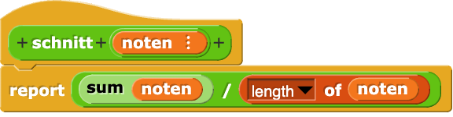
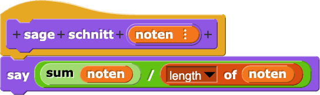
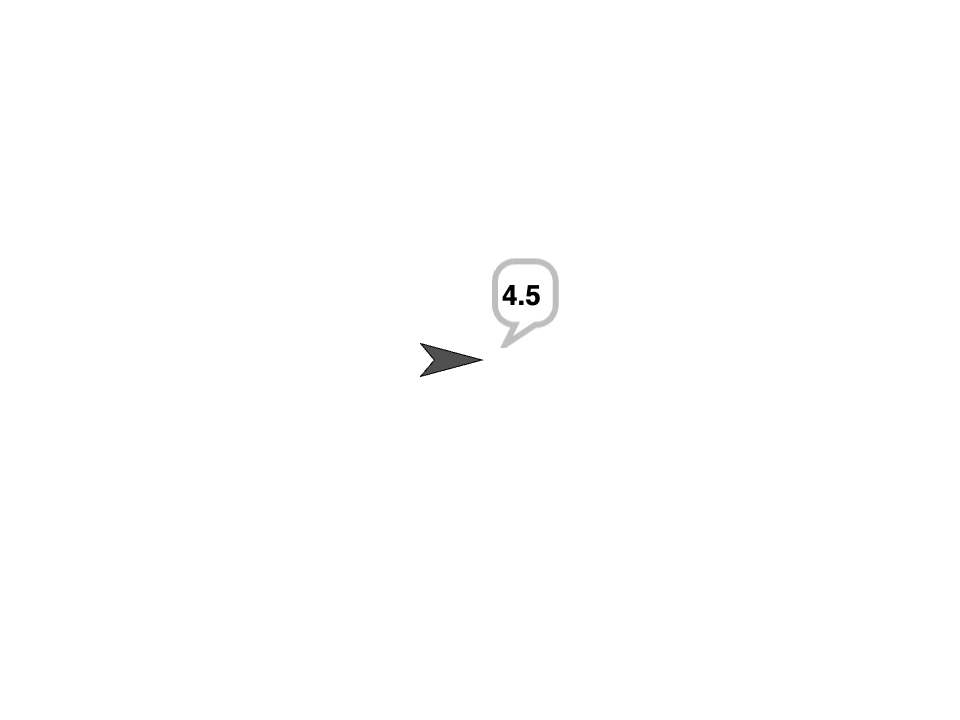
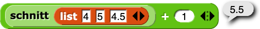

<!--
author:   Cédric Vogel
version:  1.0.2
license:  CC BY-SA 4.0
language: de
narrator: Deutsch Female

comment:  Etappe 3 der Einheit «Funktionen – vom Aufruf zur eigenen Sprache»:
          Lokale Variablen, Listen – und Wirkung. Listen als Argument und als
          Ergebnis (Index und Wert), lokale Variablen für Zwischenergebnisse,
          print gegenüber return und None. Kontext: Noten und Stoppuhr.

import: https://raw.githubusercontent.com/glpython-edu/glpython-liascript/main/README.md
import: ../00-fehler-lexikon/README.md
import: ../00-makros/README.md

@style
.lia-code--inline {
  background: #F3F4F6;
  color: #1A1A1A;
  border: none;
  border-radius: 3px;
  padding: 0.05em 0.3em;
}
.lia-effect__circle {
  display: none;
}
/* Ein Block: dünner Rahmen um Eingabe (Code, Notizen) und Antwort (glpython, «Notizen speichern») */
.lia-code--block[data-notiz],
.lia-code--block:not([hidden]):has(+ p.lia-paragraph:empty + .glpython-embed) {
  border: 1px solid #D1D5DB; border-bottom: none;
  border-radius: 4px 4px 0 0; margin-bottom: 0; padding: 8px 8px 0;
  background: #FFFFFF;
}
p.lia-paragraph:empty:has(+ .glpython-embed) { display: none; }
.lia-code--block:not([hidden]) + p.lia-paragraph:empty + .glpython-embed {
  border: 1px solid #D1D5DB; border-top: none;
  border-radius: 0 0 4px 4px; margin-bottom: 24px; padding: 0 8px 8px;
}
.notiz-actions {
  border: 1px solid #D1D5DB; border-top: none;
  border-radius: 0 0 4px 4px; margin: 0 0 24px; padding: 4px 8px 8px;
}
/* Verlaufszeile (|< < n > >|) enger an Code und Antwort */
.lia-code--block[data-notiz] .lia-code-control,
.lia-code--block:not([hidden]):has(+ p.lia-paragraph:empty + .glpython-embed) .lia-code-control {
  margin-top: 0; margin-bottom: 0; padding-top: 2px; padding-bottom: 0;
}
/* Buttons links auf derselben Zeile wie die Verlaufszeile rechts, sobald die
   Inhaltsspalte breit genug ist (unabhängig von der Navigation links) */
.lia-slide__content { container-type: inline-size; }
@container (min-width: 580px) {
  .notiz-actions,
  .lia-code--block:not([hidden]) + p.lia-paragraph:empty + .glpython-embed {
    margin-top: -34px; background: transparent; pointer-events: none;
  }
  .notiz-actions button,
  .lia-code--block:not([hidden]) + p.lia-paragraph:empty + .glpython-embed .glp-buttons button,
  .lia-code--block:not([hidden]) + p.lia-paragraph:empty + .glpython-embed iframe,
  .lia-code--block:not([hidden]) + p.lia-paragraph:empty + .glpython-embed .glpython-error,
  .lia-code--block:not([hidden]) + p.lia-paragraph:empty + .glpython-embed .glp-files {
    pointer-events: auto;
  }
}
/* Kontext (z. B. Definitionen einer Aufgabe) bleibt beim Scrollen oben sichtbar */
.kontext {
  position: sticky; top: 0; z-index: 5;
  background: #FFFFFF; border-bottom: 1px solid #D1D5DB;
  padding: 4px 0 2px; margin-bottom: 12px;
}
@end

-->

# Etappe 3: Lokale Variablen, Listen – und Wirkung

In Etappe 2 hatte jede Funktion eine feste Zahl von Parametern, und ihr Rumpf war ein einziger Ausdruck nach `return`. Jetzt werden Funktionen grösser: Eine Funktion bekommt eine **Liste** als Argument oder gibt eine Liste zurück, und Zwischenergebnisse im Rumpf bekommen einen Namen. Ausserdem begegnet Ihnen `print` – und damit die Frage, ob eine Funktion einen **Wert** zurückgibt oder etwas **bewirkt**.

**Lernziele dieser Etappe**

- Sie unterscheiden bei einer Liste die Adresse (den Index) und den Wert an dieser Adresse.
- Sie schreiben Funktionen nach dem Design-Rezept, die eine Liste als Argument bekommen oder eine Liste zurückgeben.
- Sie benennen Zwischenergebnisse im Rumpf mit lokalen Variablen.
- Sie unterscheiden Funktionen, die einen Wert zurückgeben (`return`), von Funktionen, die etwas anzeigen (`print`), und erklären, warum nur die ersten mit Doctests sinnvoll geprüft werden können.

## Input

Dieser Teil wird im Unterricht gemeinsam angeschaut. Im Selbststudium können Sie ihn jederzeit nachlesen.

1. Rückblick: Noten und Stoppuhr
2. Von drei Noten zu einer Liste
3. Index und Wert
4. Zwischenergebnisse benennen
5. Wert oder Wirkung
6. Die Überraschung: `print` im Doctest
7. Ab hier arbeiten Sie selbständig weiter

### 🎓 Rückblick: Noten und Stoppuhr

Auf dieser Folie gilt:

```python
def notenschnitt(note1, note2, note3):
    return (note1 + note2 + note3) / 3

def dauer_in_sekunden(stunden, minuten, sekunden):
    return 3600 * stunden + 60 * minuten + sekunden
```

---

✏️ **Kurzauftrag (3′):** Werten Sie von Hand aus.

`notenschnitt(4, 5, 4.5)`

Welcher Ausdruck steht nach dem **zweiten** Schritt?

- [(X)] `(9 + 4.5) / 3`
- [( )] `4 + 5 + 4.5 / 3`
- [( )] `(4 + 9.5) / 3`
**************************************************

Der Aufruf wird durch den Ausdruck nach `return` ersetzt, mit Klammern um die Summe. Dann rechnet Python von links nach rechts: zuerst `4 + 5`. Ohne Klammern würde nur `4.5` durch 3 geteilt.

**************************************************

Welchen Wert hat `notenschnitt(4, 5, 4.5)`?

[[4.5]]
@Dezimal(4.5)
**************************************************

`notenschnitt(4, 5, 4.5)  →  (4 + 5 + 4.5) / 3  →  (9 + 4.5) / 3  →  13.5 / 3  →  4.5`

**************************************************

`dauer_in_sekunden(1, 2, 30)`

[[3750]]
**************************************************

```text
dauer_in_sekunden(1, 2, 30)
→ 3600 * 1 + 60 * 2 + 30
→ 3600 + 60 * 2 + 30
→ 3600 + 120 + 30
→ 3720 + 30
→ 3750
```

**************************************************

### 🎓 Von drei Noten zu einer Liste

`notenschnitt(note1, note2, note3)` aus Etappe 2 hat genau drei Parameter. Was aber, wenn jemand vier Noten hat – oder sieben?

    {{1}}
<div>

---

Statt einer festen Zahl von Parametern bekommt die Funktion **einen** Parameter: eine **Liste** mit allen Noten, zum Beispiel `[4, 5, 4.5]`.

In der letzten Einheit haben wir Summen berechnet, indem wir eine `for`-Schleife benutzt haben. Python hat dafür eine fertige Funktion, die uns diese Arbeit abnimmt: `sum(noten)` gibt die Summe der Werte in der Liste `noten` zurück.

```python
def notenschnitt(noten):
    """
    Gibt den Durchschnitt der Noten in der Liste noten zurück.

    >>> notenschnitt([4, 5, 4.5])
    4.5
    >>> notenschnitt([6, 5])
    5.5
    >>> notenschnitt([3.5])
    3.5
    """
    return sum(noten) / len(noten)
```

</div>

    {{2}}
---

    {{2}}
**Beispiel:** Was erhalten wir, wenn wir `notenschnitt([4, 5, 4.5])` auswerten?

    {{2}}
`notenschnitt([4, 5, 4.5])`

    {{3}}
`→ sum([4, 5, 4.5]) / len([4, 5, 4.5])`

    {{4}}
`→ 13.5 / len([4, 5, 4.5])`

    {{5}}
`→ 13.5 / 3`

    {{6}}
`→ 4.5`

    {{7}}
<div>

`sum` und `len` sind Funktionen wie `zeugnis_note` in Etappe 2: Sie benutzen sie, ohne sie nachzuverfolgen. Ihr Aufruf ist **ein** Schritt. Wir schauen uns dasselbe im Visualizer an:

```python
def notenschnitt(noten):
    return sum(noten) / len(noten)

notenschnitt([4, 5, 4.5])
```
@Code.demo

</div>

### 🎓 Index und Wert

Auf dieser Folie gilt:

```python
noten = [5, 4.5, 6]
```

Mit eckigen Klammern hinter dem Namen einer Liste holen Sie einen einzelnen Wert heraus: `noten[1]`.

---

**Beispiel:** Was ergibt `noten[1]`?

- [( )] `5`
- [(X)] `4.5`
- [( )] `6`
**************************************************

Die Zahl in den eckigen Klammern ist die **Adresse** in der Liste, der **Index**. Die Adressen beginnen bei **0**:

<!-- data-type="none" -->
| Adresse (Index) | 0 | 1 | 2 |
|---|---|---|---|
| Wert | 5 | 4.5 | 6 |

`noten[1]` ist also der Wert an Adresse 1: `4.5`.

**************************************************

An welcher Adresse steht die `6`?

[[2]]
**************************************************

Die `6` ist der dritte Wert – wegen der Zählung ab 0 steht sie an Adresse 2: `noten[2] → 6`.

**************************************************

---

Index und Wert sind zwei verschiedene Dinge: Der Index sagt, **wo** etwas steht, der Wert, **was** dort steht. Eine Adresse, die es nicht gibt, meldet Python als Fehler:

```text
>>> noten[3]
IndexError: list index out of range
```

@Fehler.IndexError

### 🎓 Zwischenergebnisse benennen

Auf dieser Folie gilt:

```python
def notenschnitt(noten):
    """
    Gibt den Durchschnitt der Noten in der Liste noten zurück.
    """
    summe = sum(noten)
    anzahl = len(noten)
    return summe / anzahl
```

Im Rumpf von `notenschnitt` stecken zwei Rechnungen. Hier bekommt jedes Zwischenergebnis einen **Namen**: `summe` und `anzahl`. Solche Namen heissen **lokale Variablen** – sie gehören zum Rumpf der Funktion.

    {{1}}
<div>

---

Wir verfolgen den Aufruf im Visualizer. Achten Sie darauf, wann `summe` und `anzahl` einen Wert bekommen und wo `summe / anzahl` diese Werte einsetzt:

```python
def notenschnitt(noten):
    summe = sum(noten)
    anzahl = len(noten)
    return summe / anzahl

notenschnitt([4, 5, 4.5])
```
@Code.demo

</div>

    {{2}}
---

    {{2}}
✏️ **Kurzauftrag (2′):** Angenommen, Sie rufen in der REPL zuerst `notenschnitt([4, 5, 4.5])` auf und tippen danach `summe`. Was zeigt Python?

    {{2}}
<div>

- [( )] `13.5`
- [( )] nichts
- [(X)] eine Fehlermeldung
**************************************************

```text
>>> notenschnitt([4, 5, 4.5])
4.5
>>> summe
NameError: name 'summe' is not defined
```

Eine lokale Variable gibt es nur, solange der Aufruf läuft. Danach ist sie weg – zurück bleibt nur der Wert nach `return`. Im Visualizer sehen Sie, dass die lokalen Variablen mit dem Kasten verschwinden, wenn der Wert nach `return` zurückgegeben wird.

@Fehler.NameError

**************************************************

</div>

### 🎓 Wert oder Wirkung

In Snap! gibt es zwei Formen von Blöcken: **Reporter** sind rund, **Befehlsblöcke** haben die Form eines Puzzleteils. Was ist der Unterschied?

Wir schauen uns in Snap! zwei Blöcke an, die dasselbe berechnen: <a href="https://snap.berkeley.edu/snap/snap.html#present:Username=vl%40gl&ProjectName=say%20or%20report&editMode&noRun" target="_blank" rel="noopener">In Snap! öffnen</a> (öffnet einen neuen Tab).

    {{1}}
<div>

---

Beide Blöcke berechnen den Durchschnitt der Noten in der Liste `noten`. `schnitt` gibt ihn mit `report` zurück, `sage schnitt` zeigt ihn mit `say` an.

<div style="display: flex; flex-wrap: wrap; gap: 1.5rem; align-items: flex-start;">
<div style="flex: 1 1 16rem;">

*Reporter*

<!-- style="max-width: 100%;" -->

</div>
<div style="flex: 1 1 16rem;">

*Befehlsblock*

<!-- style="max-width: 100%;" -->

</div>
</div>

</div>

    {{2}}
<div>

---

Wir klicken auf jeden der beiden Blöcke:

<div style="display: flex; flex-wrap: wrap; gap: 1.5rem; align-items: flex-start;">
<div style="flex: 1 1 16rem;">

<!-- style="max-width: 100%;" -->

Der Reporter zeigt seinen **Wert** direkt am Block an.

</div>
<div style="flex: 1 1 16rem;">

<!-- style="max-width: 60%;" -->

Der Befehlsblock hat eine **Wirkung**: Die Figur auf der Bühne zeigt eine Sprechblase.

</div>
</div>

</div>

    {{3}}
<div>

---

Und wenn wir mit dem Ergebnis weiterrechnen wollen? Das runde Feld in

<!-- style="max-width: 8rem;" -->

nimmt nur einen Reporter. `schnitt` passt hinein:

<!-- style="max-width: 100%;" -->

Der Befehlsblock `sage schnitt` passt gar nicht hinein – er hat keinen Wert, den man weiterverwenden könnte:

<!-- style="max-width: 60%;" -->

</div>

    {{4}}
<div>

---

In Python gibt `return` einen Wert zurück – wie `report`. `print` zeigt etwas in der Konsole an – wie `say`. Aber in Python passt ein Aufruf mit `print` überall hinein, wo ein Wert stehen kann. Was kommt dann heraus?

Auf dieser Folie gilt:

```python
def notenschnitt(noten):
    """
    Gibt den Durchschnitt der Noten in der Liste noten zurück.
    """
    return sum(noten) / len(noten)

def zeige_schnitt(noten):
    """
    Zeigt den Durchschnitt der Noten in der Liste noten an.
    """
    print(sum(noten) / len(noten))
```

</div>

    {{5}}
<div>

---

**Beispiel:** In der REPL sehen die beiden Funktionen gleich aus:

```text
>>> notenschnitt([4, 5, 4.5])
4.5
>>> zeige_schnitt([4, 5, 4.5])
4.5
```

---

Gibt es trotzdem einen Unterschied? Das untersuchen wir auf der nächsten Folie.

</div>

### 🎓 Die Überraschung: `print` im Doctest

Kann man eine Funktion mit `print` wie `zeige_schnitt` mit einem Doctest prüfen?

    {{1}}
<div>

---

**Beispiel:** Wir drücken «Tests». Besteht das Beispiel?

```python
def zeige_schnitt(noten):
    """
    Zeigt den Durchschnitt der Noten in der Liste noten an.

    >>> zeige_schnitt([4, 5, 4.5])
    4.5
    """
    print(sum(noten) / len(noten))
```
@Code.rezept3

</div>

    {{2}}
<div>

---

Es besteht – ein Doctest vergleicht, was nach dem Aufruf **angezeigt** wird, und `print` zeigt `4.5` an. «Tests» zeigt dazu aber einen Hinweis: «`zeige_schnitt([4, 5, 4.5])` hat `4.5` ausgegeben, aber `None` zurückgegeben.» Was das bedeutet, zeigt das nächste Beispiel.

</div>

    {{3}}
<div>

Sobald der Wert weiterverwendet werden soll, scheitert die Funktion: Wir ergänzen im Codeblock das Beispiel `>>> zeige_schnitt([4, 5, 4.5]) + 1` mit dem Ergebnis `5.5` und drücken nochmals «Tests». Jetzt scheitert das neue Beispiel, und der Hinweis lautet: «Ein Wert ist `None`. Fehlt in einer Funktion das `return`?»

</div>

    {{4}}
<div>

Beim gescheiterten Beispiel klicken wir auf «Beispiel visualisieren» und gehen Schritt für Schritt durch: Nach dem Aufruf von `zeige_schnitt` steht dort der Ausdruck `None + 1` – und den kann Python nicht auswerten.

`zeige_schnitt` zeigt `4.5` an – das ist die Wirkung von `print`. Zurück gibt die Funktion aber keinen Wert, denn in ihrem Rumpf steht kein `return`. Eine Funktion ohne `return` gibt **`None`** zurück, den Wert für «kein Wert». Und mit `None` kann Python nicht rechnen.

@Fehler.NoneType

</div>

    {{5}}
<div>

---

`None` sichtbar machen: Die REPL zeigt `None` nicht an. Mit `print` sehen Sie es:

```text
>>> print(zeige_schnitt([4, 5, 4.5]))
4.5
None
```

Die erste Zeile ist die Wirkung von `zeige_schnitt`, die zweite der Wert, den die Funktion zurückgibt. **Darum:** Rechnet eine Funktion etwas aus, gibt sie es mit `return` zurück. `print` ist für das Anzeigen da.

</div>

### 🎓 Ab hier arbeiten Sie selbständig weiter

**Ab hier arbeiten Sie selbständig weiter.** Der Lernweg beginnt mit Aufgabe 1. Aufgaben mit 📌 geben Sie ab – die Anleitung steht jeweils direkt unter dem Codeblock. Abgegeben wird ein benannter Link auf der OneNote-Seite «1201» im Abschnitt «1200 - Funktionen», in der Zeile der Etappe.

So gehen Sie vor:

1. **Vorhersagen:** Was ergibt ein Ausdruck, ein Index, ein Aufruf? Zuerst von Hand, dann in der REPL prüfen.
2. **Design-Rezept:** Name, Parameter und Zweck, dann Beispiele – so einfach, dass klar ist, was herauskommt –, dann der Rumpf und «Tests».
3. **Im Visualizer nachsehen:** Welchen Wert bekommt eine lokale Variable? Welcher Zweig läuft?

> [!NOTE] KI: Velo oder E-Trottinett?
> Eine KI kann Ihr eigenes Denken verstärken wie ein **Velo** – Sie treten selbst in die Pedale und werden dabei fitter. Oder sie nimmt Ihnen das Denken ab wie ein **E-Trottinett** – Sie kommen auch ans Ziel, aber Ihr Muskel wächst nicht. In der Prüfung gibt es keine KI: Dort zählt Ihr eigener Muskel.
>
> **Velo in dieser Etappe:** sich Grenzfälle für eine Funktion mit einer Liste vorschlagen lassen und diese selbst auswerten · eine Meldung mit `NoneType` erklären lassen, nachdem Sie sie selbst gelesen haben · eigene Vorhersagen zu Index und Wert prüfen lassen.
>
> **E-Trottinett in dieser Etappe:** den Rumpf von `dauer_aus_sekunden` schreiben lassen · Beispiele aus dem fertigen Code abschreiben (das geht auch ganz ohne KI – und prüft dann nichts mehr).
>
> Wenn Sie eine KI benutzen: Copilot mit Ihrem Schulkonto – kostenlos für alle.

Dasselbe gilt für die Lösungen zum Aufklappen: Wer sie vor einem ernsthaften eigenen Versuch liest, fährt E-Trottinett. Niemand kontrolliert das – Sie betrügen damit nur sich selbst, und in der Prüfung gibt es nichts zum Aufklappen.

## Arbeitsphase

Fünf Aufgaben. Sie beginnen im Unterricht und arbeiten zuhause weiter.

| Aufgabe | Worum es geht |
|---|---|
| 1 | Index oder Wert? |
| 2 | Von Sekunden zur Anzeige der Stoppuhr |
| 3 | Dauer zwischen zwei Uhrzeiten 📌 |
| 4 | Wert oder Wirkung? |
| 5 | Bestzeit 📌 |

### Aufgabe 1: Index oder Wert?

Das Ziel dieser Aufgabe ist es, bei einer Liste die Adresse und den Wert sicher zu unterscheiden.

<div class="kontext">

Eine Stoppuhr zeigt `1:02:30` – eine Stunde, zwei Minuten, dreissig Sekunden. Als Liste:

```python
dauer = [1, 2, 30]
```

</div>

Werten Sie jeden Ausdruck von Hand aus.

`dauer[0]`

[[1]]
**************************************************

Adresse 0 ist der erste Wert: die Stunden.

Im Visualizer sehen Sie, was aus `dauer[0]` wird – **›** geht einen Schritt weiter, **‹** einen zurück:

```python
dauer = [1, 2, 30]

dauer[0]
```
@Code.anschauen

**************************************************

`dauer[1]`

- [( )] `1`
- [(X)] `2`
- [( )] `30`
**************************************************

Adresse 1 ist der zweite Wert: die Minuten, `2`. Wer `1` gewählt hat, hat den Index mit dem Wert verwechselt – genau darum geht es in dieser Aufgabe.

Im Visualizer sehen Sie, was aus `dauer[1]` wird:

```python
dauer = [1, 2, 30]

dauer[1]
```
@Code.anschauen

**************************************************

An welcher Adresse steht die `30`?

[[2]]
**************************************************

Die `30` ist der dritte Wert. Wegen der Zählung ab 0 steht sie an Adresse 2: `dauer[2] → 30`.

**************************************************

`len(dauer)`

[[3]]
**************************************************

`len` zählt die Werte in der Liste: drei. Die Adressen dagegen gehen nur bis 2.

**************************************************

`dauer[0] + dauer[1]`

```text
dauer[0] + dauer[1]
-> 
```
@Notiz

Welcher Ausdruck steht nach dem **ersten** Schritt?

- [(X)] `1 + dauer[1]`
- [( )] `0 + dauer[1]`
- [( )] `dauer[0] + 2`
**************************************************

Python wertet von links nach rechts aus: zuerst `dauer[0]`, und das ist der **Wert** an Adresse 0, also `1` – nicht die Adresse `0` selbst.

**************************************************

Welchen Wert hat `dauer[0] + dauer[1]`?

[[3]]
**************************************************

`dauer[0] + dauer[1]  →  1 + dauer[1]  →  1 + 2  →  3`

Vergleichen Sie Ihre Kette Schritt für Schritt mit dem Visualizer:

```python
dauer = [1, 2, 30]

dauer[0] + dauer[1]
```
@Code.anschauen

**************************************************

Was meldet Python bei `dauer[3]`?

- [( )] `30`
- [( )] `None`
- [(X)] einen Fehler
**************************************************

Die letzte Adresse ist 2 – eine Adresse 3 gibt es nicht.

Der Visualizer hält beim Schritt an, an dem der Fehler entsteht:

```python
dauer = [1, 2, 30]

dauer[3]
```
@Code.anschauen

@Fehler.IndexError

**************************************************

### Aufgabe 2: Von Sekunden zur Anzeige der Stoppuhr

Das Ziel dieser Aufgabe ist es, eine Funktion zu schreiben, die eine Liste zurückgibt und ein Zwischenergebnis benennt.

<div class="kontext">

Die Aufgabe: `dauer_in_sekunden(stunden, minuten, sekunden)` aus Etappe 2 macht aus der Anzeige der Stoppuhr eine Zahl von Sekunden. Jetzt geht es umgekehrt – aus einer Zahl von Sekunden wird die Anzeige.

Name, Parameter und Zweck sind gegeben:

```python
def dauer_aus_sekunden(sekunden_total):
    """
    Gibt die Dauer von sekunden_total Sekunden als Liste
    [stunden, minuten, sekunden] zurück, so wie eine Stoppuhr sie anzeigt.
    """
```

</div>

Bestimmen Sie zuerst, was bei diesen Aufrufen herauskommen muss – aus der Aufgabe, noch ohne Code. Ihre Überlegungen können Sie im Notizfeld festhalten.

`dauer_aus_sekunden(3750)`

```text

```
@Notiz

- [(X)] `[1, 2, 30]`
- [( )] `[0, 62, 30]`
- [( )] `[1, 62, 30]`
**************************************************

3750 Sekunden sind eine ganze Stunde (3600 Sekunden), und es bleiben 150 Sekunden. Das sind 2 Minuten (120 Sekunden) und 30 Sekunden. Eine Stoppuhr zeigt nie 62 Minuten – ab 60 Minuten zählt sie eine Stunde.

**************************************************

`dauer_aus_sekunden(60)`

```text

```
@Notiz

- [( )] `[0, 0, 60]`
- [(X)] `[0, 1, 0]`
- [( )] `[1, 0, 0]`
**************************************************

60 Sekunden sind genau eine Minute. Auch Sekunden zeigt die Stoppuhr nur bis 59.

**************************************************

`dauer_aus_sekunden(59)`

```text

```
@Notiz

- [(X)] `[0, 0, 59]`
- [( )] `[0, 59, 0]`
- [( )] `[0, 1, -1]`
**************************************************

59 Sekunden sind noch keine Minute.

**************************************************

Schreiben Sie die drei Beispiele als Doctests in den Docstring und ergänzen Sie einen Grenzfall. Schreiben Sie danach den Rumpf und prüfen Sie mit «Tests».

Zwei Operatoren helfen: `//` teilt ganzzahlig, `%` gibt den Rest. Zum Beispiel ist `150 // 60 → 2` (zwei ganze Minuten) und `150 % 60 → 30` (30 Sekunden bleiben übrig).

<details>
<summary>Tipp: Welche lokalen Variablen helfen?</summary>

Folgende lokale Variablen sind hilfreich. Am einfachsten ist es, wenn Sie sie in der Reihenfolge berechnen, in der sie aufgelistet sind:

1. `stunden`: die ganzen Stunden in `sekunden_total`
2. `sekunden_und_minuten`: wie viele Sekunden ohne die ganzen Stunden übrig bleiben
3. `minuten`: die ganzen Minuten in `sekunden_und_minuten`
4. `sekunden`: wie viele Sekunden ohne die ganzen Minuten übrig bleiben

Für alle vier brauchen Sie nur `//` oder `%`.

</details>

```python
def dauer_aus_sekunden(sekunden_total):
    """
    Gibt die Dauer von sekunden_total Sekunden als Liste
    [stunden, minuten, sekunden] zurück, so wie eine Stoppuhr sie anzeigt.
    """
```
@Code.rezept3

Wenn alle Tests bestehen: Rufen Sie in der REPL `dauer_aus_sekunden(3750)` auf und schauen Sie mit «Visualisieren», welche Werte die lokalen Variablen bekommen.

<details>
<summary>Eine mögliche Lösung</summary>

```python
def dauer_aus_sekunden(sekunden_total):
    """
    Gibt die Dauer von sekunden_total Sekunden als Liste
    [stunden, minuten, sekunden] zurück, so wie eine Stoppuhr sie anzeigt.

    >>> dauer_aus_sekunden(3750)
    [1, 2, 30]
    >>> dauer_aus_sekunden(60)
    [0, 1, 0]
    >>> dauer_aus_sekunden(59)
    [0, 0, 59]
    >>> dauer_aus_sekunden(0)
    [0, 0, 0]
    >>> dauer_aus_sekunden(3599)
    [0, 59, 59]
    """
    stunden = sekunden_total // 3600
    sekunden_und_minuten = sekunden_total % 3600
    minuten = sekunden_und_minuten // 60
    sekunden = sekunden_und_minuten % 60
    return [stunden, minuten, sekunden]
```

`dauer_aus_sekunden(0)` und `dauer_aus_sekunden(3599)` sind Grenzfälle: keine Zeit und eine Sekunde vor der vollen Stunde. Bei `3750` bekommt `sekunden_und_minuten` den Wert `150` – daraus entstehen `minuten` (2) und `sekunden` (30). Die Namen in der Liste sind genau die Parameter von `dauer_in_sekunden(stunden, minuten, sekunden)`: Die beiden Funktionen machen einander rückgängig.

</details>

### Aufgabe 3: Dauer zwischen zwei Uhrzeiten 📌

Das Ziel dieser Aufgabe ist es, eine eigene Funktion in einer neuen wiederzuverwenden.

<div class="kontext">

Ein Training beginnt um `8:00:00` und endet um `9:30:00`. Wie viele Sekunden dauert es? Eine Uhrzeit schreiben wir wie die Anzeige der Stoppuhr als Liste `[stunden, minuten, sekunden]`.

Name, Parameter und Zweck sind gegeben:

```python
def dauer_zwischen(start, ende):
    """
    Gibt die Dauer in Sekunden von der Uhrzeit start bis zur Uhrzeit
    ende zurück. start und ende sind Listen mit drei Werten:
    [stunden, minuten, sekunden]. Die Funktion darf annehmen, dass ende
    nicht vor start liegt.
    """
```

</div>

Ein erster Versuch könnte jeder Zahl der beiden Listen einen Namen geben:

```python
def dauer_zwischen(start, ende):
    start_stunden = start[0]
    start_minuten = start[1]
    start_sekunden = start[2]
    ende_stunden = ende[0]
    ende_minuten = ende[1]
    ende_sekunden = ende[2]
    ...
```

Das ginge. Wenn Sie aber Stunden, Minuten und Sekunden einzeln voneinander abziehen, müssen Sie Fälle unterscheiden: ob die Sekunden von `ende` grösser oder kleiner sind als die von `start` – und ebenso bei den Minuten.

Einfacher wird es, wenn Sie `dauer_in_sekunden` aus Etappe 2 benutzen. Mit der REPL im nachfolgenden Codeblock können Sie `dauer_in_sekunden` nach dem Ausführen auch schon benutzen, um Berechnungen für die Beispiele anzustellen.

<details>
<summary>Tipp: Wie kommt eine Uhrzeit in `dauer_in_sekunden`?</summary>

`dauer_in_sekunden` erwartet drei Zahlen, `start` ist eine Liste. Wie holen Sie einen einzelnen Wert aus einer Liste heraus?

Wenn Python bei `dauer_in_sekunden(start)` einen Fehler meldet:

@Fehler.Argumente

</details>

<!-- data-readOnly="true" -->
```python
def dauer_in_sekunden(stunden, minuten, sekunden):
    """
    Gibt die Dauer von stunden Stunden, minuten Minuten und sekunden
    Sekunden in Sekunden zurück.

    >>> dauer_in_sekunden(1, 2, 30)
    3750
    """
    return 3600 * stunden + 60 * minuten + sekunden
```
@Code.rezept3

Was muss herauskommen? Überlegen Sie es, noch bevor Sie `dauer_zwischen` schreiben. Ihre Überlegungen können Sie im Notizfeld festhalten.

`dauer_zwischen([8, 0, 0], [9, 30, 0])`

```text

```
@Notiz

[[5400]]
**************************************************

`dauer_in_sekunden(9, 30, 0) - dauer_in_sekunden(8, 0, 0)` ergibt `34200 - 28800`, also `5400`.

**************************************************

Überlegen Sie zwei weitere Beispiele, darunter einen Grenzfall. Der Satz «Die Funktion darf annehmen, dass ende nicht vor start liegt» heisst: Beispiele, in denen `ende` vor `start` liegt, gehören nicht dazu.

```text

```
@Notiz

Schreiben Sie Ihre drei Beispiele als Doctests in den Docstring des Codeblocks unten. Ergänzen Sie danach den Rumpf. Prüfen Sie mit «Tests».

```python
def dauer_in_sekunden(stunden, minuten, sekunden):
    """
    Gibt die Dauer von stunden Stunden, minuten Minuten und sekunden
    Sekunden in Sekunden zurück.

    >>> dauer_in_sekunden(1, 2, 30)
    3750
    """
    return 3600 * stunden + 60 * minuten + sekunden

def dauer_zwischen(start, ende):
    """
    Gibt die Dauer in Sekunden von der Uhrzeit start bis zur Uhrzeit
    ende zurück. start und ende sind Listen mit drei Werten:
    [stunden, minuten, sekunden]. Die Funktion darf annehmen, dass ende
    nicht vor start liegt.
    """
```
@Code.rezept3

> [!IMPORTANT] 📌 Abgabe
> Wenn Ihre Funktion fertig ist und alle Tests bestehen: Führen Sie den Codeblock mit `dauer_zwischen` noch einmal aus – es darf kein Fehler erscheinen. Klicken Sie dann darunter auf «IDE-Link kopieren» und fügen Sie den Link auf der OneNote-Seite «1201» im Abschnitt «1200 - Funktionen» in der Zeile «Etappe 3» ein – mit dem Namen «Aufgabe 3» (Namen schreiben und markieren, dann ⌘K bzw. Ctrl+K).

<details>
<summary>Eine mögliche Lösung</summary>

```python
def dauer_zwischen(start, ende):
    """
    Gibt die Dauer in Sekunden von der Uhrzeit start bis zur Uhrzeit
    ende zurück. start und ende sind Listen mit drei Werten:
    [stunden, minuten, sekunden]. Die Funktion darf annehmen, dass ende
    nicht vor start liegt.

    >>> dauer_zwischen([8, 0, 0], [9, 30, 0])
    5400
    >>> dauer_zwischen([7, 45, 0], [8, 5, 0])
    1200
    >>> dauer_zwischen([10, 15, 0], [10, 15, 0])
    0
    """
    start_in_sekunden = dauer_in_sekunden(start[0], start[1], start[2])
    ende_in_sekunden = dauer_in_sekunden(ende[0], ende[1], ende[2])
    return ende_in_sekunden - start_in_sekunden
```

`dauer_zwischen([7, 45, 0], [8, 5, 0])` geht über eine volle Stunde – hier merkt man, ob Stunden und Minuten richtig zusammengezählt werden. Gleiche Uhrzeiten ergeben 0: ein Grenzfall. Die beiden lokalen Variablen geben den Uhrzeiten in Sekunden einen Namen – ohne sie stünde alles in einer langen Zeile.

</details>

#### Und wenn ende vor start liegt?

Die Funktion `dauer_zwischen` darf annehmen, dass `ende` nicht vor `start` liegt. Wie könnte die Funktion sinnvollerweise reagieren, wenn diese Voraussetzung nicht gilt – zum Beispiel bei einem Training von `10:30:00` bis `9:30:00`? Geben Sie mindestens zwei Möglichkeiten an.

```text

```
@Notiz

<details>
<summary>Mögliche Antworten</summary>

Es gibt mehrere vernünftige Antworten, und welche passt, hängt davon ab, wofür die Funktion gebraucht wird:

- **Eine negative Dauer:** Die Funktion rechnet einfach weiter und gibt `-3600` zurück. Wer sie benutzt, muss das wissen.
- **Eine Fehlermeldung:** Die Funktion meldet, dass die Uhrzeiten nicht passen. Bei `10:30:00` bis `9:30:00` sind sie vermutlich vertauscht oder vertippt.
- **Vertauschen:** Die Funktion rechnet von der früheren zur späteren Uhrzeit und gibt `3600` zurück.
- **Über Mitternacht:** Das Ende liegt am nächsten Tag, also zählt man einen Tag dazu (24 · 3600 Sekunden). Das ergibt 23 Stunden – für ein Training kaum sinnvoll, für eine Nachtschicht von `22:00:00` bis `6:00:00` aber schon.

Die Voraussetzung im Zweck-Satz erspart diese Entscheidung – aber nur, solange niemand die Funktion anders aufruft. Was ohne Voraussetzung passieren soll, entscheidet die Aufgabe, nicht Python.

</details>

### Aufgabe 4: Wert oder Wirkung?

Das Ziel dieser Aufgabe ist es, vorherzusagen, wo sich eine Funktion mit `print` anders verhält als eine Funktion mit `return`.

<div class="kontext">

Für die ganze Aufgabe gilt:

```python
def dauer_aus_sekunden(sekunden_total):
    stunden = sekunden_total // 3600
    sekunden_und_minuten = sekunden_total % 3600
    minuten = sekunden_und_minuten // 60
    sekunden = sekunden_und_minuten % 60
    return [stunden, minuten, sekunden]

def zeige_dauer(sekunden):
    print(dauer_aus_sekunden(sekunden))
```

</div>

Was zeigt die REPL bei `zeige_dauer(3750)`?

- [(X)] `[1, 2, 30]`
- [( )] `None`
- [( )] nichts
**************************************************

`print` zeigt die Liste an – in der REPL sieht das genau so aus wie bei `dauer_aus_sekunden(3750)`.

**************************************************

Was zeigt die REPL bei `dauer_aus_sekunden(3750)[0]`?

[[1]]
**************************************************

`dauer_aus_sekunden(3750)` gibt die Liste `[1, 2, 30]` zurück, und an Adresse 0 steht `1`.

**************************************************

Was zeigt die REPL bei `zeige_dauer(3750)[0]`?

- [( )] `1`
- [( )] `[1, 2, 30]`
- [(X)] zuerst `[1, 2, 30]`, dann eine Fehlermeldung
**************************************************

`zeige_dauer` zeigt die Liste an, gibt aber `None` zurück – und `None` hat keine Adressen.

Wenn Sie nicht verstehen, warum: Auf der nächsten Seite «Im Codeblock prüfen» können Sie es herausfinden.

@Fehler.NoneType

**************************************************

Was zeigt die REPL bei `print(zeige_dauer(3750))`?

- [( )] `[1, 2, 30]`
- [(X)] `[1, 2, 30]` und darunter `None`
- [( )] `None`
**************************************************

Zuerst läuft `zeige_dauer(3750)` und zeigt die Liste an. Ihr Wert ist `None` – und den zeigt das äussere `print`.

Wenn Sie nicht verstehen, warum: Auf der nächsten Seite «Im Codeblock prüfen» können Sie es herausfinden.

**************************************************

Welcher Snap!-Block passt zu welcher Funktion?

[(Befehlsblock)(Reporter)]
[    (X)           ( )    ] `zeige_dauer` – zeigt etwas an
[    ( )           (X)    ] `dauer_aus_sekunden` – gibt einen Wert zurück
**************************************************

`zeige_dauer` hat eine Wirkung wie `say` in Snap!: ein Befehlsblock. `dauer_aus_sekunden` liefert einen Wert, den man weiterverwenden kann: ein Reporter.

**************************************************

#### Im Codeblock prüfen

Prüfen Sie Ihre Vorhersagen: Führen Sie den Codeblock aus und tippen Sie die Aufrufe in der REPL ein. Auch einen Aufruf in der REPL können Sie visualisieren: Wenn Sie ein Ergebnis überrascht, klicken Sie neben dem Aufruf auf «Visualisieren».

Danach noch eine Frage zu `return`: In `stoppuhr` steht nach `return` noch eine Zeile. Was zeigt `stoppuhr(60)`? Probieren Sie es aus und drücken Sie dann «Tests» – ein Hinweis in der Ausgabe zeigt, welche Zeile nie läuft.

```python
def dauer_aus_sekunden(sekunden_total):
    stunden = sekunden_total // 3600
    sekunden_und_minuten = sekunden_total % 3600
    minuten = sekunden_und_minuten // 60
    sekunden = sekunden_und_minuten % 60
    return [stunden, minuten, sekunden]

def zeige_dauer(sekunden):
    print(dauer_aus_sekunden(sekunden))

def stoppuhr(sekunden):
    """
    >>> stoppuhr(60)
    [0, 1, 0]
    """
    return dauer_aus_sekunden(sekunden)
    print("fertig")
```
@Code.rezept3

<details>
<summary>Was passiert bei stoppuhr(60)?</summary>

`stoppuhr(60)` gibt `[0, 1, 0]` zurück – «fertig» erscheint nie. Bei `return` ist die Funktion zu Ende: Der Wert geht zurück an die Stelle des Aufrufs, und alles, was danach im Rumpf steht, läuft nicht mehr.

</details>

### Aufgabe 5: Bestzeit 📌

Das Ziel dieser Aufgabe ist es, eine Funktion mit einer Verzweigung ganz selbständig nach dem Design-Rezept zu schreiben – mit einem Beispiel für jeden Fall.

<div class="kontext">

<details open>
<summary>Das Design-Rezept</summary>

1. Wählen Sie einen **Namen**.
2. Bestimmen Sie die **Parameter**.
3. Beschreiben Sie den **Zweck**.
4. Überlegen Sie **Beispiele** – für jeden Fall der Verzweigung eines und die Grenzfälle.
5. Schreiben Sie den **Rumpf**.
6. **Testen** Sie.

</details>

</div>

Sie laufen zweimal dieselbe Strecke und stoppen die Zeit. Die Stoppuhr zeigt einmal `0:04:50` und einmal `0:05:02`. Ihre Bestzeit ist die kürzere der beiden Dauern: `[0, 4, 50]`.

Schreiben Sie eine Funktion `kuerzere_dauer(dauer1, dauer2)`, die von zwei Dauern – als Listen `[stunden, minuten, sekunden]` – die kürzere zurückgibt. Benutzen Sie `dauer_in_sekunden`, um die beiden Dauern zu vergleichen.

<details>
<summary>Tipp: Welche Fälle gibt es?</summary>

Entweder ist `dauer1` kürzer, oder `dauer2` ist kürzer – das sind die zwei Fälle der Verzweigung. Dazwischen liegt der Grenzfall: Beide sind gleich lang. Was soll dann zurückkommen?

Im Rumpf helfen zwei lokale Variablen: die beiden Dauern in Sekunden.

</details>

Schreiben Sie die Funktion in den Codeblock unter dieser Anleitung – nach dem Rezept im Kasten, zuerst nur Name, Parameter, Zweck und Beispiele, noch ohne Rumpf. Führen Sie nach jedem Schritt aus. Wenn alle Tests bestehen, zeigt ein Hinweis in der Ausgabe von «Tests», ob es eine Zeile gibt, die kein Beispiel ausführt – zum Beispiel einen Zweig ohne Beispiel.

```python
def dauer_in_sekunden(stunden, minuten, sekunden):
    """
    Gibt die Dauer von stunden Stunden, minuten Minuten und sekunden
    Sekunden in Sekunden zurück.

    >>> dauer_in_sekunden(1, 2, 30)
    3750
    """
    return 3600 * stunden + 60 * minuten + sekunden

```
@Code.rezept3

> [!IMPORTANT] 📌 Abgabe
> Wenn Ihre Funktion fertig ist und alle Tests bestehen: Führen Sie den Codeblock oben noch einmal aus – es darf kein Fehler erscheinen. Klicken Sie dann darunter auf «IDE-Link kopieren» und fügen Sie den Link auf der OneNote-Seite «1201» im Abschnitt «1200 - Funktionen» in der Zeile «Etappe 3» ein – mit dem Namen «Aufgabe 5» (Namen schreiben und markieren, dann ⌘K bzw. Ctrl+K).

<details>
<summary>Eine mögliche Lösung</summary>

```python
def kuerzere_dauer(dauer1, dauer2):
    """
    Gibt von den Dauern dauer1 und dauer2 die kürzere zurück.

    >>> kuerzere_dauer([0, 4, 50], [0, 5, 2])
    [0, 4, 50]
    >>> kuerzere_dauer([0, 5, 2], [0, 4, 50])
    [0, 4, 50]
    >>> kuerzere_dauer([0, 5, 0], [0, 5, 0])
    [0, 5, 0]
    >>> kuerzere_dauer([1, 0, 0], [0, 59, 59])
    [0, 59, 59]
    """
    sekunden1 = dauer_in_sekunden(dauer1[0], dauer1[1], dauer1[2])
    sekunden2 = dauer_in_sekunden(dauer2[0], dauer2[1], dauer2[2])
    if sekunden1 <= sekunden2:
        return dauer1
    else:
        return dauer2
```

Das erste Beispiel führt den `if`-Zweig aus, das zweite den `else`-Zweig. Warum spielt es keine Rolle, ob im `if` `<` oder `<=` steht? `[1, 0, 0]` gegen `[0, 59, 59]` prüft, dass nicht nur die Minuten verglichen werden.

Python kann auch Listen direkt vergleichen: `[0, 4, 50] < [0, 5, 2]` ergibt `True`. Warum klappt das bei Dauern wie auf der Stoppuhr – und warum nicht bei `[0, 0, 90]` gegen `[0, 1, 0]`?

</details>

### 🧩 Knacknuss für Schnelle

`dauer_aus_sekunden` und `dauer_in_sekunden` sind Gegenstücke: Die eine macht aus Sekunden eine Anzeige, die andere aus einer Anzeige wieder Sekunden. Schreiben Sie eine Funktion `ist_umkehrung(sekunden)`, die `True` zurückgibt, wenn `dauer_in_sekunden` aus dem Ergebnis von `dauer_aus_sekunden(sekunden)` wieder genau `sekunden` macht.

<details>
<summary>Tipp</summary>

`dauer_aus_sekunden(sekunden)` gibt eine Liste zurück. Geben Sie ihr einen Namen und setzen Sie ihre drei Werte als Argumente in `dauer_in_sekunden` ein. Vergleichen Sie das Ergebnis mit `==`.

</details>

Hier können Sie Ihre Idee mit Python ausprobieren:

```python
def dauer_in_sekunden(stunden, minuten, sekunden):
    return 3600 * stunden + 60 * minuten + sekunden

def dauer_aus_sekunden(sekunden_total):
    stunden = sekunden_total // 3600
    sekunden_und_minuten = sekunden_total % 3600
    minuten = sekunden_und_minuten // 60
    sekunden = sekunden_und_minuten % 60
    return [stunden, minuten, sekunden]

```
@Code.rezept3

<details>
<summary>Eine mögliche Lösung</summary>

```python
def ist_umkehrung(sekunden):
    """
    Gibt True zurück, wenn dauer_in_sekunden aus dem Ergebnis von
    dauer_aus_sekunden(sekunden) wieder sekunden macht.

    >>> ist_umkehrung(3750)
    True
    >>> ist_umkehrung(0)
    True
    >>> ist_umkehrung(86399)
    True
    """
    dauer = dauer_aus_sekunden(sekunden)
    return dauer_in_sekunden(dauer[0], dauer[1], dauer[2]) == sekunden
```

`ist_umkehrung` prüft, ob sich die beiden Funktionen gegenseitig aufheben, wenn `dauer_in_sekunden` mit dem Ergebnis von `dauer_aus_sekunden` aufgerufen wird. Hat eine von beiden einen Fehler, gibt `ist_umkehrung` für viele Zahlen `False` zurück. So testet man mit einem einzigen Ausdruck sehr viele Fälle – probieren Sie in der REPL ein paar grosse Zahlen aus.

Gilt es auch umgekehrt? Was gibt `dauer_aus_sekunden(dauer_in_sekunden(0, 0, 90))` zurück?

</details>
