<!--
author:   Cédric Vogel
version:  1.0.1
license:  CC BY-SA 4.0
language: de
narrator: Deutsch Female

comment:  Etappe 4 der Einheit «Funktionen – vom Aufruf zur eigenen Sprache»:
          Ausdrücke als Listen – ein erster Auswerter. Spezifikation und
          Implementierung, Ausdrucksbäume in Präfixform, ein flacher Auswerter
          wird um Rechenoperatoren erweitert. Variante 4a für die Gruppe
          ohne Etappe 5: Verweise auf Etappe 5 zeigen auf Etappe 6.

import: https://raw.githubusercontent.com/glpython-edu/glpython-liascript/main/README.md
import: ../00-fehler-lexikon/README.md
import: ../00-makros/README.md

@style
.lia-code--inline {
  background: #F3F4F6;
  color: #1A1A1A;
  border: none;
  border-radius: 3px;
  padding: 0.05em 0.3em;
}
.lia-effect__circle {
  display: none;
}
/* Ein Block: dünner Rahmen um Eingabe (Code, Notizen) und Antwort (glpython, «Notizen speichern») */
.lia-code--block[data-notiz],
.lia-code--block:not([hidden]):has(+ p.lia-paragraph:empty + .glpython-embed) {
  border: 1px solid #D1D5DB; border-bottom: none;
  border-radius: 4px 4px 0 0; margin-bottom: 0; padding: 8px 8px 0;
  background: #FFFFFF;
}
p.lia-paragraph:empty:has(+ .glpython-embed) { display: none; }
.lia-code--block:not([hidden]) + p.lia-paragraph:empty + .glpython-embed {
  border: 1px solid #D1D5DB; border-top: none;
  border-radius: 0 0 4px 4px; margin-bottom: 24px; padding: 0 8px 8px;
}
.notiz-actions {
  border: 1px solid #D1D5DB; border-top: none;
  border-radius: 0 0 4px 4px; margin: 0 0 24px; padding: 4px 8px 8px;
}
/* Verlaufszeile (|< < n > >|) enger an Code und Antwort */
.lia-code--block[data-notiz] .lia-code-control,
.lia-code--block:not([hidden]):has(+ p.lia-paragraph:empty + .glpython-embed) .lia-code-control {
  margin-top: 0; margin-bottom: 0; padding-top: 2px; padding-bottom: 0;
}
/* Buttons links auf derselben Zeile wie die Verlaufszeile rechts, sobald die
   Inhaltsspalte breit genug ist (unabhängig von der Navigation links) */
.lia-slide__content { container-type: inline-size; }
@container (min-width: 580px) {
  .notiz-actions,
  .lia-code--block:not([hidden]) + p.lia-paragraph:empty + .glpython-embed {
    margin-top: -34px; background: transparent; pointer-events: none;
  }
  .notiz-actions button,
  .lia-code--block:not([hidden]) + p.lia-paragraph:empty + .glpython-embed .glp-buttons button,
  .lia-code--block:not([hidden]) + p.lia-paragraph:empty + .glpython-embed iframe,
  .lia-code--block:not([hidden]) + p.lia-paragraph:empty + .glpython-embed .glpython-error,
  .lia-code--block:not([hidden]) + p.lia-paragraph:empty + .glpython-embed .glp-files {
    pointer-events: auto;
  }
}
/* Kontext (z. B. Definitionen einer Aufgabe) bleibt beim Scrollen oben sichtbar */
.kontext {
  position: sticky; top: 0; z-index: 5;
  background: #FFFFFF; border-bottom: 1px solid #D1D5DB;
  padding: 4px 0 2px; margin-bottom: 12px;
}
@end
-->

# Etappe 4: Ausdrücke als Listen – ein erster Auswerter

Bisher haben Sie Ausdrücke ausgewertet, die Python für Sie gerechnet hat. Jetzt drehen wir die Perspektive um: Sie bauen selbst ein kleines Programm, das Ausdrücke ausrechnet – einen **Auswerter**. Dafür wird ein Ausdruck zuerst in einen **Ausdrucksbaum** übersetzt; in Python stellen wir ihn als verschachtelte Liste dar. In dieser Etappe kann Ihr Auswerter flache Bäume ausrechnen; in Etappe 5 lernt er auch verschachtelte.

**Lernziele dieser Etappe**

- Sie unterscheiden die Spezifikation einer Sprache (was ein Ausdruck bedeutet) von ihrer Implementierung (einem Programm, das ihn ausrechnet).
- Sie übersetzen Python-Ausdrücke von Hand in Ausdrucksbäume und umgekehrt und beachten dabei den Vorrang der Operatoren.
- Sie werten Aufrufe des gegebenen Auswerters von Hand aus.
- Sie erweitern den Auswerter um weitere Rechenoperatoren, bis vorgegebene Doctests bestehen.

## Input

Dieser Teil wird im Unterricht gemeinsam angeschaut. Im Selbststudium können Sie ihn jederzeit nachlesen.

1. Rückblick: Vorrang und Index
2. Eine Sprache hat zwei Seiten
3. Vom Ausdruck zum Ausdrucksbaum
4. Der Ausdrucksbaum in Python
5. Ein Auswerter für flache Bäume
6. Was der Auswerter noch nicht kann
7. Ab hier arbeiten Sie selbständig weiter

### 🎓 Rückblick: Vorrang und Index

✏️ **Kurzauftrag (3′):** Werten Sie von Hand aus.

`2 + 3 * 4`

Welcher Ausdruck steht nach dem **ersten** Schritt?

- [(X)] `2 + 12`
- [( )] `5 * 4`
- [( )] `14`
**************************************************

`*` hat Vorrang vor `+`: Zuerst wird `3 * 4` ausgewertet. Wer von links nach rechts rechnet, erhält `5 * 4`. Und `14` sind zwei Schritte auf einmal.

**************************************************

Welchen Wert hat `2 + 3 * 4`?

[[14]]
**************************************************

`2 + 3 * 4  →  2 + 12  →  14`

**************************************************

---

Auf dieser Folie gilt:

```python
dauer = [1, 2, 30]
```

`dauer[0]`

[[1]]
**************************************************

Adresse 0 ist der erste Wert. `dauer[0] → 1` – die Adresse ist `0`, der Wert ist `1`.

**************************************************

Beides brauchen wir heute: den Vorrang der Operatoren und den Zugriff auf eine Liste mit dem Index.

### 🎓 Eine Sprache hat zwei Seiten

Was bedeutet `2 + 3 * 4`? Die Antwort kennen Sie aus Etappe 1: Zuerst wird `3 * 4` ausgewertet, weil `*` Vorrang hat, dann `2 + 12`. Solche Regeln beschreiben, was ein Ausdruck bedeutet. Sie heissen die **Spezifikation** der Sprache.

    {{1}}
<div>

---

Die Regeln allein rechnen nichts aus. Dafür braucht es ein Programm, das sie befolgt – eine **Implementierung** der Sprache. Python selbst ist so ein Programm: Es liest einen Ausdruck und rechnet ihn nach den Regeln aus.

| | Spezifikation | Implementierung |
|---|---|---|
| sagt … | **was** ein Ausdruck bedeutet | **wie** er ausgerechnet wird |
| Beispiel | «`*` vor `+`», «Argumente zuerst» | Python, das `2 + 3 * 4` zu `14` macht |

</div>

    {{2}}
<div>

---

In dieser Etappe bauen wir eine eigene Implementierung, klein und Schritt für Schritt: eine Funktion `berechnen`, die einen Ausdruck als Text bekommt und seinen Wert zurückgibt.

```text
>>> berechnen("2 + 3")
5
```

Sie kennen das Muster aus Etappe 1: Eine REPL liest (*Read*), rechnet (*Eval*) und zeigt an (*Print*). In `berechnen` übernimmt eine gegebene Funktion `parse` das Lesen – Sie bauen das Rechnen.

</div>

### 🎓 Vom Ausdruck zum Ausdrucksbaum

Um einen Ausdruck auszurechnen, muss ein Programm wissen, was zuerst kommt. Der Text `"2 + 3 * 4"` sagt das nicht direkt – erst die Regeln zum Vorrang. Deshalb wird der Ausdruck zuerst in eine Form gebracht, in der die Reihenfolge sichtbar ist: einen **Ausdrucksbaum**.

<!-- data-baum="['+', 2, ['*', 3, 4]] – markiert: Wurzel" -->
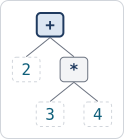

Oben, an der **Wurzel**, steht der Operator, der **zuletzt** berechnet wird: `+`. Seine beiden Teile hängen darunter – links `2`, rechts der Teilbaum für `3 * 4`. Unten stehen die Werte; sie heissen **Blätter**. Ausgerechnet wird von unten nach oben.

    {{1}}
<div>

---

**Beispiel:** Mit Klammern sieht der Baum anders aus. Zu `(2 + 3) * 4` gehört dieser Baum:

<!-- data-baum="['*', ['+', 2, 3], 4] – markiert: Wurzel" -->
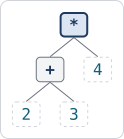

Hier wird `*` zuletzt berechnet, also steht `*` oben. Die Klammern selbst kommen im Baum nicht vor: Was sie bedeuten, steckt in der Form des Baums.

</div>

    {{2}}
---

    {{2}}
✏️ **Kurzauftrag (2′):** Welcher Ausdrucksbaum gehört zu `7 - 2 * 3`? Überlegen Sie zuerst, welcher Operator zuletzt berechnet wird.

    {{2}}
<div>

- [(X)] <!-- data-baum="['-', 7, ['*', 2, 3]]" -->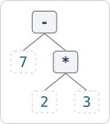
- [( )] <!-- data-baum="['*', ['-', 7, 2], 3]" -->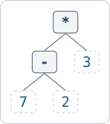
- [( )] <!-- data-baum="['-', ['*', 2, 3], 7]" -->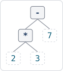
**************************************************

`*` hat Vorrang, also wird `-` zuletzt berechnet und steht oben. Der zweite Baum rechnet von links nach rechts – das wäre `(7 - 2) * 3`. Im dritten sind links und rechts vertauscht: Er rechnet `2 * 3 - 7`, und das gibt `-1` statt `1`.

**************************************************

</div>

    {{3}}
<div>

---

In unserer Implementierung stellt `parse` einen Ausdrucksbaum als verschachtelte Python-Liste dar: zuerst der Operator, dann der linke und der rechte Teil.

```text
[Operator, links, rechts]
```

| Ausdruck | Ausdrucksbaum als Liste |
|---|---|
| `2 + 3` | `['+', 2, 3]` |
| `2 + 3 * 4` | `['+', 2, ['*', 3, 4]]` |
| `(2 + 3) * 4` | `['*', ['+', 2, 3], 4]` |

Ein Teil, der selbst eine Rechnung ist, wird eine Liste in der Liste. Ein Wert allein, zum Beispiel `7`, ist auch ein Ausdrucksbaum – ein einzelnes Blatt.

</div>

### 🎓 Der Ausdrucksbaum in Python

Die Übersetzung vom Ausdruck zum Ausdrucksbaum übernimmt eine gegebene Funktion: `parse(text)` aus der Bibliothek `parser.py`. Sie müssen nicht wissen, wie sie das macht – wie bei `zeugnis_note` in Etappe 2 genügt, was ihr Docstring sagt. Wir führen den Codeblock aus und rufen `parse` in der REPL auf: `parse("2 + 3 * 4")`. Neben dem Ergebnis erscheint «Baum» – damit zeigt glpython die Liste auch als Baum.

```python
from parser import parse
```
@Code.auswerter

    {{1}}
<div>

---

`parse` gibt den Ausdrucksbaum als Liste zurück – also gilt alles, was Sie aus Etappe 3 über Listen wissen. Geben wir dem Baum von `2 + 3 * 4` einen Namen:

```python
baum = parse("2 + 3 * 4")
```

Dann steht in `baum` die Liste `['+', 2, ['*', 3, 4]]`. An Adresse 0 steht der Operator:

```text
>>> baum[0]
'+'
>>> baum[2]
['*', 3, 4]
```

✏️ **Kurzauftrag (1′):** Was ergibt `baum[1]`?

- [(X)] `2`
- [( )] `'+'`
- [( )] `['*', 3, 4]`
**************************************************

An Adresse 1 steht der linke Teil: `2`. Der Operator steht an Adresse **0**.

**************************************************

</div>

    {{2}}
<div>

---

Auch Python selbst rechnet einen Ausdruck so aus, wie Ihr Programm das machen wird: von unten nach oben im Baum. Der Visualizer zeigt das mit der Option «Ausdrücke als Bäume auswerten» – jeder Schritt macht aus einem Teilbaum seinen Wert:

```python
x = 2 + 3 * 4
```
@Code.auswerter.demo(tree)

Die Schritte sind dieselben wie in der Kette `2 + 3 * 4  →  2 + 12  →  14`.

</div>

### 🎓 Ein Auswerter für flache Bäume

Diese vier Funktionen sind das Gerüst Ihres Auswerters: Alles, was Sie in dieser Etappe bauen, wächst daraus. Er rechnet **flache** Bäume aus – ein Operator mit zwei Werten, kein Teil ist selbst eine Rechnung, zum Beispiel `['+', 1, 2]`.

| Funktion | bekommt | gibt zurück |
|---|---|---|
| `berechnen(text)` | Text | Wert |
| `auswerten(baum)` | Baum | Wert |
| `operator_anwenden(op, x, y)` | Operator und zwei Werte | Wert |
| `ist_ausgewertet(baum)` | Baum | `True`/`False` |

- `berechnen` setzt alles zusammen: zuerst `parse`, dann `auswerten`.
- `auswerten` gibt einen Wert zurück, wie er ist; einen Baum gibt es mit seinen drei Teilen an `operator_anwenden` weiter.
- `operator_anwenden` kennt bisher nur `+`. Das ist **die zentrale Funktion dieser Etappe**: Wenn Sie sie erweitern, besteht Ihr Auswerter alle Tests dieser Etappe.
- `ist_ausgewertet`: Alles, was keine Liste ist, ist schon ein Wert – wie in Etappe 1 «ausgewertet» und «nicht ausgewertet». `ist_liste` kommt aus `parser.py`.

Wir verfolgen den Aufruf `berechnen("1 + 2")` im Visualizer, im Modus «Kasten»:

```python
from parser import parse, ist_liste

def ist_ausgewertet(baum):
    if ist_liste(baum):
        return False
    else:
        return True

def operator_anwenden(op, x, y):
    if op == "+":
        return x + y

def auswerten(baum):
    if ist_ausgewertet(baum):
        return baum
    return operator_anwenden(baum[0], baum[1], baum[2])

def berechnen(text):
    return auswerten(parse(text))

berechnen("1 + 2")
```
@Code.auswerter.demo(box)

    {{1}}
---

    {{1}}
✏️ **Kurzauftrag (2′):** Beim Aufruf `berechnen("1 + 2")` rechnet Python nicht zuerst `1 + 2` aus, obwohl Argumente zuerst ausgewertet werden. Warum?

    {{1}}
<div>

- [( )] `berechnen` hält sich nicht an die Reihenfolge von Python.
- [(X)] `"1 + 2"` ist schon ausgewertet.
- [( )] Python rechnet `1 + 2` erst aus, wenn `parse` den Text braucht.
- [( )] Python rechnet `1 + 2` schon aus, der Visualizer zeigt diesen Schritt nur nicht.
**************************************************

Die Anführungszeichen machen `"1 + 2"` zu einem Text, und ein Text ist ein Wert – wie `3` oder `['+', 1, 2]`. Das Argument ist also schon ausgewertet; «Argumente zuerst» hat hier nichts zu tun. Für Python ist das `+` darin nur ein Zeichen. Was es bedeutet, findet erst `parse` heraus, und ausgerechnet wird es in `operator_anwenden`.

**************************************************

</div>

### 🎓 Was der Auswerter noch nicht kann

Was gibt das Gerüst bei `operator_anwenden('*', 3, 4)` zurück? Wir schreiben ein Beispiel in den Docstring und drücken «Tests»:

```python
from parser import parse, ist_liste

def operator_anwenden(op, x, y):
    """
    Gibt das Ergebnis des Operators op für die Werte x und y zurück.

    >>> operator_anwenden('+', 2, 3)
    5
    >>> operator_anwenden('*', 3, 4)
    12
    """
    if op == "+":
        return x + y
```
@Code.auswerter

«Got nothing»: Für `*` gibt es in `operator_anwenden` keine passende `if`-Zeile. Die Funktion läuft bis zum Ende ohne `return` und gibt `None` zurück – wie eine Funktion, die ihr Ergebnis nur mit `print` anzeigt.

@Fehler.Doctest

    {{1}}
<div>

---

✏️ **Kurzauftrag (2′):** Angenommen, der Auswerter kann `+` und `*`. Was passiert bei `berechnen("2 + 3 * 4")`?

- [( )] `14`
- [( )] `None`
- [(X)] eine Fehlermeldung
**************************************************

`parse` liefert `['+', 2, ['*', 3, 4]]`. `auswerten` gibt die drei Teile direkt an `operator_anwenden` weiter, also rechnet Python `2 + ['*', 3, 4]` – eine Zahl plus eine Liste:

```text
>>> berechnen("2 + 3 * 4")
TypeError: unsupported operand type(s) for +: 'int' and 'list'
```

@Fehler.ListeStattZahl

**************************************************

</div>

    {{2}}
---

    {{2}}
Ihr Auswerter kann bisher nur **flache** Bäume – ein Operator mit zwei Werten. Was er braucht, damit auch `['*', 3, 4]` zuerst zu einem Wert wird, sehen wir in Etappe 6.

### 🎓 Ab hier arbeiten Sie selbständig weiter

**Ab hier arbeiten Sie selbständig weiter.** Der Lernweg beginnt mit Aufgabe 1. Aufgaben mit 📌 geben Sie ab. Abgegeben wird ein benannter Link auf der OneNote-Seite «1201» im Abschnitt «1200 - Funktionen», in der Zeile der Etappe.

So gehen Sie vor:

1. **Übersetzen:** Ausdruck → Ausdrucksbaum und zurück, zuerst von Hand, dann mit `parse` prüfen.
2. **Von Hand auswerten:** Was macht der Auswerter mit einem flachen Baum, Schritt für Schritt?
3. **Erweitern:** In Aufgabe 4 arbeiten Sie in der glpython-IDE – mit Ihrer eigenen Datei `auswerter.py` und der Bibliothek `parser.py`.

---

**Die IDE:** Wir öffnen das Projekt von Aufgabe 4, schauen die drei Tabs `aufgabe.md`, `auswerter.py` und `parser.py` an und drücken «Tests». Die Anleitung steht im Tab `aufgabe.md`, der beim Öffnen offen ist. Abgegeben wird mit «Teilen»: Es kopiert einen Link auf Ihren Stand. Denselben Link brauchen Sie auch, wenn Sie noch nicht fertig sind: Die IDE merkt sich Ihre Arbeit nur in diesem Browser.

[Gerüst in der IDE öffnen](https://glpython-edu.github.io/?p=rZZdbts4EMevMiCwSFJTUmzH7UJAAwTYti8L9KVAH6KgoKyxTZgaCfyI4wQB9g57hR4jb7nJnmRBfVhy5DhdYO0Hy8MfZ4b_GZJ6YLcsnnBGIkcWs09WlCXCRQxXzmxQW9SMs1xI-iyVB0RrDsst46wosRtZLEWKYZ4xzhYorNNoWHzNtCPGmcZSMc5upXFCyXtknFk01jDO5sUtarH0JiWNtRqrUf9zw9lCKu_noR8gfmClsKuXUZ1WLGYra0sTR5EWm3Ap7cqlzqCeF2SRbDgv8mipyq1dFRRg5qKFo7WVBSFFfp1RLixqKZSJzi8C4UymHc7XGAhlAp8eUoDaWNTBTotIGIPWRHvJaBTZV1JbFlvt8JHvS9dfwZ6iSqSohua1pIzFrM670izzoif1l76gfn4yFjI0XeUMLJ6fNGQSvS3Tbr42ptRivsIwoYSunFkKWprSK1CzXf3_QN15grUgghQ1SmtAZJlEjcRBpKiBnE5oobzbLk76_NPlCP_89TegJPhaoha20JBLC_cblPDdO6YQvqO0qHFHICW0QZ0hAerl80-6txxSaUAohfDNtwykaCyukPwqGgESWugih1JogxpkXhba1v84SGN_VJXzWEIZLiqTcGaJ1frsaSpcfhYnBADQuvTPX2Rq4Zt2CPdOPz_N1xw26KUQLgczXxUEPTfebQxXSqHhsBEG1igJ4U8f249VqVR6-NVXNfBBLi8vBwlNz-oxH_t1KhiHs18Cr09GJxzGHCY3Df9ZKPMrE-qHCYfpzYGpfa3kolN6T1D_0Widpv5UVAaHQL2MtkxF0xQ_BG2QMqTTouRwx2H7arEyYeCTXmJK0lTboW0sA0XZbYiq_eAOHGWwbYu7V5Fh7J0SjQ6zN-FgzGHc0Odv0uNwxmHS4NPwuPvghMOHDj8OvzvhMOVw0cDjyVE62nf9VibRS_4o_ds-PD6e97t9xX8_2HVFCR8_QsJGCRs21B2MYDtAgwNo13bt2UvHzwV_Rvk-ak_d5uQTLjf1AXGorTrfs2HpusHhhp2-uuNeO8h6KnhzbWwMQ7E9cn1-wyv2etw-VPFbYfwNMF8R0qnFO_sfhQE_56AmnduEzRI21KUPjGEEkx00PQxNwhmM4GKHvW97uJ9rI0UnenVf1Es7S4g9clbfJ_sXdmf7_984znsvFf04L14mHh__BQ)

---

> [!NOTE] KI: Velo oder E-Trottinett?
> Eine KI kann Ihr eigenes Denken verstärken wie ein **Velo** – Sie treten selbst in die Pedale und werden dabei fitter. Oder sie nimmt Ihnen das Denken ab wie ein **E-Trottinett** – Sie kommen auch ans Ziel, aber Ihr Muskel wächst nicht. In der Prüfung gibt es keine KI: Dort zählt Ihr eigener Muskel.
>
> **Velo in dieser Etappe:** sich Ausdrücke zum Üben vorschlagen lassen, sie selbst übersetzen und mit `parse` prüfen · sich erklären lassen, warum ein Operator oben im Baum steht, nachdem Sie es selbst überlegt haben · eine Meldung mit `'int' and 'list'` erklären lassen, nachdem Sie sie selbst gelesen haben.
>
> **E-Trottinett in dieser Etappe:** die Übersetzungen erzeugen lassen und übernehmen · `operator_anwenden` schreiben lassen.
>
> Wenn Sie eine KI benutzen: Copilot mit Ihrem Schulkonto – kostenlos für alle. Prüfen Sie, was sie sagt, mit `parse`: Auch eine KI kann sich bei einem Baum irren.

Dasselbe gilt für die Lösungen zum Aufklappen: Wer sie vor einem ernsthaften eigenen Versuch liest, fährt E-Trottinett. Niemand kontrolliert das – Sie betrügen damit nur sich selbst, und in der Prüfung gibt es nichts zum Aufklappen.

## Arbeitsphase

Fünf Aufgaben. Sie beginnen im Unterricht und arbeiten zuhause weiter.

| Aufgabe | Worum es geht |
|---|---|
| 1 | Vom Ausdruck zum Ausdrucksbaum |
| 2 | Vom Ausdrucksbaum zum Ausdruck |
| 3 | Den Auswerter von Hand auswerten |
| 4 | Weitere Operatoren 📌 |
| 5 | Wer liegt falsch? |

### Aufgabe 1: Vom Ausdruck zum Ausdrucksbaum

Das Ziel dieser Aufgabe ist es, einen Ausdruck sicher in seinen Ausdrucksbaum zu übersetzen.

Überlegen Sie bei jedem Ausdruck zuerst, welcher Operator **zuletzt** berechnet wird – er steht oben. Wählen Sie bei den ersten beiden Ausdrücken zuerst den Baum, dann die Liste.

`2 * 3 + 4`

- [(X)] <!-- data-baum="['+', ['*', 2, 3], 4]" -->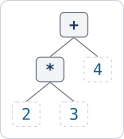
- [( )] <!-- data-baum="['*', 2, ['+', 3, 4]]" -->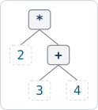
- [( )] <!-- data-baum="['+', 4, ['*', 2, 3]]" -->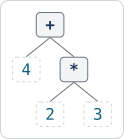
**************************************************

`*` hat Vorrang, `+` wird zuletzt berechnet und steht oben. Der zweite Baum gehört zu `2 * (3 + 4)`. Der dritte hat denselben Wert, aber links und rechts vertauscht – er gehört zu `4 + 2 * 3`. Ein Baum hält die Reihenfolge fest, in der die Teile stehen.

**************************************************

Was ist `2 * 3 + 4` als Liste?

- [( )] `['*', 2, ['+', 3, 4]]`
- [( )] `['+', 4, ['*', 2, 3]]`
- [(X)] `['+', ['*', 2, 3], 4]`
**************************************************

Zuerst der Operator an der Wurzel, `'+'`, dann der linke Teil – der Teilbaum `['*', 2, 3]` – und zuletzt der rechte, `4`: `['+', ['*', 2, 3], 4]`.

**************************************************

`(8 - 2) * 3`

- [( )] <!-- data-baum="['-', 8, ['*', 2, 3]]" -->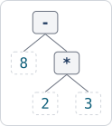
- [(X)] <!-- data-baum="['*', ['-', 8, 2], 3]" -->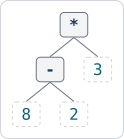
- [( )] <!-- data-baum="['*', 3, ['-', 8, 2]]" -->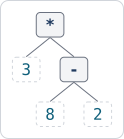
**************************************************

Die Klammern sagen: zuerst `8 - 2`. Also wird `*` zuletzt berechnet und steht oben. Der erste Baum übersieht die Klammern – er gehört zu `8 - 2 * 3` und ergibt `2` statt `18`.

**************************************************

Was ist `(8 - 2) * 3` als Liste?

- [( )] `['*', 3, ['-', 8, 2]]`
- [(X)] `['*', ['-', 8, 2], 3]`
- [( )] `['-', 8, ['*', 2, 3]]`
**************************************************

Oben steht `'*'`, links der Teilbaum für `8 - 2`, rechts `3`: `['*', ['-', 8, 2], 3]`.

**************************************************

Bei den nächsten beiden Ausdrücken wählen Sie die Liste direkt.

`2 * 3 ** 2`

- [(X)] `['*', 2, ['**', 3, 2]]`
- [( )] `['*', ['**', 3, 2], 2]`
- [( )] `['**', ['*', 2, 3], 2]`
**************************************************

`**` hat Vorrang vor `*`: zuerst `3 ** 2`, dann `2 * 9`. Oben steht also `*`, rechts der Teilbaum für `3 ** 2`: `['*', 2, ['**', 3, 2]]`. In der zweiten Liste sind links und rechts vertauscht – sie gehört zu `3 ** 2 * 2`. Die dritte rechnet von links nach rechts: `(2 * 3) ** 2` ergibt `36` statt `18`.

<!-- data-baum="['*', 2, ['**', 3, 2]]" -->
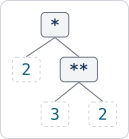

**************************************************

`10 - 4 - 3`

- [( )] `['-', 3, ['-', 10, 4]]`
- [(X)] `['-', ['-', 10, 4], 3]`
- [( )] `['-', 10, ['-', 4, 3]]`
**************************************************

Gleiche Operatoren rechnet Python von links nach rechts: zuerst `10 - 4`, dann `6 - 3`. Das zweite `-` wird zuletzt berechnet und steht oben, mit `10 - 4` als linkem Teil: `['-', ['-', 10, 4], 3]`. Die dritte Liste rechnet `10 - (4 - 3)` und ergibt `9` statt `3`. In der ersten sind links und rechts vertauscht – sie gehört zu `3 - (10 - 4)`.

<!-- data-baum="['-', ['-', 10, 4], 3]" -->
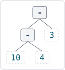

**************************************************

Schreiben Sie jetzt die Liste selbst. Leerzeichen spielen keine Rolle, und Sie können `'` oder `"` verwenden.

`(2 + 3) * (4 - 1)`

[[ ['*', ['+', 2, 3], ['-', 4, 1] ] ]]
<script>
let eingabe = `@input`.replace(/\s/g, "").replace(/[‘’‚‹›]/g, "'").replace(/[“”„«»]/g, '"').replace(/"([^"']*)"/g, "'$1'")
let hinweis = ""
if (eingabe.split("[").length !== eingabe.split("]").length) hinweis = "Prüfen Sie die eckigen Klammern: Zu jeder [ gehört eine ]."
setTimeout(() => hinweis ? send.lia(hinweis, [], false) : send.lia(String(eingabe === "['*',['+',2,3],['-',4,1]]")), 0)
"LIA: wait"
</script>
**************************************************

Beide Klammern werden zuerst berechnet, `*` zuletzt – es steht oben, mit einem Teilbaum auf jeder Seite:

`['*', ['+', 2, 3], ['-', 4, 1]]`

<!-- data-baum="['*', ['+', 2, 3], ['-', 4, 1]]" -->
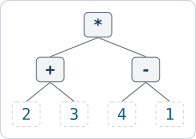

**************************************************

`1 + 2 * 3 - 4`

[[ ['-', ['+', 1, ['*', 2, 3] ], 4] ]]
<script>
let eingabe = `@input`.replace(/\s/g, "").replace(/[‘’‚‹›]/g, "'").replace(/[“”„«»]/g, '"').replace(/"([^"']*)"/g, "'$1'")
let hinweis = ""
if (eingabe.split("[").length !== eingabe.split("]").length) hinweis = "Prüfen Sie die eckigen Klammern: Zu jeder [ gehört eine ]."
setTimeout(() => hinweis ? send.lia(hinweis, [], false) : send.lia(String(eingabe === "['-',['+',1,['*',2,3]],4]")), 0)
"LIA: wait"
</script>
**************************************************

`*` hat Vorrang: `2 * 3` ist ein Teilbaum. Danach kommen `+` und `-` von links nach rechts – `-` wird zuletzt berechnet und steht oben. Sein linker Teil ist `1 + 2 * 3`, sein rechter `4`: `['-', ['+', 1, ['*', 2, 3]], 4]`.

<!-- data-baum="['-', ['+', 1, ['*', 2, 3]], 4]" -->
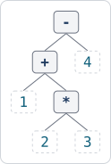

**************************************************

Prüfen Sie Ihre Übersetzungen jetzt mit Python. Führen Sie den Codeblock aus und rufen Sie in der REPL `parse` auf, zum Beispiel `parse("2 * 3 + 4")`. Mit «Baum» neben dem Ergebnis sehen Sie den Baum.

```python
from parser import parse
```
@Code.auswerter

### Aufgabe 2: Vom Ausdrucksbaum zum Ausdruck

Das Ziel dieser Aufgabe ist es, einen Ausdrucksbaum zurück in einen Python-Ausdruck zu übersetzen – mit Klammern genau dort, wo sie nötig sind.

Schreiben Sie zu jedem Baum den Ausdruck. Klammern brauchen Sie nur, wo ohne sie etwas anderes berechnet würde. Leerzeichen spielen keine Rolle.

<!-- data-baum="['*', ['+', 1, 2], 3]" -->
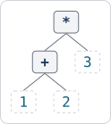

`['*', ['+', 1, 2], 3]`

[[ (1 + 2) * 3 ]]
<script>
let eingabe = `@input`.replace(/\s/g, "")
let hinweis = ""
if (["((1+2))*3", "((1+2)*3)"].includes(eingabe)) hinweis = "Richtig gerechnet, aber mit überflüssigen Klammern. Nötig sind nur die Klammern um 1 + 2."
setTimeout(() => hinweis ? send.lia(hinweis, [], false) : send.lia(String(eingabe === "(1+2)*3")), 0)
"LIA: wait"
</script>
**************************************************

`(1 + 2) * 3` – ohne Klammern würde `1 + 2 * 3` zuerst `2 * 3` rechnen.

**************************************************

<!-- data-baum="['-', 10, ['-', 4, 3]]" -->
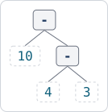

`['-', 10, ['-', 4, 3]]`

[[ 10 - (4 - 3) ]]
<script>
let eingabe = `@input`.replace(/\s/g, "")
let hinweis = ""
if (["10-((4-3))", "(10-(4-3))"].includes(eingabe)) hinweis = "Richtig gerechnet, aber mit überflüssigen Klammern. Nötig sind nur die Klammern um 4 - 3."
setTimeout(() => hinweis ? send.lia(hinweis, [], false) : send.lia(String(eingabe === "10-(4-3)")), 0)
"LIA: wait"
</script>
**************************************************

`10 - (4 - 3)` – ohne Klammern rechnet Python von links nach rechts: `10 - 4 - 3` gehört zum Baum `['-', ['-', 10, 4], 3]` aus Aufgabe 1.

**************************************************

Beim letzten Ausdrucksbaum sehen Sie nur die Liste.

`['+', 1, ['*', 2, 3]]`

[[ 1 + 2 * 3 ]]
<script>
let eingabe = `@input`.replace(/\s/g, "")
let hinweis = ""
if (["1+(2*3)", "(1+(2*3))", "1+((2*3))"].includes(eingabe)) hinweis = "Richtig gerechnet, aber die Klammern um 2 * 3 sind überflüssig: * hat ohnehin Vorrang vor +."
if (eingabe === "(1+2*3)") hinweis = "Richtig gerechnet, aber die Klammern um den ganzen Ausdruck sind überflüssig."
setTimeout(() => hinweis ? send.lia(hinweis, [], false) : send.lia(String(eingabe === "1+2*3")), 0)
"LIA: wait"
</script>
**************************************************

`1 + 2 * 3` – hier braucht es keine Klammern, weil `*` ohnehin Vorrang hat. `1 + (2 * 3)` rechnet dasselbe, die Klammern sind aber überflüssig.

**************************************************

Prüfen Sie Ihre Ausdrücke mit Python: `parse` muss genau den gegebenen Baum zurückgeben. Mit `==` vergleicht Python zwei Listen – tippen Sie in der REPL zum Beispiel `parse("(1 + 2) * 3") == ['*', ['+', 1, 2], 3]`. Ergibt das `True`, stimmt Ihr Ausdruck.

```python
from parser import parse
```
@Code.auswerter

### Aufgabe 3: Den Auswerter von Hand auswerten

Das Ziel dieser Aufgabe ist es, Schritt für Schritt vorherzusagen, was der Auswerter mit einem flachen Baum macht.

Werten Sie jeden Ausdruck von Hand aus.

<details open>
<summary>Code: <code>ist_ausgewertet</code></summary>

```python
def ist_ausgewertet(baum):
    if ist_liste(baum):
        return False
    else:
        return True
```

`ist_liste(x)` aus `parser.py` gibt `True` zurück, wenn `x` eine Liste ist.

</details>

`ist_ausgewertet(7)`

- [(X)] `True`
- [( )] `False`
**************************************************

`7` ist keine Liste, also schon ein Wert: `ist_liste(7)` ist `False`, und `ist_ausgewertet` gibt `True` zurück.

**************************************************

`ist_ausgewertet(['+', 4, 5])`

- [( )] `True`
- [(X)] `False`
**************************************************

`['+', 4, 5]` ist eine Liste – ein Baum, der noch ausgerechnet werden muss.

**************************************************

<details open>
<summary>Code: <code>ist_ausgewertet</code>, <code>operator_anwenden</code>, <code>auswerten</code></summary>

```python
def ist_ausgewertet(baum):
    if ist_liste(baum):
        return False
    else:
        return True

def operator_anwenden(op, x, y):
    if op == "+":
        return x + y

def auswerten(baum):
    if ist_ausgewertet(baum):
        return baum
    return operator_anwenden(baum[0], baum[1], baum[2])
```

| Funktion | bekommt | gibt zurück |
|---|---|---|
| `auswerten(baum)` | Baum | Wert |
| `operator_anwenden(op, x, y)` | Operator und zwei Werte | Wert |
| `ist_ausgewertet(baum)` | Baum | `True`/`False` |

</details>

`auswerten(['+', 4, 5])`

```text
auswerten(['+', 4, 5])
-> 
```
@Notiz

Welcher Ausdruck steht nach dem **zweiten** Schritt?

- [(X)] `operator_anwenden('+', ['+', 4, 5][1], ['+', 4, 5][2])`
- [( )] `operator_anwenden(0, ['+', 4, 5][1], ['+', 4, 5][2])`
- [( )] `operator_anwenden('+', 4, 5)`
**************************************************

Der erste Schritt ersetzt den Aufruf durch den Ausdruck nach dem `return`, das ausgeführt wird – mit der Liste an der Stelle von `baum`. Der zweite wertet das erste Argument aus: `['+', 4, 5][0]` ist der **Wert** an Adresse 0, also `'+'` – nicht die Adresse `0`. Und jeder Index ist ein eigener Schritt, deshalb steht `operator_anwenden('+', 4, 5)` erst zwei Schritte später.

**************************************************

Welchen Wert hat `auswerten(['+', 4, 5])`?

[[9]]
**************************************************

```text
auswerten(['+', 4, 5])
→ operator_anwenden(['+', 4, 5][0], ['+', 4, 5][1], ['+', 4, 5][2])   # ist_ausgewertet ist False
→ operator_anwenden('+', ['+', 4, 5][1], ['+', 4, 5][2])
→ operator_anwenden('+', 4, ['+', 4, 5][2])
→ operator_anwenden('+', 4, 5)
→ 4 + 5                                                               # op == "+" ist True
→ 9
```

Vergleichen Sie Ihre Kette Schritt für Schritt mit dem Visualizer – **›** geht einen Schritt weiter, **‹** einen zurück. Im Kasten steht `baum[0]` statt `['+', 4, 5][0]`; die Schritte sind dieselben.

```python
from parser import ist_liste

def ist_ausgewertet(baum):
    if ist_liste(baum):
        return False
    else:
        return True

def operator_anwenden(op, x, y):
    if op == "+":
        return x + y

def auswerten(baum):
    if ist_ausgewertet(baum):
        return baum
    return operator_anwenden(baum[0], baum[1], baum[2])

auswerten(['+', 4, 5])
```
@Code.auswerter.anschauen

**************************************************

<details open>
<summary>Code: <code>berechnen</code></summary>

```python
def berechnen(text):
    return auswerten(parse(text))
```

`parse` aus `parser.py` gibt den Ausdrucksbaum zu einem Ausdruck als Text zurück.

</details>

Welchen Wert hat `berechnen("4 + 5")`?

[[9]]
**************************************************

`parse("4 + 5")` gibt `['+', 4, 5]` zurück – und damit geht es weiter wie oben: `berechnen("4 + 5") → auswerten(parse("4 + 5")) → auswerten(['+', 4, 5]) → … → 9`.

**************************************************

### Aufgabe 4: Weitere Operatoren 📌

Das Ziel dieser Aufgabe ist es, den Auswerter um alle Rechenoperatoren zu erweitern: `-`, `*`, `/`, `//`, `%` und `**`.

Sie arbeiten in der glpython-IDE. Die Anleitung steht im Projekt selbst, im Tab `aufgabe.md` – er ist offen, wenn Sie das Projekt öffnen, und erklärt auch die beiden anderen Tabs.

[Gerüst in der IDE öffnen](https://glpython-edu.github.io/?p=rZZdbts4EMevMiCwSFJTUmzH7UJAAwTYti8L9KVAH6KgoKyxTZgaCfyI4wQB9g57hR4jb7nJnmRBfVhy5DhdYO0Hy8MfZ4b_GZJ6YLcsnnBGIkcWs09WlCXCRQxXzmxQW9SMs1xI-iyVB0RrDsst46wosRtZLEWKYZ4xzhYorNNoWHzNtCPGmcZSMc5upXFCyXtknFk01jDO5sUtarH0JiWNtRqrUf9zw9lCKu_noR8gfmClsKuXUZ1WLGYra0sTR5EWm3Ap7cqlzqCeF2SRbDgv8mipyq1dFRRg5qKFo7WVBSFFfp1RLixqKZSJzi8C4UymHc7XGAhlAp8eUoDaWNTBTotIGIPWRHvJaBTZV1JbFlvt8JHvS9dfwZ6iSqSohua1pIzFrM670izzoif1l76gfn4yFjI0XeUMLJ6fNGQSvS3Tbr42ptRivsIwoYSunFkKWprSK1CzXf3_QN15grUgghQ1SmtAZJlEjcRBpKiBnE5oobzbLk76_NPlCP_89TegJPhaoha20JBLC_cblPDdO6YQvqO0qHFHICW0QZ0hAerl80-6txxSaUAohfDNtwykaCyukPwqGgESWugih1JogxpkXhba1v84SGN_VJXzWEIZLiqTcGaJ1frsaSpcfhYnBADQuvTPX2Rq4Zt2CPdOPz_N1xw26KUQLgczXxUEPTfebQxXSqHhsBEG1igJ4U8f249VqVR6-NVXNfBBLi8vBwlNz-oxH_t1KhiHs18Cr09GJxzGHCY3Df9ZKPMrE-qHCYfpzYGpfa3kolN6T1D_0Widpv5UVAaHQL2MtkxF0xQ_BG2QMqTTouRwx2H7arEyYeCTXmJK0lTboW0sA0XZbYiq_eAOHGWwbYu7V5Fh7J0SjQ6zN-FgzGHc0Odv0uNwxmHS4NPwuPvghMOHDj8OvzvhMOVw0cDjyVE62nf9VibRS_4o_ds-PD6e97t9xX8_2HVFCR8_QsJGCRs21B2MYDtAgwNo13bt2UvHzwV_Rvk-ak_d5uQTLjf1AXGorTrfs2HpusHhhp2-uuNeO8h6KnhzbWwMQ7E9cn1-wyv2etw-VPFbYfwNMF8R0qnFO_sfhQE_56AmnduEzRI21KUPjGEEkx00PQxNwhmM4GKHvW97uJ9rI0UnenVf1Es7S4g9clbfJ_sXdmf7_984znsvFf04L14mHh__BQ)

<details>
<summary>Tipp: Was heisst «Got nothing»?</summary>

@Fehler.Doctest

</details>

> [!NOTE] Noch nicht fertig?
> Die IDE merkt sich Ihre Arbeit nur in diesem Browser – auf einem anderen Gerät oder nach einiger Zeit ist sie nicht mehr da. Drücken Sie deshalb am Ende jeder Lektion «Teilen» und speichern Sie den Link in Ihren eigenen Notizen in OneNote (nicht in der Zeile für die Abgabe). In der nächsten Lektion öffnen Sie die IDE über diesen Link.

> [!IMPORTANT] 📌 Abgabe
> Wenn alle Tests bestehen: Drücken Sie in der IDE «Teilen» – das kopiert einen Link auf Ihren Stand. Fügen Sie den Link auf der OneNote-Seite «1201» im Abschnitt «1200 - Funktionen» in der Zeile «Etappe 4» ein – mit dem Namen «Aufgabe 4» (Namen schreiben und markieren, dann ⌘K bzw. Ctrl+K).

<details>
<summary>Eine mögliche Lösung</summary>

```python
def operator_anwenden(op, x, y):
    if op == "+":
        return x + y
    if op == "-":
        return x - y
    if op == "*":
        return x * y
    if op == "/":
        return x / y
    if op == "//":
        return x // y
    if op == "%":
        return x % y
    if op == "**":
        return x ** y
```

Die Reihenfolge der `if`-Zeilen spielt keine Rolle: Höchstens eine passt zum Operator. Bei `-`, `/`, `//`, `%` und `**` zählt dagegen die Reihenfolge von `x` und `y` – `y - x` würde bei `operator_anwenden('-', 7, 2)` `-5` geben. Beispiele für `berechnen`: `berechnen("9 - 4")` gibt `5`, `berechnen("7 / 2")` gibt `3.5`.

</details>

### Aufgabe 5: Wer liegt falsch?

Das Ziel dieser Aufgabe ist es, bei einem scheiternden Test des Auswerters zu entscheiden, ob die Funktion oder das Beispiel falsch ist.

Ein scheiternder Test sagt nur: Funktion und Beispiel passen nicht zusammen. Prüfen Sie zuerst das Beispiel – stimmt es, wenn Sie es von Hand ausrechnen?

Drücken Sie «Tests» und lesen Sie die Meldung:

```python
def operator_anwenden(op, x, y):
    """
    Gibt das Ergebnis des Operators op für die Werte x und y zurück.

    >>> operator_anwenden('-', 9, 4)
    5
    >>> operator_anwenden('*', 9, 4)
    36
    """
    if op == "-":
        return y - x
    if op == "*":
        return x * y
```
@Code.rezept3

Wer liegt falsch?

- [(X)] Die Funktion
- [( )] Das Beispiel
**************************************************

`9 - 4` ist `5` – das Beispiel stimmt. Die Funktion rechnet `y - x`, also `4 - 9`, und gibt `-5` zurück. Bei `*` fällt die Vertauschung nicht auf, weil `9 * 4` und `4 * 9` gleich sind – deshalb braucht jeder Operator sein eigenes Beispiel.

**************************************************

Und hier? Drücken Sie wieder «Tests»:

```python
def operator_anwenden(op, x, y):
    """
    Gibt das Ergebnis des Operators op für die Werte x und y zurück.

    >>> operator_anwenden('//', 9, 4)
    2.25
    >>> operator_anwenden('%', 9, 4)
    1
    """
    if op == "//":
        return x // y
    if op == "%":
        return x % y
```
@Code.rezept3

Wer liegt falsch?

- [( )] Die Funktion
- [(X)] Das Beispiel
**************************************************

`//` teilt ganzzahlig: `9 // 4` ist `2` – zwei ganze Vierer passen in 9. `2.25` wäre `9 / 4`. Das Beispiel ist falsch, die Funktion stimmt. Korrigieren Sie das Beispiel, nicht den Rumpf.

**************************************************

### 🧩 Knacknuss für Schnelle

`berechnen("2 + 3 * 4")` scheitert, weil das rechte Argument `['*', 3, 4]` noch ein Baum ist. Ändern Sie den Auswerter so, dass er Bäume der **Tiefe 2** ausrechnet – Bäume, deren Teile Werte oder flache Bäume sind –, **ohne** dass `auswerten` sich selbst aufruft – das ist das Thema von Etappe 5; versuchen Sie es zuerst ohne.

Im Input hiess es, Ihr Auswerter bestehe alle Tests dieser Etappe, wenn Sie `operator_anwenden` erweitern. Das war nicht ganz genau: Den zweiten Test unten besteht er nur, wenn Sie auch `auswerten` ändern.

<details>
<summary>Tipp</summary>

Ein flacher Baum ist genau das, was Ihr bisheriges `auswerten` schon kann. Geben Sie ihm einen neuen Namen, zum Beispiel `auswerten_flach`, und schreiben Sie ein neues `auswerten`, das die beiden Teile zuerst mit `auswerten_flach` ausrechnet.

</details>

Hier können Sie Ihre Idee mit Python ausprobieren:

```python
from parser import parse, ist_liste

def ist_ausgewertet(baum):
    if ist_liste(baum):
        return False
    else:
        return True

def operator_anwenden(op, x, y):
    if op == "+":
        return x + y
    if op == "*":
        return x * y

def auswerten(baum):
    """
    Gibt den Wert des Ausdrucksbaums baum zurück.

    >>> auswerten(['+', 1, 2])
    3
    >>> auswerten(['+', 2, ['*', 3, 4]])
    14
    """
    if ist_ausgewertet(baum):
        return baum
    return operator_anwenden(baum[0], baum[1], baum[2])

def berechnen(text):
    return auswerten(parse(text))
```
@Code.auswerter

<details>
<summary>Eine mögliche Lösung</summary>

```python
def auswerten_flach(baum):
    if ist_ausgewertet(baum):
        return baum
    return operator_anwenden(baum[0], baum[1], baum[2])

def auswerten(baum):
    """
    Gibt den Wert des Ausdrucksbaums baum zurück.

    >>> auswerten(['+', 1, 2])
    3
    >>> auswerten(['+', 2, ['*', 3, 4]])
    14
    """
    if ist_ausgewertet(baum):
        return baum
    return operator_anwenden(baum[0], auswerten_flach(baum[1]), auswerten_flach(baum[2]))
```

`auswerten` rechnet zuerst die beiden Teile aus – genau die Regel «Argumente zuerst» aus Etappe 1 –, dann den Operator oben. Und Tiefe 3? Dann bräuchte es eine Funktion `auswerten_tiefe2` für die Teile, für Tiefe 4 noch eine, und so weiter: Für jede Stufe eine neue Funktion, die fast gleich aussieht. Was wäre, wenn `auswerten` die Teile einfach mit sich selbst ausrechnete? Das sehen wir zu Beginn von Etappe 6.

</details>

**Noch eine Frage:** `parse("-(1 + 2)")` gibt `['-', ['+', 1, 2]]` zurück. Was passiert bei `berechnen("-(1 + 2)")` – mit dem Gerüst oder mit Ihrer Lösung für Tiefe 2?

- [( )] `-3`
- [( )] `None` – «Got nothing»
- [(X)] eine Fehlermeldung `IndexError`
- [( )] eine Fehlermeldung `TypeError`
**************************************************

Das `-` vor der Klammer hat nur **einen** Teil: Die Liste hat zwei Einträge statt drei. `auswerten` gibt trotzdem `baum[0]`, `baum[1]` und `baum[2]` an `operator_anwenden` weiter – und eine Adresse 2 gibt es nicht.

@Fehler.IndexError

Ein Operator mit nur einem Teil braucht im Auswerter einen eigenen Fall. Bisher kommen nur Operatoren mit zwei Teilen vor.

**************************************************
