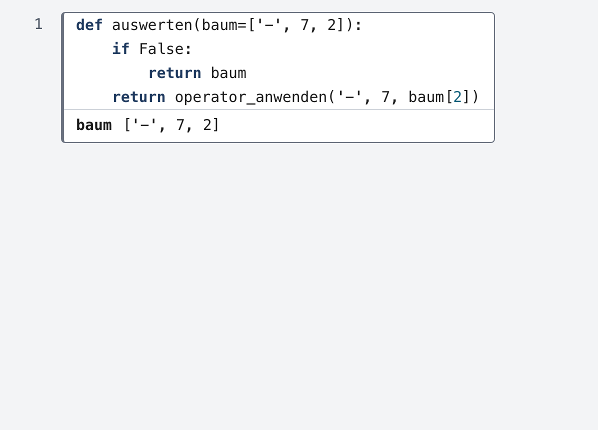
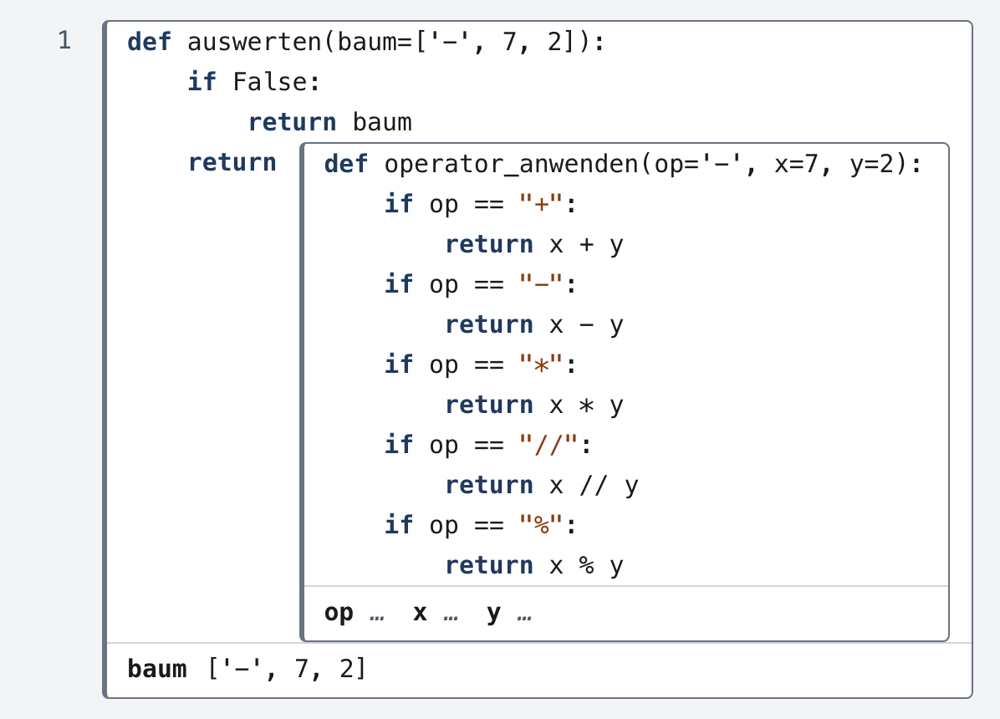
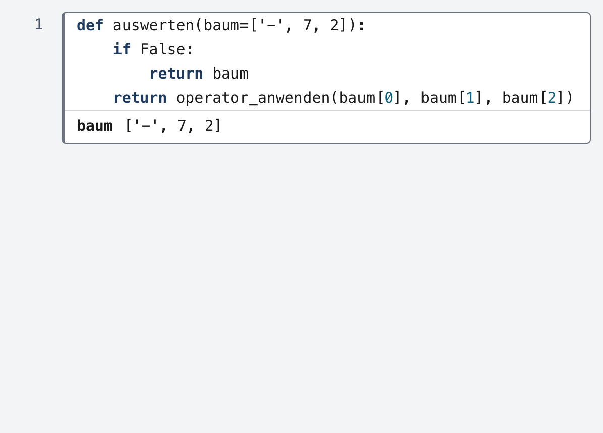
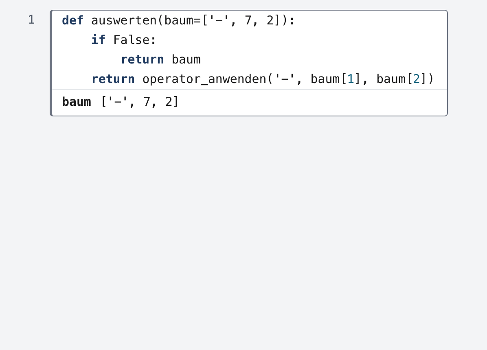
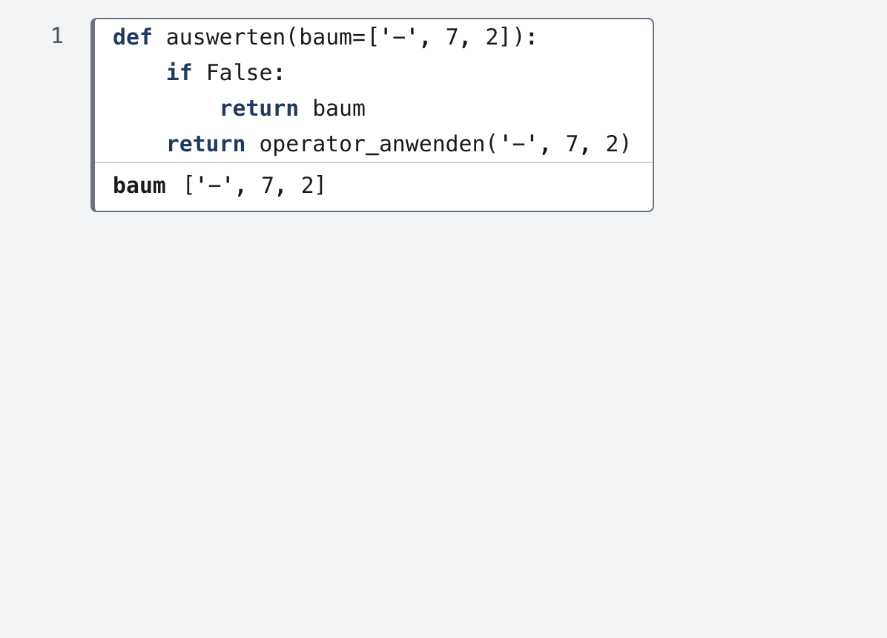

<!--
author:   Cédric Vogel
version:  1.0.0
language: de
narrator: Deutsch Female

comment:  Etappe 6 der Einheit «Funktionen – vom Aufruf zur eigenen Sprache»:
          Konsolidierung und Prüfungsvorbereitung. Variante 6a für die Gruppe
          ohne Etappe 5: setzt Etappen 1–4 voraus, der rekursive Auswerter
          nur als Ausblick. Aufgaben nach Typ, die Lernenden wählen aus.
          Prüfen mit materials/00-vorlage/checkliste.md.

import: https://raw.githubusercontent.com/glpython-edu/glpython-liascript/main/README.md
import: ../00-fehler-lexikon/README.md
import: ../00-makros/README.md

@style
.lia-code--inline {
  background: #F3F4F6;
  color: #1A1A1A;
  border: none;
  border-radius: 3px;
  padding: 0.05em 0.3em;
}
.lia-effect__circle {
  display: none;
}
/* Ein Block: dünner Rahmen um Eingabe (Code, Notizen) und Antwort (glpython, «Notizen speichern») */
.lia-code--block[data-notiz],
.lia-code--block:not([hidden]):has(+ p.lia-paragraph:empty + .glpython-embed) {
  border: 1px solid #D1D5DB; border-bottom: none;
  border-radius: 4px 4px 0 0; margin-bottom: 0; padding: 8px 8px 0;
  background: #FFFFFF;
}
p.lia-paragraph:empty:has(+ .glpython-embed) { display: none; }
.lia-code--block:not([hidden]) + p.lia-paragraph:empty + .glpython-embed {
  border: 1px solid #D1D5DB; border-top: none;
  border-radius: 0 0 4px 4px; margin-bottom: 24px; padding: 0 8px 8px;
}
.notiz-actions {
  border: 1px solid #D1D5DB; border-top: none;
  border-radius: 0 0 4px 4px; margin: 0 0 24px; padding: 4px 8px 8px;
}
/* Verlaufszeile (|< < n > >|) enger an Code und Antwort */
.lia-code--block[data-notiz] .lia-code-control,
.lia-code--block:not([hidden]):has(+ p.lia-paragraph:empty + .glpython-embed) .lia-code-control {
  margin-top: 0; margin-bottom: 0; padding-top: 2px; padding-bottom: 0;
}
/* Buttons links auf derselben Zeile wie die Verlaufszeile rechts, sobald die
   Inhaltsspalte breit genug ist (unabhängig von der Navigation links) */
.lia-slide__content { container-type: inline-size; }
@container (min-width: 580px) {
  .notiz-actions,
  .lia-code--block:not([hidden]) + p.lia-paragraph:empty + .glpython-embed {
    margin-top: -34px; background: transparent; pointer-events: none;
  }
  .notiz-actions button,
  .lia-code--block:not([hidden]) + p.lia-paragraph:empty + .glpython-embed .glp-buttons button,
  .lia-code--block:not([hidden]) + p.lia-paragraph:empty + .glpython-embed iframe,
  .lia-code--block:not([hidden]) + p.lia-paragraph:empty + .glpython-embed .glpython-error,
  .lia-code--block:not([hidden]) + p.lia-paragraph:empty + .glpython-embed .glp-files {
    pointer-events: auto;
  }
}
/* Kontext (z. B. Definitionen einer Aufgabe) bleibt beim Scrollen oben sichtbar */
.kontext {
  position: sticky; top: 0; z-index: 5;
  background: #FFFFFF; border-bottom: 1px solid #D1D5DB;
  padding: 4px 0 2px; margin-bottom: 12px;
}
@end
-->

# Etappe 6: Konsolidierung und Prüfungsvorbereitung

In dieser Etappe kommt nichts Neues dazu, was Sie üben müssen. Sie wiederholen, was Sie in den Etappen 1–4 gelernt haben, mit Aufgaben, wie sie auch in der Prüfung vorkommen. Zum Schluss beantworten Sie Fragen im Stil der Prüfung, so wie auf exam.net.

**Lernziele dieser Etappe**

- Sie können Ausdrücke und Funktionsaufrufe Schritt für Schritt auswerten und begründen, warum ein Aufruf scheitert.
- Sie unterscheiden Funktionen, die einen Wert zurückgeben, von Funktionen, die etwas anzeigen.
- Sie entwickeln Funktionen mit dem Design-Rezept und prüfen sie mit Doctests, auch ohne glpython.
- Sie übersetzen Ausdrücke in Ausdrucksbäume und zurück und verfolgen, was der Auswerter mit einem flachen Baum macht.

## Input

Dieser Teil wird im Unterricht gemeinsam angeschaut. Im Selbststudium können Sie ihn jederzeit nachlesen.

1. Auswerter für beliebig grosse Bäume
2. Die Prüfung
3. Ab hier arbeiten Sie selbständig weiter

### 🎓 Auswerter für beliebig grosse Bäume

Am Ende von Etappe 4 ist unser Auswerter an `berechnen("2 + 3 * 4")` gescheitert:

```text
>>> berechnen("2 + 3 * 4")
TypeError: unsupported operand type(s) for +: 'int' and 'list'
```

`parse` liefert `['+', 2, ['*', 3, 4]]`. `auswerten` gibt den rechten Teil `['*', 3, 4]` unausgewertet an `operator_anwenden` weiter, und Python soll `2 + ['*', 3, 4]` rechnen – eine Zahl plus eine Liste.

    {{1}}
<div>

---

Was müsste mit `['*', 3, 4]` passieren, bevor `operator_anwenden` rechnet? Es müsste zuerst zu einem Wert werden – genau die Regel «Argumente zuerst» aus Etappe 1. Und `['*', 3, 4]` ist selbst wieder ein Ausdrucksbaum.

Wir öffnen den Auswerter aus Etappe 4 in der IDE. In seinen Docstrings stehen schon Beispiele mit verschachtelten Bäumen. Wir drücken «Tests», visualisieren ein gescheitertes Beispiel und ändern den Auswerter, bis alle Beispiele bestehen.

[Auswerter in der IDE öffnen](https://glpython-edu.github.io/?p=rZZba-M4FMe_ykFQeokc17m0Q2AKHWZmXxYGloF9qMug2CeJiHxsdGmbKf02-zHmrV9skR0ndu2ks7DJQxzpdy766-hYz-yBzUackciQzdgXK4oC4WoGt848oraoYfH6S8MclcS5XMJS58YgfHr9x2XIOMuEpK9SeWNRmwyLDeMsL3A3QwqldbQcZinjbIHCOo2Gze6YdsQ401goxtmDNE4o-dM7tmisYZwl-QNqsfRDShprNZaz_uees4VU3s9zO8TsmRXCrrqRnVZsxlbWFmYWhlo8DpfSrtzcGdRJThbJDpM8C5eq2NhVTgGmLlw4WluZE1LoVxtmwqKWQpnw8koE65xMrmQqUTtahsIYtCZ8E1ejSL-R2rCZ1Q5feFurRrptCZWYo-oOryWlbMaqFEuJUq9yXH3pM-rG9glnYLutEw6ZtCCUQoK_MFkh5QVqYXONNIwppltn5koma5AE-1r4LBE-oTSFRIWliwfUJlmJZGVRWaRtORCYZIXSoiagPFkNY_Kmt7UWYCyuLMgMvos5NCXywbfZx7TQeQaF0AY1yKzIta3-cZDG_vBFgB6LKcVFOSScWWK5XHs2Fy47n8UEAFC79M9_yLmF79oh_HT69Vey5vCIROB5n3ZO0HDj3c7gVik0HB6FgTVKQvjTx_ZzZSqAkuBv1LaUzge5ubnpJDQ-r-Z87MNUEA2nvwXenQ5OOUQcRvdb_qtQ5ncMqocRh_F9j2lTK7nYK90S1H80WqepaYrKYBeollFvU11nPwQ9IqVIZ3nB4YnD5uBmpcLAF73EOUkDKRr4tvVhIC-qrpRKLDcA4QkcpbCpN7e1I93YOyW2OkzfhYOIQ7SlL9-lo-GUw2iLj4fH3QenHK73-HH44pTDmMNkC0ejo3TYdv1eJuFb_ih90oaj43lftBX_0Ft1eQEfP0LMBjHrFtQTDGDTQYN-NOhBL_rRix407EfDPvQQ2wef9LMnfdkeSrfMtz5X9ZuBjje-FKtOVZ6jW2dS7ZK18Sam6oB952bve9qtzf1ktyOND2Mj34fqIt71oWjSb-GPRoWXbYtDdN_OpKdrHXoZNET0w9XgdqBbsB65u7znJXsX1Q_lEmvt56gxWRHSmcUn-x-1B2_TK_vebcymMetK3wQiGMBoB437odFwCgOY7LCr4QFv1xA0vB2AxnDR8NXsQG1XYTOxwxHD8P0FXMNJA4oOrNIfjfGO-nCIGsCbFUz6ybNS23MI4Gzs5TvfWQST7lZvK2lfveWVpaqM85jYC2fVlaZ94duP_f-X08tgd28Mm3HeXEZfXv4F)

</div>

    {{2}}
<div>

---

In `auswerten` hat sich eine einzige Zeile geändert:

```python
# Etappe 4
return operator_anwenden(baum[0], baum[1], baum[2])

# jetzt
return operator_anwenden(baum[0], auswerten(baum[1]), auswerten(baum[2]))
```

`auswerten` ruft sich selbst auf. Eine solche Funktion heisst **rekursiv**. Sie kommt zu einem Ende, weil jeder Aufruf einen kleineren Teil des Baums bekommt, und eine Zahl gibt `auswerten` ohne weiteren Aufruf zurück. So rechnet der Auswerter Bäume jeder Tiefe aus.

> [!NOTE]
> Das ist ein Ausblick, kein Prüfungsstoff. In der Prüfung kommt nur der flache Auswerter aus Etappe 4 vor. Wer es selbst versuchen möchte: Im Projekt steht im Tab `anleitung.md`, was zu tun ist.

</div>

### 🎓 Die Prüfung

Die Prüfung schreiben Sie auf **exam.net**, im Python-Editor dort. Er ist anders als glpython:

- Es gibt **eine einzige Datei**, keine REPL, keinen Visualizer, kein «Tests» und keine Bibliotheken wie `parser.py`.
- Sie prüfen Ihre Funktionen mit **Doctests**. Dazu stehen am Ende der Datei zwei Zeilen: `import doctest` und `print(doctest.testmod())`.

**Beispiel:** Wir führen diese Datei aus. Was zeigt Python an?

```python
def quadrat(x):
    """
    Gibt das Quadrat von x zurück.

    >>> quadrat(3)
    9
    >>> quadrat(0)
    0
    >>> quadrat(-2)
    -4
    """
    return x * x

import doctest
print(doctest.testmod())
```
@Code.pruefung

Das letzte Beispiel scheitert. Der Bericht zeigt, welches Beispiel (`Failed example:`), was erwartet war (`Expected:`) und was herauskam (`Got:`) – so wie bei «Tests» in glpython. Die letzte Zeile zählt zusammen: `TestResults(failed=1, attempted=3)`, also ein Beispiel von drei gescheitert.

    {{1}}
<div>

---

Liegt der Fehler in der Funktion oder im Beispiel? `-2 * -2` ist `4`, die Funktion rechnet richtig – falsch ist das Beispiel. Wir ändern im Docstring `-4` in `4` und führen die Datei noch einmal aus:

```text
TestResults(failed=0, attempted=3)
```

Jetzt bestehen alle drei Beispiele, und es erscheint nur diese eine Zeile. Ohne `print` würde ein Lauf, in dem alle Beispiele bestehen, gar nichts anzeigen.

</div>

    {{2}}
<div>

---

**Prüfungsstoff** sind die Etappen 1–4. Die Aufgaben dieser Etappe haben Formen, wie sie auch in der Prüfung vorkommen können. Ganz am Schluss stehen Fragen im Stil der Prüfung, so wie auf exam.net.

**Ihr Spickzettel:** An die Prüfung dürfen Sie ein A4-Blatt, einseitig mit handschriftlichen Notizen beschrieben, mitbringen. Schreiben Sie es jetzt, während Sie die Aufgaben lösen: Notieren Sie, was Sie nachschauen mussten.

</div>

### 🎓 Ab hier arbeiten Sie selbständig weiter

**Ab hier arbeiten Sie selbständig weiter.** Die Aufgaben sind nach Typ geordnet, von A bis G, und in jedem Typ von leicht zu schwer:

- **A** Auswerten von Hand
- **B** Welcher Fehler, und warum?
- **C** Wert oder Wirkung
- **D** Das Design-Rezept
- **E** Wer liegt falsch?
- **F** Ausdruck und Ausdrucksbaum
- **G** Der flache Auswerter
- **H** Fragen im Stil der Prüfung

**Sie müssen nicht alles machen.** Wählen Sie aus jedem Typ mindestens eine Aufgabe. Wenn Sie sich bei einem Typ sicher fühlen, nehmen Sie die schwierigere. Die Fragen im Stil der Prüfung (**H**) am Schluss machen alle.

Wenn eine Fehlermeldung erscheint: Das Fehler-Lexikon erklärt die Meldungen, die in der Einheit vorkommen.

> [!NOTE] KI: Velo oder E-Trottinett?
> Eine KI kann Ihr eigenes Denken verstärken wie ein **Velo** – oder es Ihnen abnehmen wie ein **E-Trottinett**. In der Prüfung gibt es keine KI: Dort zählt Ihr eigener Muskel.
>
> **Velo in dieser Etappe:** sich eine Fehlermeldung erklären lassen, nachdem Sie sie selbst gelesen haben · die eigene Begründung oder Kette prüfen lassen · sich weitere Übungsaufgaben eines Typs vorschlagen lassen und sie selbst lösen.
>
> **E-Trottinett in dieser Etappe:** die Lösungen oder Begründungen schreiben lassen und übernehmen.
>
> Wenn Sie eine KI benutzen: Copilot mit Ihrem Schulkonto – kostenlos für alle.

Dasselbe gilt für die Lösungen zum Aufklappen: Wer sie vor einem ernsthaften eigenen Versuch liest, fährt E-Trottinett. Niemand kontrolliert das – Sie betrügen damit nur sich selbst, und in der Prüfung gibt es nichts zum Aufklappen.

## Arbeitsphase

Die Aufgaben sind nach Typ geordnet. Wählen Sie aus jedem Typ mindestens eine. Die zweite Aufgabe eines Typs ist jeweils die schwierigere.

| Typ | Aufgaben | Worum es geht |
|---|---|---|
| A | A1, A2 | Auswerten von Hand |
| B | B1, B2 | Welcher Fehler, und warum? |
| C | C1, C2 | Wert oder Wirkung |
| D | D1, D2 | Das Design-Rezept |
| E | E1, E2 | Wer liegt falsch? |
| F | F1, F2 | Ausdruck und Ausdrucksbaum |
| G | G1, G2 | Der flache Auswerter |
| H | H1–H5 | Fragen im Stil der Prüfung (für alle) |

### A1: Verschachtelte Aufrufe

Das Ziel dieser Aufgabe ist es, einen verschachtelten Aufruf Schritt für Schritt auszuwerten.

<div class="kontext">

Für die ganze Aufgabe gilt:

```python
def plus_drei(x):
    return x + 3

def doppelt(x):
    return 2 * x
```

</div>

Werten Sie `doppelt(plus_drei(4))` im Notizfeld aus, ein Schritt pro Zeile mit `->`.

```text
doppelt(plus_drei(4))
-> 
```
@Notiz

Welcher Ausdruck steht nach dem **ersten** Schritt?

- [(X)] `doppelt(4 + 3)`
- [( )] `2 * plus_drei(4)`
- [( )] `doppelt(7)`
- [( )] `2 * (4 + 3)`
**************************************************

Zuerst wird das Argument ausgewertet, also der innere Aufruf `plus_drei(4)`. Er wird durch den Ausdruck nach seinem `return` ersetzt, mit `4` an der Stelle von `x`: `doppelt(4 + 3)`.

- `2 * plus_drei(4)` ersetzt zuerst den äusseren Aufruf. Python wertet aber zuerst die Argumente aus.
- `doppelt(7)` überspringt einen Schritt: Auch `4 + 3 → 7` ist ein eigener Schritt.
- `2 * (4 + 3)` macht zwei Ersetzungen auf einmal.

**************************************************

Was ist das Ergebnis?

[[14]]
**************************************************

```text
doppelt(plus_drei(4))
→ doppelt(4 + 3)
→ doppelt(7)
→ 2 * 7
→ 14
```

**************************************************

### A2: Eine Funktion ruft eine andere auf

Das Ziel dieser Aufgabe ist es, Schritte in die richtige Reihenfolge zu bringen, wenn eine Funktion eine andere aufruft.

```python
def dreifach(x):
    return 3 * x

def differenz(a, b):
    return dreifach(a) - b
```

Hier sind die Schritte der Auswertung von `differenz(2 + 1, dreifach(1))`, gemischt:

- **A** `differenz(3, 3 * 1)`
- **B** `dreifach(3) - 3`
- **C** `9 - 3`
- **D** `differenz(3, dreifach(1))`
- **E** `(3 * 3) - 3`
- **F** `differenz(3, 3)`

Tragen Sie in jede Lücke den Buchstaben des nächsten Schritts ein.

`differenz(2 + 1, dreifach(1))` → [[ D ]] → [[ A ]] → [[ F ]] → [[ B ]] → [[ E ]] → [[ C ]] → `6`
<script>
let eingabe = @input.map(x => x.trim().toUpperCase()).join(",")
eingabe === "D,A,F,B,E,C"
</script>
**************************************************

Zuerst werden die Argumente ausgewertet, von links nach rechts, dann wird der Aufruf `differenz` ersetzt:

```text
differenz(2 + 1, dreifach(1))
→ differenz(3, dreifach(1))     D: 2 + 1 ist ausgerechnet
→ differenz(3, 3 * 1)           A: dreifach(1) ist ersetzt
→ differenz(3, 3)               F: 3 * 1 ist ausgerechnet
→ dreifach(3) - 3               B: differenz ist ersetzt
→ (3 * 3) - 3                   E: dreifach(3) ist ersetzt, in Klammern
→ 9 - 3                         C: 3 * 3 ist ausgerechnet
→ 6
```

**************************************************

<details>
<summary>Mit dem Visualizer prüfen</summary>

Führen Sie den Block aus und visualisieren Sie in der REPL `differenz(2 + 1, dreifach(1))`.

```python
def dreifach(x):
    return 3 * x

def differenz(a, b):
    return dreifach(a) - b
```
@Code.erkunden

</details>

### B1: Was fehlt hier?

Das Ziel dieser Aufgabe ist es, zu begründen, warum ein Aufruf scheitert, ohne ihn auszuführen.

Jeder der beiden Aufrufe scheitert. Begründen Sie im Notizfeld in ein bis zwei Sätzen, wo und warum. Den Namen des Fehlers brauchen Sie nicht.

```python
def gesamtpreis(anzahl, preis):
    return anzahl * stückpreis
```

`gesamtpreis(3, 4)`

```text

```
@Notiz

<details>
<summary>Lösung</summary>

Im Rumpf steht `stückpreis`, aber die Funktion hat keinen Parameter und keine Variable mit diesem Namen. Der Parameter heisst `preis`. Python kennt den Namen `stückpreis` nicht.

```text
NameError: name 'stückpreis' is not defined
```

@Fehler.NameError

</details>

```python
def mittelwert(a, b):
    return (a + b) // 2

def note(liste):
    return mittelwert(liste[0], liste[1], liste[2])
```

`note([4, 5, 6])`

```text

```
@Notiz

<details>
<summary>Lösung</summary>

`note` ruft `mittelwert` mit drei Argumenten auf, `mittelwert` hat aber nur zwei Parameter, `a` und `b`. Für das dritte Argument `6` gibt es keinen Platz.

```text
TypeError: mittelwert() takes 2 positional arguments but 3 were given
```

@Fehler.Argumente

</details>

### B2: Wo scheitert es?

Das Ziel dieser Aufgabe ist es, einen Aufruf so weit zu verfolgen, bis man sieht, wo er scheitert.

Jeder der beiden Aufrufe scheitert. Begründen Sie im Notizfeld in ein bis zwei Sätzen, wo und warum: Welcher Wert führt zum Fehler?

```python
def pro_person(betrag, personen):
    return betrag // personen

def nach_abmeldung(betrag, personen, abgemeldet):
    return pro_person(betrag, personen - abgemeldet)
```

`nach_abmeldung(60, 3, 3)`

```text

```
@Notiz

<details>
<summary>Lösung</summary>

`nach_abmeldung(60, 3, 3)` ruft `pro_person(60, 3 - 3)` auf, also `pro_person(60, 0)`. Dort steht `60 // 0`, und durch 0 kann man nicht teilen.

```text
ZeroDivisionError: integer division or modulo by zero
```

@Fehler.ZeroDivisionError

</details>

```python
def zähle(n):
    return 1 + zähle(n + 1)
```

`zähle(1)`

```text

```
@Notiz

<details>
<summary>Lösung</summary>

`zähle(1)` wird zu `1 + zähle(2)`, das wird zu `1 + (1 + zähle(3))`, und so weiter. Jeder Aufruf ruft wieder `zähle` auf, und kein Aufruf gibt einen Wert ohne weiteren Aufruf zurück. Die Kette hört nie auf, bis Python abbricht.

```text
RecursionError: maximum recursion depth exceeded
```

@Fehler.RecursionError

</details>

### C1: Anzeigen oder zurückgeben?

Das Ziel dieser Aufgabe ist es, vorherzusagen, wo sich eine Funktion mit `print` anders verhält als eine mit `return`.

<div class="kontext">

Für die ganze Aufgabe gilt:

```python
def halbiere_a(x):
    return x // 2

def halbiere_b(x):
    print(x // 2)
```

</div>

Was geschieht bei `halbiere_a(10) + 1`?

- [(X)] Es kommt `6` heraus.
- [( )] Es wird `5` angezeigt, dann kommt `6` heraus.
- [( )] Es wird `5` angezeigt, dann erscheint eine Fehlermeldung.
**************************************************

`halbiere_a(10)` gibt `5` zurück, und `5 + 1` ist `6`. Angezeigt wird dabei nichts, ausser dem Ergebnis in der REPL.

**************************************************

Was geschieht bei `halbiere_b(10) + 1`?

- [( )] Es kommt `6` heraus.
- [( )] Es wird `5` angezeigt, dann kommt `6` heraus.
- [(X)] Es wird `5` angezeigt, dann erscheint eine Fehlermeldung.
**************************************************

`halbiere_b(10)` zeigt `5` an, das ist die Wirkung von `print`. Zurück gibt die Funktion aber nichts, also `None`. Dann soll Python `None + 1` rechnen, und das geht nicht.

```text
TypeError: unsupported operand type(s) for +: 'NoneType' and 'int'
```

@Fehler.NoneType

**************************************************

Prüfen Sie beide Vorhersagen in der REPL.

```python
def halbiere_a(x):
    return x // 2

def halbiere_b(x):
    print(x // 2)
```
@Code.erkunden

### C2: Was ein Doctest sieht

Das Ziel dieser Aufgabe ist es, zu erklären, was ein Doctest prüft und was nicht.

```python
def halbiere_b(x):
    """
    Gibt die Hälfte von x zurück, abgerundet.

    >>> halbiere_b(10)
    5
    """
    print(x // 2)
```

Besteht das Beispiel `halbiere_b(10)`?

- [(X)] Ja
- [( )] Nein
**************************************************

Ja. Ein Doctest vergleicht, was nach dem Aufruf **angezeigt** wird, und `print` zeigt `5` an. Dass die Funktion `None` zurückgibt, sieht dieses Beispiel nicht.

**************************************************

Der Zweck im Docstring sagt «Gibt … zurück». Welches Beispiel deckt auf, dass `halbiere_b` das nicht tut?

- [( )] `>>> halbiere_b(4)` mit dem Ergebnis `2`
- [(X)] `>>> halbiere_b(4) + 1` mit dem Ergebnis `3`
- [( )] `>>> halbiere_b(0)` mit dem Ergebnis `0`
**************************************************

Nur ein Beispiel, das mit dem Ergebnis weiterrechnet, scheitert: `halbiere_b(4) + 1` wird zu `None + 1`. Die anderen beiden bestehen, weil `print` das erwartete Ergebnis anzeigt.

**************************************************

Ergänzen Sie das Beispiel `halbiere_b(4) + 1` und drücken Sie «Tests». Ändern Sie dann die Funktion so, dass sie tut, was der Zweck sagt, und alle Beispiele bestehen.

```python
def halbiere_b(x):
    """
    Gibt die Hälfte von x zurück, abgerundet.

    >>> halbiere_b(10)
    5
    """
    print(x // 2)
```
@Code.rezept3

<details>
<summary>Lösung</summary>

```python
def halbiere_b(x):
    """
    Gibt die Hälfte von x zurück, abgerundet.

    >>> halbiere_b(10)
    5
    >>> halbiere_b(4) + 1
    3
    """
    return x // 2
```

Mit `return` statt `print` gibt die Funktion den Wert zurück. Die REPL und der Doctest zeigen ihn trotzdem an.

</details>

### D1: Punkte in der Tabelle

Das Ziel dieser Aufgabe ist es, eine Funktion mit zwei Parametern nach dem Design-Rezept zu schreiben.

In einer Meisterschaft gibt ein Sieg 3 Punkte und ein Unentschieden 1 Punkt. Die Funktion heisst `punkte(siege, unentschieden)` und gibt die Punktzahl zurück.

Gehen Sie nach dem Design-Rezept vor, ab Schritt 3: Zweck, mindestens drei Beispiele als Doctests, Rumpf, Testen mit «Tests».

```python
def punkte(siege, unentschieden):
    """

    """
```
@Code.rezept3

<details>
<summary>Eine mögliche Lösung</summary>

```python
def punkte(siege, unentschieden):
    """
    Gibt die Punktzahl für siege Siege und unentschieden Unentschieden zurück.

    >>> punkte(0, 0)
    0
    >>> punkte(2, 0)
    6
    >>> punkte(3, 2)
    11
    """
    return 3 * siege + unentschieden
```

Ihre Beispiele dürfen anders sein. Wichtig ist, dass Sie das Ergebnis jedes Beispiels ohne den Code überlegt haben, und dass ein einfacher Fall wie `punkte(0, 0)` dabei ist.

</details>

### D2: Punkte aus einer Liste

Das Ziel dieser Aufgabe ist es, eine Funktion zu schreiben, die eine Liste bekommt und eine eigene Funktion aufruft, so wie in der Prüfung: ohne «Tests», nur mit «Ausführen».

Die Ergebnisse einer Mannschaft stehen in einer Liste: zuerst die Siege, dann die Unentschieden, dann die Niederlagen, zum Beispiel `[5, 2, 3]`. Niederlagen geben keine Punkte.

Schreiben Sie eine Funktion `tabellenpunkte(ergebnisse)`, die die Punktzahl zurückgibt. Sie soll `punkte` aus D1 aufrufen. Kopieren Sie dazu eine Lösung von D1 in den Editor.

Gehen Sie nach dem Design-Rezept vor, ab Schritt 3: Zweck, mindestens drei Beispiele als Doctests, Rumpf, Testen.

Schreiben Sie am Ende der Datei diese zwei Zeilen und prüfen Sie mit «Ausführen»:

```text
import doctest
print(doctest.testmod())
```

```python
# Ihre Lösung
```
@Code.pruefung

<details>
<summary>Eine mögliche Lösung</summary>

```python
def punkte(siege, unentschieden):
    """
    Gibt die Punktzahl für siege Siege und unentschieden Unentschieden zurück.

    >>> punkte(3, 2)
    11
    """
    return 3 * siege + unentschieden


def tabellenpunkte(ergebnisse):
    """
    Gibt die Punktzahl für die Liste ergebnisse zurück: Siege,
    Unentschieden, Niederlagen.

    >>> tabellenpunkte([0, 0, 4])
    0
    >>> tabellenpunkte([5, 2, 3])
    17
    >>> tabellenpunkte([1, 1, 1])
    4
    """
    return punkte(ergebnisse[0], ergebnisse[1])


import doctest
print(doctest.testmod())
```

`tabellenpunkte` holt die Siege mit `ergebnisse[0]` und die Unentschieden mit `ergebnisse[1]` und gibt beide an `punkte` weiter. Die Niederlagen in `ergebnisse[2]` braucht sie nicht. Das Beispiel `[0, 0, 4]` prüft das: Nur Niederlagen geben 0 Punkte.

</details>

### E1: Stunden und Minuten

Das Ziel dieser Aufgabe ist es, mit dem Bericht eines Doctests zu entscheiden, wer falsch liegt: die Funktion oder ein Beispiel.

Drücken Sie «Tests». Liegt der Fehler in der Funktion oder in den Beispielen? Begründen Sie im Notizfeld und korrigieren Sie dann, was falsch ist.

```python
def stunden(minuten):
    """
    Gibt zurück, wie viele volle Stunden minuten Minuten sind.

    >>> stunden(120)
    2
    >>> stunden(90)
    1
    >>> stunden(59)
    0
    """
    return minuten % 60
```
@Code.rezept3

```text

```
@Notiz

<details>
<summary>Lösung</summary>

Alle drei Beispiele scheitern, und alle drei stimmen mit dem Zweck überein: 120 Minuten sind 2 volle Stunden, 90 Minuten 1 volle Stunde, 59 Minuten keine. Der Fehler liegt in der Funktion. `%` gibt den **Rest** zurück, also die übrigen Minuten. Für volle Stunden braucht es `//`:

```python
    return minuten // 60
```

Wenn alle Beispiele scheitern, liegt der Fehler meist in der Funktion. Scheitert nur eines, schauen Sie zuerst dieses Beispiel genau an.

</details>

### E2: Eintritt

Das Ziel dieser Aufgabe ist es, ohne Python zu entscheiden, wer falsch liegt.

Ein Beispiel scheitert. Liegt der Fehler in der Funktion oder im Beispiel? Begründen Sie im Notizfeld, **bevor** Sie «Tests» drücken.

```python
def eintritt(erwachsene, kinder):
    """
    Gibt den Eintrittspreis für erwachsene Erwachsene und kinder Kinder
    zurück: 12 Franken pro erwachsene Person und 5 Franken pro Kind.

    >>> eintritt(2, 0)
    24
    >>> eintritt(1, 2)
    22
    >>> eintritt(2, 3)
    34
    """
    return 12 * erwachsene + 5 * kinder
```
@Code.rezept3

```text

```
@Notiz

<details>
<summary>Lösung</summary>

Das Beispiel `eintritt(2, 3)` ist falsch. 2 Erwachsene kosten 24 Franken und 3 Kinder 15 Franken, zusammen 39 Franken, nicht 34. Die Funktion rechnet genau das, was der Zweck sagt. Wer 34 erwartet, hat für die Kinder nur 2 statt 3 gezählt.

</details>

### F1: Vom Ausdruck zum Ausdrucksbaum

Das Ziel dieser Aufgabe ist es, einen Ausdruck als verschachtelte Liste zu schreiben, ohne `parse`.

Überlegen Sie bei jedem Ausdruck zuerst, welcher Operator **zuletzt** berechnet wird: Er steht vorne in der Liste.

`7 - 2 * 3`

- [( )] `['*', ['-', 7, 2], 3]`
- [(X)] `['-', 7, ['*', 2, 3]]`
- [( )] `['-', ['*', 2, 3], 7]`
**************************************************

`*` hat Vorrang, `-` wird zuletzt berechnet und steht vorne. Die erste Liste rechnet `(7 - 2) * 3`. In der dritten sind links und rechts vertauscht, sie gehört zu `2 * 3 - 7`.

**************************************************

`12 // 4 // 3`

- [(X)] `['//', ['//', 12, 4], 3]`
- [( )] `['//', 12, ['//', 4, 3]]`
- [( )] `['//', 3, ['//', 12, 4]]`
**************************************************

Gleiche Operatoren rechnet Python von links nach rechts: zuerst `12 // 4`, dann `3 // 3`. Das zweite `//` steht deshalb vorne, mit `12 // 4` als linkem Teil. Die zweite Liste rechnet `12 // (4 // 3)` und ergibt `12` statt `1`.

**************************************************

Schreiben Sie die Liste jetzt selbst. Leerzeichen spielen keine Rolle, und Sie können `'` oder `"` verwenden.

`2 ** 3 - 1`

[[ ['-', ['**', 2, 3], 1] ]]
<script>
let eingabe = `@input`.replace(/\s/g, "").replace(/[‘’‚‹›]/g, "'").replace(/[“”„«»]/g, '"').replace(/"([^"']*)"/g, "'$1'")
let hinweis = ""
if (eingabe.split("[").length !== eingabe.split("]").length) hinweis = "Prüfen Sie die eckigen Klammern: Zu jeder [ gehört eine ]."
setTimeout(() => hinweis ? send.lia(hinweis, [], false) : send.lia(String(eingabe === "['-',['**',2,3],1]")), 0)
"LIA: wait"
</script>
**************************************************

`**` hat Vorrang vor `-`: `2 ** 3` ist ein Teilbaum. `-` wird zuletzt berechnet und steht vorne: `['-', ['**', 2, 3], 1]`.

**************************************************

`(1 + 2) * (3 + 4) - 5`

[[ ['-', ['*', ['+', 1, 2], ['+', 3, 4] ], 5] ]]
<script>
let eingabe = `@input`.replace(/\s/g, "").replace(/[‘’‚‹›]/g, "'").replace(/[“”„«»]/g, '"').replace(/"([^"']*)"/g, "'$1'")
let hinweis = ""
if (eingabe.split("[").length !== eingabe.split("]").length) hinweis = "Prüfen Sie die eckigen Klammern: Zu jeder [ gehört eine ]."
setTimeout(() => hinweis ? send.lia(hinweis, [], false) : send.lia(String(eingabe === "['-',['*',['+',1,2],['+',3,4]],5]")), 0)
"LIA: wait"
</script>
**************************************************

Die Klammern werden zuerst berechnet, dann `*`, zuletzt `-`. `-` steht vorne, sein linker Teil ist `(1 + 2) * (3 + 4)` mit einem Teilbaum auf jeder Seite, sein rechter `5`:

`['-', ['*', ['+', 1, 2], ['+', 3, 4]], 5]`

**************************************************

### F2: Vom Ausdrucksbaum zum Ausdruck

Das Ziel dieser Aufgabe ist es, eine verschachtelte Liste zurück in einen Ausdruck zu übersetzen, mit Klammern genau dort, wo sie nötig sind.

Schreiben Sie zu jeder Liste den Ausdruck. Klammern brauchen Sie nur, wo ohne sie etwas anderes berechnet würde. Leerzeichen spielen keine Rolle.

`['-', ['-', 9, 5], 1]`

[[ 9 - 5 - 1 ]]
<script>
let eingabe = `@input`.replace(/\s/g, "")
let hinweis = ""
if (["(9-5)-1", "((9-5)-1)", "(9-5-1)"].includes(eingabe)) hinweis = "Richtig gerechnet, aber mit überflüssigen Klammern: Python rechnet - ohnehin von links nach rechts."
setTimeout(() => hinweis ? send.lia(hinweis, [], false) : send.lia(String(eingabe === "9-5-1")), 0)
"LIA: wait"
</script>
**************************************************

`9 - 5 - 1`: Python rechnet von links nach rechts, also zuerst `9 - 5`. Genau das sagt der Baum.

**************************************************

`['-', 9, ['-', 5, 1]]`

[[ 9 - (5 - 1) ]]
<script>
let eingabe = `@input`.replace(/\s/g, "")
let hinweis = ""
if (["9-((5-1))", "(9-(5-1))"].includes(eingabe)) hinweis = "Richtig gerechnet, aber mit überflüssigen Klammern. Nötig sind nur die Klammern um 5 - 1."
setTimeout(() => hinweis ? send.lia(hinweis, [], false) : send.lia(String(eingabe === "9-(5-1)")), 0)
"LIA: wait"
</script>
**************************************************

`9 - (5 - 1)`: Ohne Klammern würde Python zuerst `9 - 5` rechnen, das wäre der Baum davor. Ergebnis `5` statt `3`.

**************************************************

`['*', ['+', 2, 3], ['+', 4, 5]]`

[[ (2 + 3) * (4 + 5) ]]
<script>
let eingabe = `@input`.replace(/\s/g, "")
let hinweis = ""
if (["((2+3)*(4+5))", "((2+3))*(4+5)", "(2+3)*((4+5))"].includes(eingabe)) hinweis = "Richtig gerechnet, aber mit überflüssigen Klammern. Nötig sind nur die Klammern um 2 + 3 und um 4 + 5."
if (["2+3*(4+5)", "(2+3)*4+5", "2+3*4+5"].includes(eingabe)) hinweis = "Rechnen Sie Ihren Ausdruck nach: Beide Additionen müssen vor dem * berechnet werden."
setTimeout(() => hinweis ? send.lia(hinweis, [], false) : send.lia(String(eingabe === "(2+3)*(4+5)")), 0)
"LIA: wait"
</script>
**************************************************

`(2 + 3) * (4 + 5)`: Beide Teilbäume sind Additionen, und `*` hat Vorrang. Ohne Klammern würde Python `3 * 4` zuerst rechnen.

**************************************************

### G1: Schritte des Auswerters ordnen

Das Ziel dieser Aufgabe ist es, die Schritte des flachen Auswerters in der Darstellung des Visualizers zu ordnen.

Die Bilder zeigen fünf aufeinanderfolgende Schritte von `auswerten(['-', 7, 2])` im Modus «Kasten», gemischt. Der Kasten `auswerten` ist offen, und die Bedingung ist schon ausgewertet. Bild **C** ist der erste der fünf Schritte. Vergleichen Sie die letzte Zeile im Kasten `auswerten`.

**A**

<!-- style="width: 60%;" -->

**B**

<!-- style="width: 60%;" -->

**C**

<!-- style="width: 60%;" -->

**D**

<!-- style="width: 60%;" -->

**E**

<!-- style="width: 60%;" -->

Tragen Sie in jede Lücke den Buchstaben des nächsten Schritts ein.

C → [[ D ]] → [[ A ]] → [[ E ]] → [[ B ]]
<script>
let eingabe = @input.map(x => x.trim().toUpperCase()).join(",")
eingabe === "D,A,E,B"
</script>
**************************************************

Bevor `operator_anwenden` aufgerufen wird, werden seine Argumente ausgewertet, von links nach rechts, und jeder Index ist ein eigener Schritt: `baum[0]` wird zum **Wert** an Adresse 0, also `'-'` (D), dann `baum[1]` zu `7` (A) und `baum[2]` zu `2` (E). Erst dann öffnet sich der Kasten `operator_anwenden` (B).

**************************************************

<details>
<summary>Mit dem Visualizer prüfen</summary>

Führen Sie den Block aus, visualisieren Sie in der REPL `auswerten(['-', 7, 2])` und gehen Sie mit **›** bis zu diesen Schritten.

```python
def ist_liste(wert):
    return type(wert) == list


def ist_ausgewertet(baum):
    if ist_liste(baum):
        return False
    else:
        return True


def operator_anwenden(op, x, y):
    if op == "+":
        return x + y
    if op == "-":
        return x - y
    if op == "*":
        return x * y
    if op == "//":
        return x // y
    if op == "%":
        return x % y


def auswerten(baum):
    if ist_ausgewertet(baum):
        return baum
    return operator_anwenden(baum[0], baum[1], baum[2])
```
@Code.erkunden(box)

</details>

### G2: Was passiert bei …?

Das Ziel dieser Aufgabe ist es, am Code des flachen Auswerters vorherzusagen, was bei einem Aufruf herauskommt oder warum er scheitert.

```python
def ist_liste(wert):
    return type(wert) == list


def ist_ausgewertet(baum):
    if ist_liste(baum):
        return False
    else:
        return True


def operator_anwenden(op, x, y):
    if op == "+":
        return x + y
    if op == "-":
        return x - y
    if op == "*":
        return x * y
    if op == "//":
        return x // y
    if op == "%":
        return x % y


def auswerten(baum):
    if ist_ausgewertet(baum):
        return baum
    return operator_anwenden(baum[0], baum[1], baum[2])
```

Schreiben Sie zu jedem Aufruf ins Notizfeld, welcher Wert herauskommt. Wenn der Aufruf scheitert oder etwas Unerwartetes geschieht: Begründen Sie in ein bis zwei Sätzen, wo und warum.

`auswerten(['%', 17, 5])`

```text

```
@Notiz

`auswerten(7)`

```text

```
@Notiz

`auswerten(['**', 2, 3])`

```text

```
@Notiz

`auswerten(['+', 2, ['*', 3, 4]])`

```text

```
@Notiz

<details>
<summary>Lösungen</summary>

**`auswerten(['%', 17, 5])`:** `2`. `['%', 17, 5]` ist eine Liste, also nicht ausgewertet. `auswerten` ruft `operator_anwenden('%', 17, 5)` auf, und `17 % 5` ist der Rest von 17 geteilt durch 5, also `2`.

**`auswerten(7)`:** `7`. `7` ist keine Liste, also ist `ist_ausgewertet(7)` `True`, und `auswerten` gibt `7` gleich zurück, ohne `operator_anwenden` aufzurufen.

**`auswerten(['**', 2, 3])`:** Die REPL zeigt nichts an, denn der Wert ist `None`. `auswerten` ruft `operator_anwenden('**', 2, 3)` auf. Dort trifft keine Bedingung zu, denn `'**'` kommt nicht vor. Die Funktion endet ohne `return` und gibt deshalb `None` zurück. Python meldet keinen Fehler.

**`auswerten(['+', 2, ['*', 3, 4]])`:** Der Aufruf scheitert. `auswerten` ruft `operator_anwenden('+', 2, ['*', 3, 4])` auf, der rechte Teil ist noch eine Liste. Dort soll Python `2 + ['*', 3, 4]` rechnen, eine Zahl plus eine Liste, und das geht nicht. Der flache Auswerter kann nur Bäume mit einem Operator und zwei Werten auswerten.

```text
TypeError: unsupported operand type(s) for +: 'int' and 'list'
```

@Fehler.ListeStattZahl

</details>

Prüfen Sie Ihre Vorhersagen: Führen Sie den Block aus und geben Sie die Aufrufe in der REPL ein. Um `None` sichtbar zu machen, schreiben Sie `print(auswerten(['**', 2, 3]))`.

```python
def ist_liste(wert):
    return type(wert) == list


def ist_ausgewertet(baum):
    if ist_liste(baum):
        return False
    else:
        return True


def operator_anwenden(op, x, y):
    if op == "+":
        return x + y
    if op == "-":
        return x - y
    if op == "*":
        return x * y
    if op == "//":
        return x // y
    if op == "%":
        return x % y


def auswerten(baum):
    if ist_ausgewertet(baum):
        return baum
    return operator_anwenden(baum[0], baum[1], baum[2])
```
@Code.erkunden

### H – Fragen im Stil der Prüfung

Das Ziel dieser Aufgabe ist es, Fragen im Stil der Prüfung kennenzulernen. Die ersten drei beantworten Sie ohne Editor, die letzten zwei programmieren Sie in einem leeren Editor, so wie auf exam.net: ohne REPL, ohne Visualizer und ohne «Tests», nur mit «Ausführen».

> [!IMPORTANT]
> In der Prüfung kann es auch andere Arten von Fragen geben, und nicht alle Arten, die hier vorkommen, müssen in der Prüfung erscheinen.

Nehmen Sie sich etwa **30 Minuten** Zeit, am besten am Stück. Benutzen Sie nur Ihren Spickzettel, keine Lösungen und keine KI. Schauen Sie die Lösungen erst an, wenn Sie alle fünf Fragen bearbeitet haben.

1. Welcher Fehler, und warum?
2. Schritte ordnen
3. Wer liegt falsch?
4. Rundenzeiten
5. Preis mit Rabatt

#### H1: Welcher Fehler, und warum?

```python
def doppelt(x):
    print(2 * x)

def vierfach(x):
    return doppelt(doppelt(x))
```

Der Aufruf `vierfach(3)` scheitert. Begründen Sie in ein bis zwei Sätzen, wo und warum.

```text

```
@Notiz

<details>
<summary>Lösung</summary>

`doppelt(3)` zeigt `6` an, gibt aber nichts zurück, also `None`. Darum wird danach `doppelt(None)` aufgerufen, und `2 * None` lässt sich nicht berechnen.

Python meldet:

```text
TypeError: unsupported operand type(s) for *: 'int' and 'NoneType'
```

@Fehler.NoneType

</details>

#### H2: Schritte ordnen

```python
def quadrat(x):
    return x * x

def summe_quadrate(a, b):
    return quadrat(a) + quadrat(b)
```

Hier sind die Schritte der Auswertung von `summe_quadrate(1, 2)`, gemischt:

- **A** `1 + (2 * 2)`
- **B** `quadrat(1) + quadrat(2)`
- **C** `1 + quadrat(2)`
- **D** `(1 * 1) + quadrat(2)`
- **E** `1 + 4`

Tragen Sie in jede Lücke den Buchstaben des nächsten Schritts ein.

`summe_quadrate(1, 2)` → [[ B ]] → [[ D ]] → [[ C ]] → [[ A ]] → [[ E ]] → `5`
<script>
let eingabe = @input.map(x => x.trim().toUpperCase()).join(",")
eingabe === "B,D,C,A,E"
</script>
**************************************************

Der Aufruf `summe_quadrate(1, 2)` wird durch den Ausdruck nach dem `return` ersetzt, mit `1` und `2` an der Stelle von `a` und `b`. Python rechnet von links nach rechts: zuerst `quadrat(1)` ganz aus, bis `1` dasteht, dann erst `quadrat(2)`.

**************************************************

#### H3: Wer liegt falsch?

```python
def ist_liste(wert):
    return type(wert) == list


def ist_ausgewertet(baum):
    """
    Gibt True zurück, wenn baum schon ausgewertet ist: Alles, was keine Liste ist, ist ein Wert.
    """
    if ist_liste(baum):
        return False
    else:
        return True


def operator_anwenden(op, x, y):
    """
    Gibt das Ergebnis des Operators op für die Werte x und y zurück.
    """
    if op == "+":
        return x + y
    if op == "-":
        return x - y
    if op == "*":
        return x * y
    if op == "/":
        return x / y
    if op == "//":
        return x // y
    if op == "%":
        return x % y
    if op == "**":
        return x ** y


def auswerten(baum):
    """
    Gibt den Wert des flachen Ausdrucksbaums baum zurück.

    >>> auswerten(5)
    5
    >>> auswerten(['+', 1, 2])
    3
    >>> auswerten(['*', 3, 4])
    12
    >>> auswerten(['-', 2, 7])
    5
    >>> auswerten(['**', 2, 3])
    8
    """
    if ist_ausgewertet(baum):
        return baum
    return operator_anwenden(baum[0], baum[1], baum[2])
```

Ein Beispiel in `auswerten` scheitert. Liegt der Fehler in der Funktion oder im Beispiel? Begründen Sie in ein bis zwei Sätzen.

```text

```
@Notiz

<details>
<summary>Lösung</summary>

Der Fehler liegt im Beispiel `auswerten(['-', 2, 7])`. Der Baum `['-', 2, 7]` steht für den Ausdruck `2 - 7`, denn der erste Wert nach dem Operator ist der linke. Die Funktion rechnet richtig `-5`, das Beispiel erwartet falsch `5`.

Richtig wäre:

```text
>>> auswerten(['-', 2, 7])
-5
```

</details>

#### H4: Rundenzeiten

Bei einem Lauf wird nach jeder Runde gemessen, wie viele Sekunden seit dem Start vergangen sind. Die Liste `zeiten` enthält diese Zwischenzeiten.

Beispiel: Bei `[70, 135]` war die erste Runde nach 70 Sekunden fertig und die zweite nach 135 Sekunden. Die zweite Runde hat also 65 Sekunden gedauert.

Die Funktion heisst `runde(zeiten, nummer)`. Sie gibt zurück, wie viele Sekunden die Runde mit der Nummer `nummer` gedauert hat. Die erste Runde hat die Nummer 1.

Gehen Sie nach dem Design-Rezept vor, ab Schritt 3: Zweck, mindestens drei Beispiele als Doctests, Rumpf, Testen.

**Hinweis:** Die erste Runde ist ein Sonderfall, denn vor ihr gibt es keine Zwischenzeit.

Schreiben Sie am Ende der Datei diese zwei Zeilen und prüfen Sie mit «Ausführen»:

```text
import doctest
print(doctest.testmod())
```

```python
# Ihre Lösung
```
@Code.pruefung

<details>
<summary>Eine mögliche Lösung</summary>

```python
def runde(zeiten, nummer):
    """
    Gibt zurück, wie viele Sekunden die Runde nummer gedauert hat;
    zeiten enthält die Zwischenzeiten in Sekunden.

    >>> runde([70, 135], 1)
    70
    >>> runde([70, 135], 2)
    65
    >>> runde([60, 125, 185], 3)
    60
    """
    if nummer == 1:
        return zeiten[0]
    return zeiten[nummer - 1] - zeiten[nummer - 2]


import doctest
print(doctest.testmod())
```

Ihre Beispiele dürfen anders sein. Wichtig ist, dass Sie das Ergebnis jedes Beispiels ohne den Code überlegt haben und dass Runde 1 dabei ist.

Runde `nummer` endet bei `zeiten[nummer - 1]`, weil die Liste bei 0 zu zählen beginnt. Sie beginnt dort, wo die Runde davor geendet hat, also bei `zeiten[nummer - 2]`. Die erste Runde beginnt beim Start, und für den Start gibt es keine Zwischenzeit. Darum gibt sie einfach `zeiten[0]` zurück.

> [!CAUTION]
> **Eine unvollständige Lösung.** Diese Lösung besteht alle drei Beispiele, weil keines davon Runde 1 prüft:
>
> ```python
> def runde(zeiten, nummer):
>     """
>     >>> runde([70, 135], 2)
>     65
>     >>> runde([60, 125, 185], 3)
>     60
>     >>> runde([60, 125, 185], 2)
>     65
>     """
>     return zeiten[nummer - 1] - zeiten[nummer - 2]
> ```
>
> Alle Tests bestehen: `TestResults(failed=0, attempted=3)`. Dieses Beispiel würde scheitern:
>
> ```text
> >>> runde([70, 135], 1)
> 70
> ```
>
> Die Funktion gibt `-65` zurück, weil `zeiten[-1]` das letzte Element der Liste ist.

</details>

#### H5: Preis mit Rabatt

Schreiben Sie eine Funktion, die den Preis für einen Einkauf berechnet. Gegeben sind der Preis pro Stück, die Anzahl Stück und ein fester Rabatt in Franken, der vom Gesamtpreis abgezogen wird.

Beispiel: 4 Stück zu 3 Franken mit 2 Franken Rabatt kosten 10 Franken.

Gehen Sie nach dem Design-Rezept vor, mit allen sechs Schritten: Name, Parameter, Zweck, mindestens drei Beispiele als Doctests, Rumpf, Testen.

Schreiben Sie am Ende der Datei diese zwei Zeilen und prüfen Sie mit «Ausführen»:

```text
import doctest
print(doctest.testmod())
```

```python
# Ihre Lösung
```
@Code.pruefung

<details>
<summary>Eine mögliche Lösung</summary>

```python
def preis(stückpreis, anzahl, rabatt):
    """
    Gibt den Preis für anzahl Stück zu stückpreis Franken zurück,
    abzüglich rabatt Franken.

    >>> preis(3, 4, 2)
    10
    >>> preis(5, 3, 0)
    15
    >>> preis(10, 1, 10)
    0
    """
    return stückpreis * anzahl - rabatt


import doctest
print(doctest.testmod())
```

Name, Reihenfolge der Parameter und Beispiele dürfen bei Ihnen anders sein. Wichtig ist, dass der Zweck alle Parameter beim Namen nennt und dass Sie das Ergebnis jedes Beispiels ohne den Code überlegt haben. Das erste Beispiel ist das aus der Aufgabe. Die anderen prüfen Grenzfälle: kein Rabatt, und ein Rabatt so gross wie der Gesamtpreis.

Wer `anzahl * (stückpreis - rabatt)` schreibt, zieht den Rabatt pro Stück ab statt vom Gesamtpreis. Das Beispiel aus der Aufgabe zeigt es: 4 · (3 − 2) = 4, nicht 10.

</details>

> [!TIP]
> **Schon fertig?** Im Input haben Sie gesehen, wie der Auswerter beliebig grosse Bäume ausrechnet. Probieren Sie es selbst: Im Projekt steht im Tab `anleitung.md`, was zu tun ist. Freiwillig, kein Prüfungsstoff.
>
> [Auswerter in der IDE öffnen](https://glpython-edu.github.io/?p=rZZba-M4FMe_ykFQeokc17m0Q2AKHWZmXxYGloF9qMug2CeJiHxsdGmbKf02-zHmrV9skR0ndu2ks7DJQxzpdy766-hYz-yBzUackciQzdgXK4oC4WoGt848oraoYfH6S8MclcS5XMJS58YgfHr9x2XIOMuEpK9SeWNRmwyLDeMsL3A3QwqldbQcZinjbIHCOo2Gze6YdsQ401goxtmDNE4o-dM7tmisYZwl-QNqsfRDShprNZaz_uees4VU3s9zO8TsmRXCrrqRnVZsxlbWFmYWhlo8DpfSrtzcGdRJThbJDpM8C5eq2NhVTgGmLlw4WluZE1LoVxtmwqKWQpnw8koE65xMrmQqUTtahsIYtCZ8E1ejSL-R2rCZ1Q5feFurRrptCZWYo-oOryWlbMaqFEuJUq9yXH3pM-rG9glnYLutEw6ZtCCUQoK_MFkh5QVqYXONNIwppltn5koma5AE-1r4LBE-oTSFRIWliwfUJlmJZGVRWaRtORCYZIXSoiagPFkNY_Kmt7UWYCyuLMgMvos5NCXywbfZx7TQeQaF0AY1yKzIta3-cZDG_vBFgB6LKcVFOSScWWK5XHs2Fy47n8UEAFC79M9_yLmF79oh_HT69Vey5vCIROB5n3ZO0HDj3c7gVik0HB6FgTVKQvjTx_ZzZSqAkuBv1LaUzge5ubnpJDQ-r-Z87MNUEA2nvwXenQ5OOUQcRvdb_qtQ5ncMqocRh_F9j2lTK7nYK90S1H80WqepaYrKYBeollFvU11nPwQ9IqVIZ3nB4YnD5uBmpcLAF73EOUkDKRr4tvVhIC-qrpRKLDcA4QkcpbCpN7e1I93YOyW2OkzfhYOIQ7SlL9-lo-GUw2iLj4fH3QenHK73-HH44pTDmMNkC0ejo3TYdv1eJuFb_ih90oaj43lftBX_0Ft1eQEfP0LMBjHrFtQTDGDTQYN-NOhBL_rRix407EfDPvQQ2wef9LMnfdkeSrfMtz5X9ZuBjje-FKtOVZ6jW2dS7ZK18Sam6oB952bve9qtzf1ktyOND2Mj34fqIt71oWjSb-GPRoWXbYtDdN_OpKdrHXoZNET0w9XgdqBbsB65u7znJXsX1Q_lEmvt56gxWRHSmcUn-x-1B2_TK_vebcymMetK3wQiGMBoB437odFwCgOY7LCr4QFv1xA0vB2AxnDR8NXsQG1XYTOxwxHD8P0FXMNJA4oOrNIfjfGO-nCIGsCbFUz6ybNS23MI4Gzs5TvfWQST7lZvK2lfveWVpaqM85jYC2fVlaZ94duP_f-X08tgd28Mm3HeXEZfXv4F)
